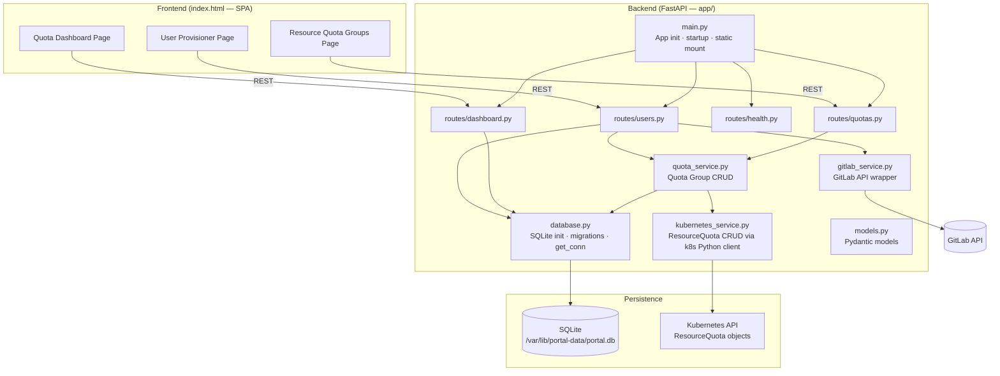
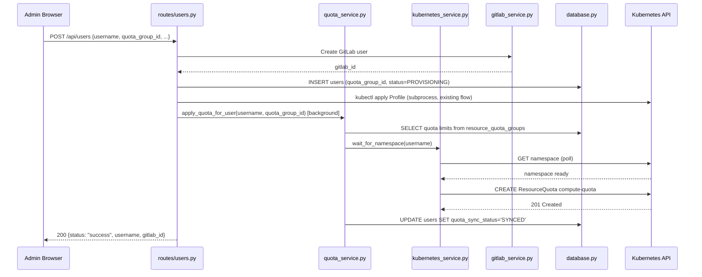
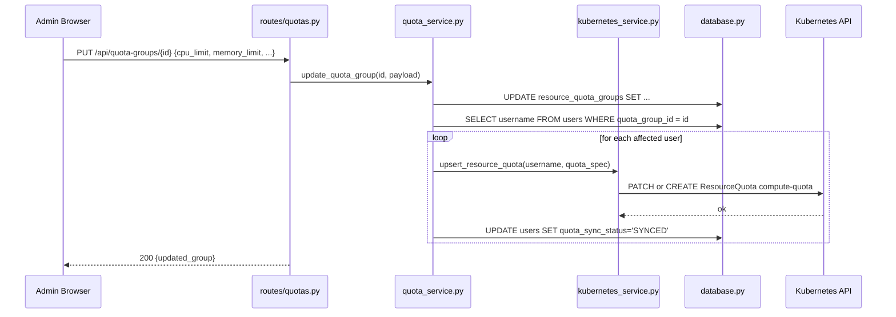
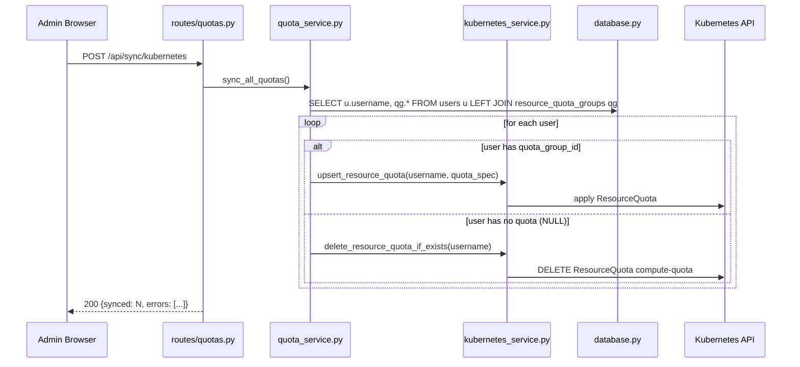
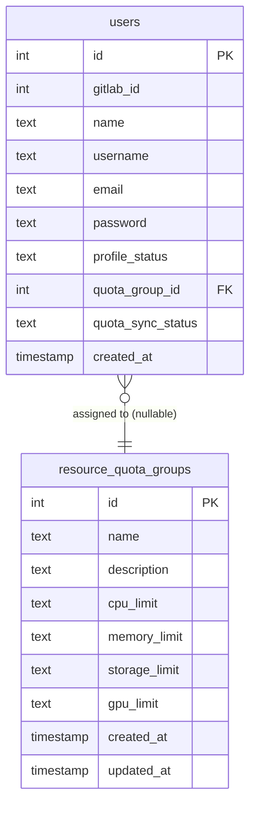

# Design Document: Resource Quota Management

## Overview

This feature adds an **Editable Resource Quota Groups** module to the existing Charmed Kubeflow Admin Portal. Admins define named quota templates (groups) specifying CPU, memory, storage, and GPU limits, then assign groups to users. The portal enforces these budgets by creating/updating/deleting Kubernetes `ResourceQuota` objects on each user's namespace automatically.

The design involves three areas of change: (1) splitting the monolithic `app.py` into a modular `app/` package, (2) extending the SQLite schema with a `resource_quota_groups` table and a foreign-key column on `users`, and (3) adding new API routes and frontend pages while preserving all existing behaviour exactly.

---

## Architecture



---

## Sequence Diagrams

### 1. Create User with Quota Group



### 2. Edit Quota Group (Auto-Sync All Affected Users)



### 3. Full Kubernetes Sync



---

## Components and Interfaces

### `app/database.py`

**Purpose**: Centralised SQLite connection factory, schema initialisation, and additive migrations.

**Responsibilities**:
- Create tables on first run
- Run `ALTER TABLE` migrations idempotently (check `PRAGMA table_info` before altering)
- Expose `get_conn()` as a context manager

```python
def init_db() -> None: ...
def _run_migrations(conn: sqlite3.Connection) -> None: ...
def get_conn() -> ContextManager[sqlite3.Connection]: ...
```

---

### `app/models.py`

**Purpose**: All Pydantic v2 request/response models.

**Responsibilities**:
- Validate resource limit strings (CPU, memory, storage in Gi format, GPU as integer string)
- Provide response shapes for quota groups, users, sync results, and dashboard stats

---

### `app/gitlab_service.py`

**Purpose**: Thin wrapper around the GitLab REST API (extracted from `app.py::gl_api`).

```python
def gl_api(method: str, path: str, data: Any = None) -> tuple[dict, int]: ...
```

---

### `app/kubernetes_service.py`

**Purpose**: All Kubernetes `ResourceQuota` operations using the official `kubernetes` Python client (replaces `subprocess` for quota work; existing subprocess calls for Profile/namespace remain in `users.py`).

```python
def get_k8s_client() -> CoreV1Api: ...
def upsert_resource_quota(username: str, quota_spec: dict) -> None: ...
def delete_resource_quota_if_exists(username: str) -> None: ...
def namespace_exists(username: str) -> bool: ...
async def wait_for_namespace(username: str, timeout_s: int = 30) -> bool: ...
```

---

### `app/quota_service.py`

**Purpose**: Business logic for quota group CRUD and synchronisation. Coordinates between `database.py` and `kubernetes_service.py`.

```python
def list_quota_groups() -> list[dict]: ...
def get_quota_group(group_id: int) -> dict: ...
def create_quota_group(payload: QuotaGroupCreate) -> dict: ...
def update_quota_group(group_id: int, payload: QuotaGroupUpdate) -> dict: ...
def delete_quota_group(group_id: int) -> None: ...
def duplicate_quota_group(group_id: int) -> dict: ...
def assign_quota_to_user(username: str, group_id: int | None) -> None: ...
async def apply_quota_for_user(username: str, group_id: int) -> None: ...
async def sync_all_quotas() -> dict: ...
```

---

### `app/routes/quotas.py`

**Purpose**: FastAPI router for all quota group and sync endpoints.

```python
router = APIRouter(prefix="/api", tags=["quotas"])
```

---

### `app/routes/dashboard.py`

**Purpose**: Aggregated stats endpoint for the Quota Dashboard page.

```python
router = APIRouter(prefix="/api/dashboard", tags=["dashboard"])
```

---

### `app/routes/users.py`

**Purpose**: Refactored user endpoints from `app.py`, extended to handle `quota_group_id`.

---

### `app/main.py`

**Purpose**: FastAPI application factory — mounts routers, static files, startup hook.

---

## Data Models

### Database Schema

```sql
-- Existing table (unchanged columns)
CREATE TABLE IF NOT EXISTS users (
    id              INTEGER PRIMARY KEY AUTOINCREMENT,
    gitlab_id       INTEGER UNIQUE,
    name            TEXT,
    username        TEXT UNIQUE,
    email           TEXT UNIQUE,
    password        TEXT,
    profile_status  TEXT,
    created_at      TIMESTAMP DEFAULT CURRENT_TIMESTAMP
    -- quota_group_id added via migration below
);

-- Migration (run once, idempotent via PRAGMA table_info check)
ALTER TABLE users ADD COLUMN quota_group_id INTEGER REFERENCES resource_quota_groups(id);
ALTER TABLE users ADD COLUMN quota_sync_status TEXT DEFAULT 'NO_QUOTA';
-- quota_sync_status values: 'NO_QUOTA' | 'SYNCED' | 'DRIFTED' | 'ERROR'

-- New table
CREATE TABLE IF NOT EXISTS resource_quota_groups (
    id             INTEGER PRIMARY KEY AUTOINCREMENT,
    name           TEXT UNIQUE NOT NULL,
    description    TEXT,
    cpu_limit      TEXT,        -- e.g. "16"   (empty/null = no limit applied)
    memory_limit   TEXT,        -- e.g. "64Gi"
    storage_limit  TEXT,        -- e.g. "500Gi"
    gpu_limit      TEXT,        -- e.g. "2"
    created_at     TIMESTAMP DEFAULT CURRENT_TIMESTAMP,
    updated_at     TIMESTAMP DEFAULT CURRENT_TIMESTAMP
);
```

### Entity-Relationship Diagram



---

## Pydantic Models (`app/models.py`)

```python
from __future__ import annotations
import re
from typing import Optional
from pydantic import BaseModel, field_validator


# ── Validators ────────────────────────────────────────────────────────────────

_GI_PATTERN = re.compile(r"^\d+Gi$")
_CPU_PATTERN = re.compile(r"^\d+(\.\d+)?$")  # e.g. "16" or "1.5"
_GPU_PATTERN = re.compile(r"^\d+$")


def _validate_gi(value: Optional[str], field: str) -> Optional[str]:
    """Validates that a value matches NNGi format or is empty/None."""
    if value and not _GI_PATTERN.match(value):
        raise ValueError(f"{field} must be in 'NNGi' format (e.g. '64Gi'), got '{value}'")
    return value or None


# ── Quota Group models ─────────────────────────────────────────────────────────

class QuotaGroupCreate(BaseModel):
    name: str
    description: Optional[str] = None
    cpu_limit: Optional[str] = None      # e.g. "16"
    memory_limit: Optional[str] = None   # e.g. "64Gi"
    storage_limit: Optional[str] = None  # e.g. "500Gi"
    gpu_limit: Optional[str] = None      # e.g. "2"

    @field_validator("cpu_limit")
    @classmethod
    def validate_cpu(cls, v: Optional[str]) -> Optional[str]:
        if v and not _CPU_PATTERN.match(v):
            raise ValueError("cpu_limit must be a positive number string (e.g. '16' or '1.5')")
        return v or None

    @field_validator("memory_limit")
    @classmethod
    def validate_memory(cls, v: Optional[str]) -> Optional[str]:
        return _validate_gi(v, "memory_limit")

    @field_validator("storage_limit")
    @classmethod
    def validate_storage(cls, v: Optional[str]) -> Optional[str]:
        return _validate_gi(v, "storage_limit")

    @field_validator("gpu_limit")
    @classmethod
    def validate_gpu(cls, v: Optional[str]) -> Optional[str]:
        if v and not _GPU_PATTERN.match(v):
            raise ValueError("gpu_limit must be a non-negative integer string (e.g. '2')")
        return v or None


class QuotaGroupUpdate(QuotaGroupCreate):
    name: Optional[str] = None  # name update is optional


class QuotaGroupResponse(BaseModel):
    id: int
    name: str
    description: Optional[str]
    cpu_limit: Optional[str]
    memory_limit: Optional[str]
    storage_limit: Optional[str]
    gpu_limit: Optional[str]
    assigned_users: int = 0
    created_at: str
    updated_at: str


# ── User models ────────────────────────────────────────────────────────────────

class UserCreate(BaseModel):
    name: str
    username: str
    email: str
    password: str
    quota_group_id: Optional[int] = None  # None = unlimited


class UserQuotaAssign(BaseModel):
    quota_group_id: Optional[int] = None  # None removes quota (unlimited)


class UserResponse(BaseModel):
    gitlab_id: int
    name: str
    username: str
    email: str
    password: str
    profile_status: str
    quota_group_id: Optional[int]
    quota_group_name: Optional[str]
    quota_sync_status: str
    created_at: str


# ── Sync models ────────────────────────────────────────────────────────────────

class SyncResult(BaseModel):
    synced: int
    skipped: int
    errors: list[str]


# ── Dashboard models ───────────────────────────────────────────────────────────

class QuotaStats(BaseModel):
    total_quota_groups: int
    users_with_quotas: int
    unlimited_users: int
    total_cpu_cores: float        # sum of cpu_limit across all assigned users
    total_memory_gi: float        # sum of memory_limit (in Gi) across assigned users
    total_gpu_count: int
    users_per_group: list[dict]   # [{name, count}, ...]
    cpu_by_group: list[dict]      # [{name, cpu}, ...]
    memory_by_group: list[dict]   # [{name, memory_gi}, ...]
    gpu_by_group: list[dict]      # [{name, gpu}, ...]
```

---

## Key Functions with Formal Specifications

### `kubernetes_service.upsert_resource_quota()`

```python
def upsert_resource_quota(username: str, quota_spec: dict) -> None:
    """
    Create or replace the 'compute-quota' ResourceQuota in the user's namespace.

    Preconditions:
        - username is a non-empty, DNS-label-compliant string
        - quota_spec contains at least one key from:
          {'limits.cpu', 'limits.memory', 'requests.storage', 'nvidia.com/gpu'}
        - The namespace `username` exists in the cluster

    Postconditions:
        - A ResourceQuota named 'compute-quota' exists in namespace `username`
          with spec.hard matching quota_spec
        - If it already existed with different values it is now updated (patch)
        - No side effects on other namespaces

    Raises:
        kubernetes.client.ApiException with status 503 if k8s API unreachable
    """
```

### `quota_service.update_quota_group()`

```python
def update_quota_group(group_id: int, payload: QuotaGroupUpdate) -> QuotaGroupResponse:
    """
    Update quota group fields and trigger a sync for all affected users.

    Preconditions:
        - group_id references an existing row in resource_quota_groups
        - payload passes Pydantic validation (cpu/memory/storage/gpu formats)

    Postconditions:
        - resource_quota_groups row is updated; updated_at refreshed
        - For every user with quota_group_id == group_id:
            upsert_resource_quota() is called
            quota_sync_status is set to 'SYNCED' on success, 'ERROR' on failure
        - Returns the updated QuotaGroupResponse

    Loop Invariant (over affected users):
        All previously processed users have an up-to-date ResourceQuota;
        DB quota_sync_status reflects latest sync outcome for those users.

    Raises:
        HTTPException 404 if group_id not found
        HTTPException 503 if Kubernetes API is unreachable (DB update is rolled back)
    """
```

### `quota_service.delete_quota_group()`

```python
def delete_quota_group(group_id: int) -> None:
    """
    Delete a quota group only when no users are assigned to it.

    Preconditions:
        - group_id references an existing row in resource_quota_groups

    Postconditions:
        - If COUNT(users WHERE quota_group_id = group_id) > 0:
            raises HTTPException 400 with count of affected users (no deletion)
        - Otherwise:
            resource_quota_groups row is deleted
            No ResourceQuota objects are touched (users had none assigned)

    Raises:
        HTTPException 404 if group_id not found
        HTTPException 400 if assigned_users > 0
    """
```

### `quota_service.sync_all_quotas()`

```python
async def sync_all_quotas() -> SyncResult:
    """
    Full idempotent reconciliation of all ResourceQuota objects cluster-wide.

    Preconditions:
        - Kubernetes API is reachable

    Postconditions:
        - For every user with quota_group_id != NULL:
            ResourceQuota 'compute-quota' exists in their namespace with correct values
        - For every user with quota_group_id == NULL:
            ResourceQuota 'compute-quota' is absent from their namespace (deleted if present)
        - Returns SyncResult with counts and list of error messages (non-fatal per-user errors)

    Loop Invariant (over all users):
        All previously processed users are in the correct quota state;
        skipped users (namespace missing) are counted but do not abort the loop.
    """
```

---

## Algorithmic Pseudocode

### ResourceQuota Build Algorithm

```pascal
PROCEDURE build_quota_spec(group: QuotaGroupResponse)
  INPUT:  group — a resource quota group row
  OUTPUT: quota_spec — dict of Kubernetes hard limits

  BEGIN
    quota_spec ← {}

    IF group.cpu_limit IS NOT NULL AND group.cpu_limit ≠ '' THEN
      quota_spec["limits.cpu"] ← group.cpu_limit
    END IF

    IF group.memory_limit IS NOT NULL AND group.memory_limit ≠ '' THEN
      quota_spec["limits.memory"] ← group.memory_limit
    END IF

    IF group.storage_limit IS NOT NULL AND group.storage_limit ≠ '' THEN
      quota_spec["requests.storage"] ← group.storage_limit
    END IF

    IF group.gpu_limit IS NOT NULL AND group.gpu_limit ≠ '' THEN
      quota_spec["nvidia.com/gpu"] ← group.gpu_limit
    END IF

    ASSERT LENGTH(quota_spec) > 0  // at least one limit must be set

    RETURN quota_spec
  END
END PROCEDURE
```

### Full Sync Algorithm

```pascal
PROCEDURE sync_all_quotas()
  INPUT:  — (reads from DB and Kubernetes)
  OUTPUT: SyncResult {synced, skipped, errors}

  BEGIN
    users ← SELECT u.username, qg.* FROM users u
            LEFT JOIN resource_quota_groups qg ON u.quota_group_id = qg.id

    synced ← 0
    skipped ← 0
    errors ← []

    FOR EACH user IN users DO
      ASSERT user.username IS valid DNS label

      IF NOT namespace_exists(user.username) THEN
        LOG warning "Namespace not found, skipping"
        skipped ← skipped + 1
        CONTINUE
      END IF

      IF user.quota_group_id IS NULL THEN
        delete_resource_quota_if_exists(user.username)
        UPDATE users SET quota_sync_status = 'NO_QUOTA' WHERE username = user.username
      ELSE
        quota_spec ← build_quota_spec(user.group)
        TRY
          upsert_resource_quota(user.username, quota_spec)
          UPDATE users SET quota_sync_status = 'SYNCED' WHERE username = user.username
          synced ← synced + 1
        CATCH ApiException AS e
          LOG error e.message
          UPDATE users SET quota_sync_status = 'ERROR' WHERE username = user.username
          errors.append(f"{user.username}: {e.message}")
        END TRY
      END IF
    END FOR

    RETURN SyncResult(synced=synced, skipped=skipped, errors=errors)
  END
END PROCEDURE
```

---

## API Contract Details

### Resource Quota Groups

| Method | Path | Body | Response | Notes |
|--------|------|------|----------|-------|
| GET | `/api/quota-groups` | — | `list[QuotaGroupResponse]` | includes `assigned_users` count |
| POST | `/api/quota-groups` | `QuotaGroupCreate` | `QuotaGroupResponse` | 422 on validation error |
| PUT | `/api/quota-groups/{id}` | `QuotaGroupUpdate` | `QuotaGroupResponse` | triggers auto-sync |
| DELETE | `/api/quota-groups/{id}` | — | `{"deleted": id}` | 400 if users assigned |
| POST | `/api/quota-groups/{id}/duplicate` | — | `QuotaGroupResponse` | name gets " (copy)" suffix |

### User Quota

| Method | Path | Body | Response | Notes |
|--------|------|------|----------|-------|
| POST | `/api/users` | `UserCreate` (extended) | `UserResponse` | `quota_group_id` now accepted |
| PUT | `/api/users/{username}/quota` | `UserQuotaAssign` | `UserResponse` | triggers upsert/delete |
| GET | `/api/users` | — | `list[UserResponse]` | includes `quota_group_name`, `quota_sync_status` |

### Synchronisation & Dashboard

| Method | Path | Body | Response |
|--------|------|------|----------|
| POST | `/api/sync/kubernetes` | — | `SyncResult` |
| GET | `/api/dashboard/quota-stats` | — | `QuotaStats` |

---

## Kubernetes ResourceQuota Object Structure

```yaml
apiVersion: v1
kind: ResourceQuota
metadata:
  name: compute-quota          # always this name
  namespace: <username>
spec:
  hard:
    limits.cpu: "<cpu_limit>"            # only if cpu_limit is set
    limits.memory: "<memory_limit>"      # only if memory_limit is set
    requests.storage: "<storage_limit>"  # only if storage_limit is set
    nvidia.com/gpu: "<gpu_limit>"        # only if gpu_limit is set
```

The `kubernetes_service` uses `CoreV1Api`:
- `create_namespaced_resource_quota()` for new quotas
- `patch_namespaced_resource_quota()` (strategic merge) for existing ones
- `delete_namespaced_resource_quota()` for removal
- `read_namespaced_resource_quota()` to check existence (catches `ApiException(404)`)

---

## Error Handling

| Scenario | HTTP Code | Behaviour |
|----------|-----------|-----------|
| Namespace does not exist during sync | — | Log warning, increment `skipped`, continue loop |
| ResourceQuota already exists | — | Patch it (idempotent upsert, never fail) |
| Kubernetes API unreachable | 503 | Return error; roll back DB changes if mid-transaction |
| Invalid quota value format | 422 | Pydantic raises `RequestValidationError` automatically |
| DB write failure | 500 | Log error, return 500 |
| Delete group with assigned users | 400 | `{"detail": "Cannot delete: N users are assigned to this group"}` |
| Quota group not found | 404 | `{"detail": "Quota group {id} not found"}` |

---

## Correctness Properties

*A property is a characteristic or behaviour that should hold true across all valid executions of a system — essentially a formal statement about what the system should do. Properties serve as the bridge between human-readable specifications and machine-verifiable correctness guarantees.*

### Property 1: Quota spec build correctness

*For any* `QuotaGroupResponse`, calling `build_quota_spec(group)` shall produce a dict that contains exactly the keys corresponding to non-null, non-empty limit fields (`"limits.cpu"`, `"limits.memory"`, `"requests.storage"`, `"nvidia.com/gpu"`) and excludes all keys for null or empty fields; the values for included keys shall be the verbatim string values from the group.

**Validates: Requirements 6.5, 12.2**

---

### Property 2: Validation round-trip — valid inputs always accepted

*For any* string `s` that matches `^\d+Gi$`, `QuotaGroupCreate(memory_limit=s)` shall succeed without raising a `ValidationError`. The same applies to `storage_limit` with `^\d+Gi$`, `cpu_limit` with `^\d+(\.\d+)?$`, and `gpu_limit` with `^\d+$`.

**Validates: Requirements 4.1, 4.2, 4.3, 4.4, 4.6**

---

### Property 3: Validation round-trip — invalid inputs always rejected

*For any* string `s` that does not match `^\d+Gi$`, `QuotaGroupCreate(memory_limit=s)` shall raise `ValidationError`. The same applies to `storage_limit` with `^\d+Gi$`, `cpu_limit` with `^\d+(\.\d+)?$`, and `gpu_limit` with `^\d+$`.

**Validates: Requirements 4.1, 4.2, 4.3, 4.4**

---

### Property 4: Delete guard — groups with assigned users cannot be deleted

*For any* `resource_quota_groups` row with `id`, if the count of users with `quota_group_id = id` is greater than zero, then calling `delete_quota_group(id)` shall raise an `HTTPException` with status 400 and shall leave the `resource_quota_groups` row and all `users` rows unchanged.

**Validates: Requirements 3.5, 10.6**

---

### Property 5: Additive migration idempotency

*For any* SQLite database state, calling `init_db()` N times (N ≥ 1) shall produce the same schema as calling it once; existing data rows shall remain intact after repeated invocations and no `ALTER TABLE` step shall fail when the target column already exists.

**Validates: Requirements 2.1, 2.4, 2.5, 2.6**

---

### Property 6: Idempotent sync

*For any* cluster state where all users are already in the correct quota state (SYNCED users have matching `ResourceQuota` objects, NO_QUOTA users have none), calling `sync_all_quotas()` N times (N ≥ 1) shall produce the same Kubernetes state and the same `quota_sync_status` values as calling it once; no errors shall be reported for successfully synced users.

**Validates: Requirements 7.5**

---

### Property 7: Sync completeness — correct quota state for all users

*For any* set of users with any combination of `quota_group_id` values (null or non-null), after `sync_all_quotas()` completes on a cluster where all namespaces exist, every user with a non-null `quota_group_id` shall have a `ResourceQuota` named `compute-quota` in their namespace with `spec.hard` matching their group, and every user with `quota_group_id = NULL` shall have no `ResourceQuota` named `compute-quota` in their namespace.

**Validates: Requirements 7.1, 7.2, 8.1, 8.2**

---

### Property 8: Sync resilience — missing namespaces do not abort the loop

*For any* set of users where some have missing namespaces, `sync_all_quotas()` shall process all users whose namespaces exist, increment `skipped` for each missing namespace, and return a `SyncResult` whose `synced + skipped + len(errors)` equals the total number of users processed.

**Validates: Requirements 7.3, 7.4, 10.3**

---

### Property 9: Upsert idempotency

*For any* valid `(username, quota_spec)` pair where the namespace exists, calling `upsert_resource_quota(username, quota_spec)` twice shall result in a `ResourceQuota` named `compute-quota` in that namespace with `spec.hard` equal to `quota_spec`, with no error on the second call.

**Validates: Requirements 6.1, 6.2, 10.4**

---

### Property 10: No-quota invariant — unlimited users never get a ResourceQuota

*For any* user `u` in the system with `quota_group_id = NULL`, the system shall not create or update a `ResourceQuota` named `compute-quota` in namespace `u.username` unless an admin explicitly assigns a quota group to that user via `PUT /api/users/{username}/quota`.

**Validates: Requirements 5.2, 11.5**

---

### Property 11: GET /api/users response contains all required fields

*For any* set of users in the Database, calling `GET /api/users` shall return a list where each object contains all original fields (`gitlab_id`, `name`, `username`, `email`, `password`, `profile_status`, `created_at`) plus the additive new fields (`quota_group_id`, `quota_group_name`, `quota_sync_status`).

**Validates: Requirements 5.5, 8.5, 11.1**

---

### Property 12: Dashboard stats correctness

*For any* database state with N total users, M of which have non-null `quota_group_id`, calling `GET /api/dashboard/quota-stats` shall return a `QuotaStats` where `users_with_quotas = M`, `unlimited_users = N - M`, and the per-group breakdown lists contain exactly one entry per distinct `quota_group_id` with accurate aggregated values.

**Validates: Requirements 9.1, 9.3, 9.4**

---

## Testing Strategy

### Unit Testing Approach

- Test `quota_service` functions by injecting a mock `kubernetes_service` and an in-memory SQLite connection
- Test `build_quota_spec` for all combinations of null/non-null fields
- Test `delete_quota_group` boundary: exactly 0 users (allowed) vs ≥1 user (blocked)

### Property-Based Testing Approach

**Property Test Library**: `hypothesis`

Key properties to test:
- `build_quota_spec(group)` — for any group with at least one non-null limit, the resulting dict contains only the expected keys and none of the absent-limit keys
- `QuotaGroupCreate` validators — for any string not matching `NNGi`, `field_validator` raises `ValueError`; for any string matching `NNGi`, it passes
- `sync_all_quotas()` idempotency — running sync twice produces the same final state as running it once

### Integration Testing Approach

- Use `pytest` with a real SQLite temp file and a mocked `kubernetes.client.CoreV1Api`
- Test the full create-user-with-quota flow end-to-end through the FastAPI `TestClient`
- Test that editing a quota group triggers `upsert_resource_quota` once per assigned user

---

## Performance Considerations

- The `PUT /api/quota-groups/{id}` endpoint triggers a synchronous loop over all affected users. For large deployments (>50 users per group), this should be moved to a background task (`BackgroundTasks`) to avoid request timeout; the endpoint returns immediately with a `202 Accepted`.
- `GET /api/dashboard/quota-stats` executes a single aggregating SQL query rather than N+1 round-trips.
- `POST /api/sync/kubernetes` is expected to be an infrequent admin action and may take several seconds; the frontend should show a progress indicator.

---

## Security Considerations

- All `/api/quota-groups/*`, `/api/users/*/quota`, and `/api/sync/*` endpoints must be protected by the same admin authentication mechanism used by existing user endpoints.
- Quota limit values are validated client-side (format) and server-side (Pydantic) before being passed to the Kubernetes API to prevent injection via crafted resource strings.
- The Kubernetes client is configured via in-cluster service account credentials (same as existing kubectl subprocess approach), so no additional secrets are required.

---

## Module File Tree

```
app/
├── main.py                 # FastAPI app, router registration, startup hook
├── database.py             # SQLite init, migrations, get_conn context manager
├── models.py               # Pydantic models (all request/response shapes)
├── quota_service.py        # Quota group CRUD + Kubernetes sync orchestration
├── kubernetes_service.py   # kubernetes Python client — ResourceQuota operations
├── gitlab_service.py       # GitLab API wrapper (extracted from app.py)
└── routes/
    ├── users.py            # GET/POST/DELETE /api/users + PUT /api/users/{u}/quota
    ├── quotas.py           # /api/quota-groups/* + /api/sync/kubernetes
    ├── health.py           # GET /api/health
    └── dashboard.py        # GET /api/dashboard/quota-stats

static/
├── index.html              # Extended SPA (existing + new Quota Groups & Dashboard pages)
├── logo.png
└── favicon.ico
```

---

## Dependencies

New dependencies to add to `requirements.txt`:

```text
fastapi==0.115.0
uvicorn==0.30.6
requests==2.32.3
pydantic==2.8.2
kubernetes==31.0.0      # official Python k8s client (replaces subprocess for quota ops)
```

No other external libraries are needed. Chart.js is loaded from CDN in `index.html`.
