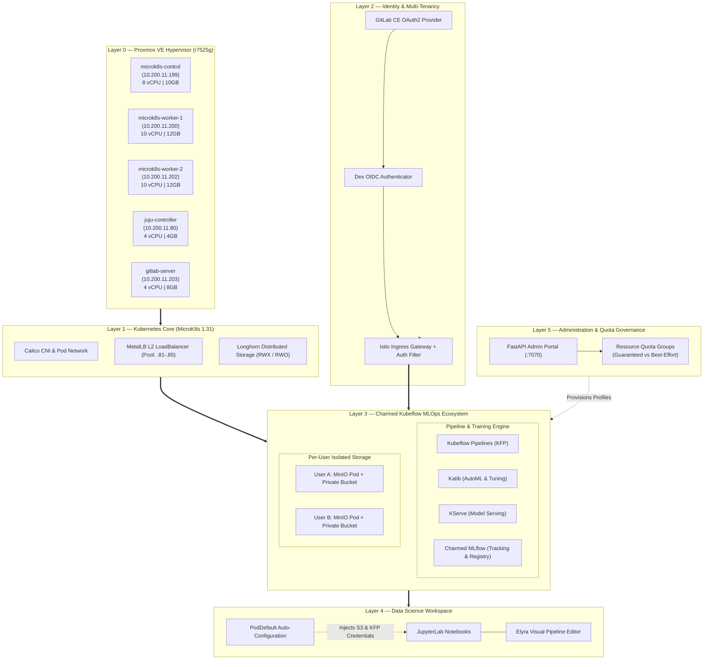

# KubeOlive — Enterprise Charmed Kubeflow MLOps Platform

[](https://microk8s.io/)
[](https://charmed-kubeflow.io/)
[](https://www.terraform.io/)
[](https://www.ansible.com/)
[](https://longhorn.io/)
[](https://about.gitlab.com/)
[](https://www.proxmox.com/)

A production-grade, self-hosted **MLOps Platform** deployed on **Proxmox VE**. Fully automated with **Terraform** and **Ansible**, orchestrated via **Charmed Kubeflow** and **Juju**, backed by **Longhorn distributed storage**, secured with **GitLab OIDC multi-tenancy**, and featuring **per-user MinIO storage isolation**, **Elyra visual pipelines**, and a custom **FastAPI Admin Portal**.

---

## Architecture Overview



---

## Virtual Machine & Network Topology

All nodes run on a dedicated VLAN bridged via `vmbr0` on the Proxmox hypervisor.

| Hostname | Role | vCPU | RAM | Disk | IP Address | OS / Runtime |
|:---|:---|:---:|:---:|:---:|:---|:---|
| **`microk8s-control`** | MicroK8s Control Plane | 8 | 10 GB | 100 GB | `10.200.11.199` | Ubuntu 24.04 LTS / MicroK8s 1.31 |
| **`microk8s-worker-1`** | MicroK8s Worker Node 01 | 10 | 12 GB | 150 GB | `10.200.11.200` | Ubuntu 24.04 LTS / MicroK8s 1.31 |
| **`microk8s-worker-2`** | MicroK8s Worker Node 02 | 10 | 12 GB | 150 GB | `10.200.11.202` | Ubuntu 24.04 LTS / MicroK8s 1.31 |
| **`juju-controller`** | Canonical Juju Orchestrator | 4 | 4 GB | 50 GB | `10.200.11.80` | Ubuntu 24.04 LTS / Juju 3.5 |
| **`gitlab-server`** | GitLab CE + Admin Portal | 4 | 8 GB | 60 GB | `10.200.11.203` | Ubuntu 24.04 LTS / Docker Compose |
| **MetalLB Pool** | External Ingress Virtual IPs | — | — | — | `10.200.11.81–85` | L2 LoadBalancer (VIP: `.81` / `.200`) |

---

## Platform Layers & Capabilities

### 1. Infrastructure Layer (Terraform on Proxmox)
* **Declarative Provisioning:** Uses the `bpg/proxmox` provider to clone cloud-init templates into fully configured VMs.
* **Storage Performance:** SCSI disks on local SSD pools with TRIM/discard enabled (`discard = "on"`).
* **Automated Cloud-Init:** Automatically injects SSH authorized keys, network gateways, DNS resolvers, and user credentials on boot.
* *Detailed guide: [`docs/01-infrastructure-terraform.md`](docs/01-infrastructure-terraform.md)*

### 2. Kubernetes Cluster Layer (MicroK8s + Ansible)
* **Lightweight & Hardened:** MicroK8s v1.31 with strict confinement, automated cluster join sequencing (`serial: 1`), and host pre-flight tuning (`sysctl`, `ip_tables`, kernel modules).
* **L2 Ingress Balancing:** MetalLB manages a dedicated IP pool providing reliable ingress endpoints for Kubeflow services.
* *Detailed guide: [`docs/02-cluster-ansible.md`](docs/02-cluster-ansible.md)*

### 3. Distributed Storage Layer (Longhorn CSI)
* **High-Availability Storage:** Longhorn deployed across all Kubernetes nodes via Helm, providing distributed volume replication across physical worker disks.
* **StorageClasses:** Supports both `ReadWriteOnce` (for dedicated user databases and notebooks) and `ReadWriteMany` (for shared team datasets).
* *Detailed guide: [`docs/03-storage-longhorn.md`](docs/03-storage-longhorn.md)*

### 4. Identity & Multi-Tenancy (GitLab CE + Dex OIDC)
* **Single Sign-On (SSO):** GitLab CE acts as the authoritative OAuth2 identity provider.
* **Dex OIDC Federation:** Kubeflow delegates authentication to Dex, which validates user identity against GitLab via OAuth2 scopes (`openid`, `profile`, `email`).
* *Detailed guide: [`docs/04-gitlab-oidc.md`](docs/04-gitlab-oidc.md)*

### 5. Charmed Kubeflow MLOps Engine
* **Juju Orchestrator:** Canonical Juju coordinates complex charm relations, handles lifecycle hooks, and manages the entire Kubeflow application bundle.
* **Complete Lifecycle:** Includes Kubeflow Pipelines (KFP), Katib AutoML, KServe model serving, and integrated MLflow experiment tracking.
* *Detailed guide: [`docs/05-kubeflow-juju.md`](docs/05-kubeflow-juju.md)*

### 6. Per-User MinIO Tenant Isolation
* **Zero Cross-User Data Leaks:** Default Kubeflow uses a single shared MinIO bucket where all users' artifacts mix. KubeOlive solves this by deploying a dedicated MinIO instance inside each user's namespace.
* **Automatic Secret Provisioning:** User credentials and bucket permissions are confined strictly to their own namespace boundary.
* *Detailed guide: [`docs/11-minio-per-user-isolation.md`](docs/11-minio-per-user-isolation.md)*

### 7. Interactive Data Science & Elyra Visual Pipelines
* **Zero-Configuration UX:** When data scientists launch JupyterLab, Elyra visual pipeline editor is already configured with pre-authenticated S3 object storage and KFP endpoints.
* **PodDefault Automation:** A Kubeflow `PodDefault` admission webhook automatically injects the necessary environment variables and secret mounts at pod creation time.
* *Detailed guide: [`docs/06-elyra-notebook.md`](docs/06-elyra-notebook.md)*

### 8. Governance & Admin Portal
* **FastAPI Management Service:** Hosted on the GitLab VM (`:7070`), providing an intuitive portal for creating user profiles, onboarding team members, and provisioning namespaces.
* **Resource Quota Groups:** Enforces tier-based compute allocation (`Guaranteed` vs `Best-Effort`) preventing runaway training jobs from starving cluster resources.
* *Detailed guide: [`docs/07-admin-portal.md`](docs/07-admin-portal.md)* & *[`docs/08-resource-quotas.md`](docs/08-resource-quotas.md)*

---

## Repository Directory Structure

```
.
├── README.md                          # Main project overview and architecture manual
├── .gitignore                         # Comprehensive ignore rules (secrets, states, zips)
│
├── docs/                              # Complete technical documentation suite
│   ├── 00-index.md                    # Documentation index and architecture matrix
│   ├── 01-infrastructure-terraform.md # Proxmox VM provisioning walkthrough
│   ├── 02-cluster-ansible.md          # MicroK8s cluster formation & Ansible tasks
│   ├── 03-storage-longhorn.md         # Longhorn distributed block storage deployment
│   ├── 04-gitlab-oidc.md              # GitLab OAuth2 & Dex OIDC federation guide
│   ├── 05-kubeflow-juju.md            # Charmed Kubeflow bundle & Juju relations
│   ├── 06-elyra-notebook.md           # Elyra visual pipeline auto-config & image build
│   ├── 07-admin-portal.md             # FastAPI admin portal design and user management
│   ├── 08-resource-quotas.md          # Resource Quota Groups architecture & enforcement
│   ├── 09-mlops-pipeline.md           # End-to-end ML training, tracking, and deployment
│   ├── 10-recovery.md                 # Cluster recovery runbook after power cuts / reboots
│   ├── 11-minio-per-user-isolation.md # Per-user isolated MinIO storage architecture
│   └── COMPLETE-TECHNICAL-WALKTHROUGH.md # Consolidated platform guide
│
├── scripts/                           # Operational tooling and automation runbooks
│   ├── README.md                      # Usage guide for operational scripts
│   ├── deploy-mlflow.sh               # Juju automation to deploy and integrate MLflow
│   └── cluster-recovery.sh            # Self-healing cluster recovery script
│
├── micro_k8s/                         # Core Kubernetes & platform automation
│   ├── README.md                      # Platform engineering overview
│   ├── DEPLOYMENT.md                  # New Proxmox cluster deployment walkthrough
│   ├── minio.md                       # MinIO storage architecture deep dive
│   │
│   ├── terraform/                     # Proxmox VM declaration
│   │   ├── README.md                  # Terraform sizing, parameters, and usage
│   │   ├── main.tf                    # VM resource definitions
│   │   ├── variables.tf               # Input variable specifications
│   │   ├── providers.tf               # bpg/proxmox provider settings
│   │   └── terraform.tfvars.example   # Template variable file
│   │
│   ├── ansible/                       # Configuration management & cluster setup
│   │   ├── README.md                  # Playbook execution order, roles, and tags
│   │   ├── playbook.yml               # Multi-play orchestration playbook
│   │   ├── group_vars/all.yml         # Single source of truth for IPs and networks
│   │   ├── inventory.ini              # Active rendered inventory
│   │   ├── inventory.188.ini.example  # Reference inventory for alternate subnets
│   │   ├── generate-inventory.sh      # Inventory compilation script
│   │   ├── metallb-pool.yaml          # MetalLB IPAddressPool manifest
│   │   └── roles/                     # Modular Ansible roles
│   │       ├── common/                # OS preparation, sysctl, kernel modules
│   │       ├── master/                # MicroK8s control plane bootstrap
│   │       ├── worker/                # MicroK8s worker node join
│   │       ├── metallb/               # MetalLB L2 load balancer setup
│   │       ├── longhorn/              # Longhorn CSI distributed storage
│   │       ├── juju/                  # Juju controller registration
│   │       └── gitlab/                # GitLab CE + OAuth2 credentials
│   │
│   ├── elyra/                         # Custom notebook image & runtime automation
│   │   ├── Dockerfile                 # Custom Elyra + KFP image specification
│   │   ├── patch_elyra.py             # Runtime credential synchronization script
│   │   ├── setup-elyra-runtime.sh     # Script to inject KFP runtime configurations
│   │   └── WALKTHROUGH.md             # Beginner walkthrough for Elyra integration
│   │
│   └── recovery/                      # Disaster recovery scripts
│       └── recover.sh                 # Cluster self-healing script
│
└── .kiro/                             # Architectural specifications & requirements
    └── specs/resource-quota-management/
```

---

## Quick Start & Deployment Guide

### Phase 1: Provision Virtual Machines
```bash
cd micro_k8s/terraform
cp terraform.tfvars.example terraform.tfvars
# Update Proxmox endpoint, credentials, and VMIDs
terraform init
terraform apply -auto-approve
```

### Phase 2: Form the MicroK8s Cluster & Base Services
```bash
cd ../ansible
# Verify node IP allocations in group_vars/all.yml
./generate-inventory.sh
ansible-playbook -i inventory.ini ping.yml
ansible-playbook -i inventory.ini playbook.yml
```

### Phase 3: Deploy Charmed Kubeflow via Juju
SSH into the `juju-controller` VM (`10.200.11.80`):
```bash
juju deploy kubeflow --trust --channel 1.9/stable
```

### Phase 4: Deploy MLflow & MinIO Integration
Run the automated deployment script on `juju-controller`:
```bash
./scripts/deploy-mlflow.sh
```

### Phase 5: Access the Platform
* **Kubeflow Central Dashboard:** `http://10.200.11.81` (or your MetalLB ingress VIP)
* **GitLab CE Portal:** `http://10.200.11.203`
* **Longhorn Storage UI:** `http://10.200.11.199:30080`
* **Admin Portal:** `http://10.200.11.203:7070`

---

## High Availability & Cluster Recovery

If the hypervisor undergoes an ungraceful reboot or power loss, run the recovery runbook:

```bash
./scripts/cluster-recovery.sh
```

**What the script heals automatically:**
1. **Ghost Pod Eviction:** Deletes pods stuck in `Unknown`, `CrashLoopBackOff`, or `OOMKilled` states.
2. **CSI Driver Reconnect:** Cleans stuck volume attachments in Longhorn to ensure persistent volumes remount cleanly.
3. **Stabilization Polling:** Monitors all deployments and daemonsets until zero degraded resources remain.

---

## Documentation Sitemap

| Number | Document | Description |
|:---:|:---|:---|
| **01** | [`docs/01-infrastructure-terraform.md`](docs/01-infrastructure-terraform.md) | Proxmox VE VM sizing, network interfaces, and cloud-init automation |
| **02** | [`docs/02-cluster-ansible.md`](docs/02-cluster-ansible.md) | MicroK8s cluster formation, Calico CNI, and role sequencing |
| **03** | [`docs/03-storage-longhorn.md`](docs/03-storage-longhorn.md) | Longhorn CSI distributed storage architecture and volume replication |
| **04** | [`docs/04-gitlab-oidc.md`](docs/04-gitlab-oidc.md) | GitLab CE identity provider setup, OAuth2 credentials, and Dex OIDC federation |
| **05** | [`docs/05-kubeflow-juju.md`](docs/05-kubeflow-juju.md) | Charmed Kubeflow deployment, Juju charms, relations, and dashboard ingress |
| **06** | [`docs/06-elyra-notebook.md`](docs/06-elyra-notebook.md) | Elyra visual pipeline auto-config, PodDefault injection, and container image |
| **07** | [`docs/07-admin-portal.md`](docs/07-admin-portal.md) | FastAPI Admin Portal architecture, namespace provisioning, and user profiles |
| **08** | [`docs/08-resource-quotas.md`](docs/08-resource-quotas.md) | Resource Quota Groups: Guaranteed vs Best-Effort compute tier enforcement |
| **09** | [`docs/09-mlops-pipeline.md`](docs/09-mlops-pipeline.md) | End-to-end ML application: KFP pipeline, MLflow tracking, and KServe inference |
| **10** | [`docs/10-recovery.md`](docs/10-recovery.md) | Step-by-step disaster recovery runbook after hypervisor reboot or power loss |
| **11** | [`docs/11-minio-per-user-isolation.md`](docs/11-minio-per-user-isolation.md) | Multi-tenant MinIO architecture preventing cross-user dataset leaks |
| **—** | [`docs/COMPLETE-TECHNICAL-WALKTHROUGH.md`](docs/COMPLETE-TECHNICAL-WALKTHROUGH.md) | Complete end-to-end platform reference and implementation manual |
