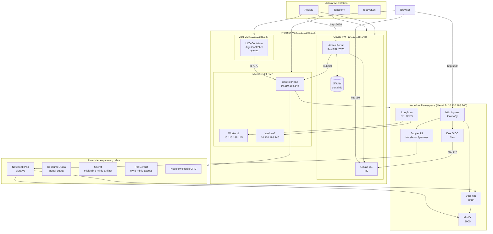
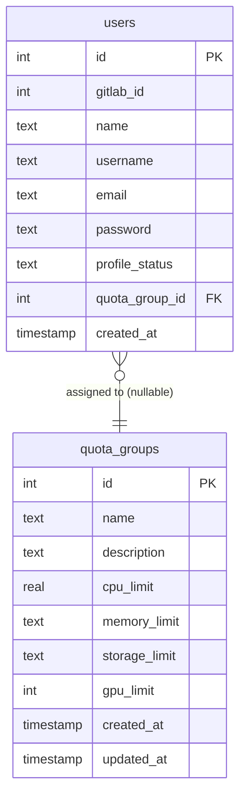
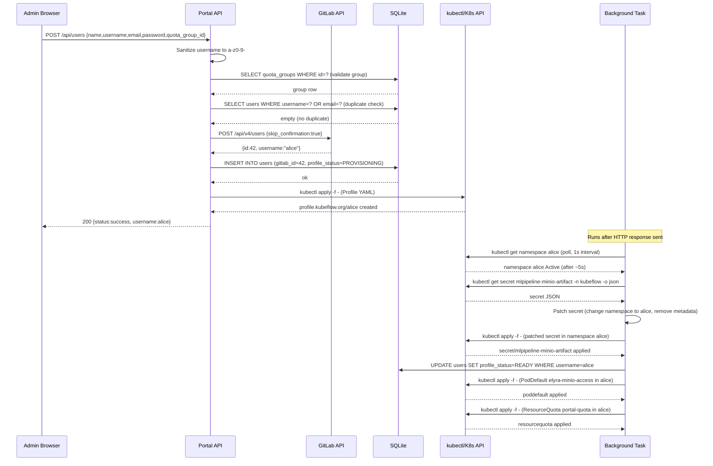
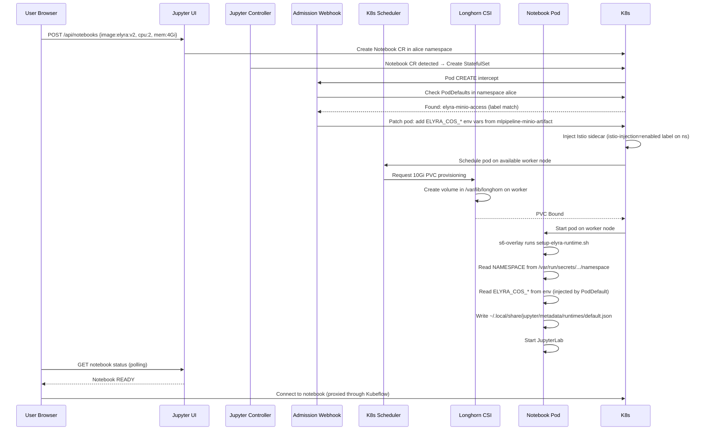
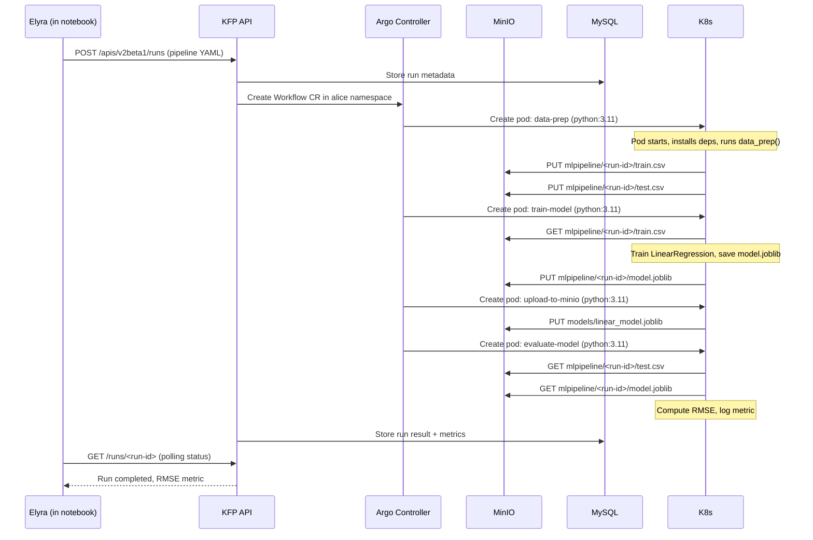
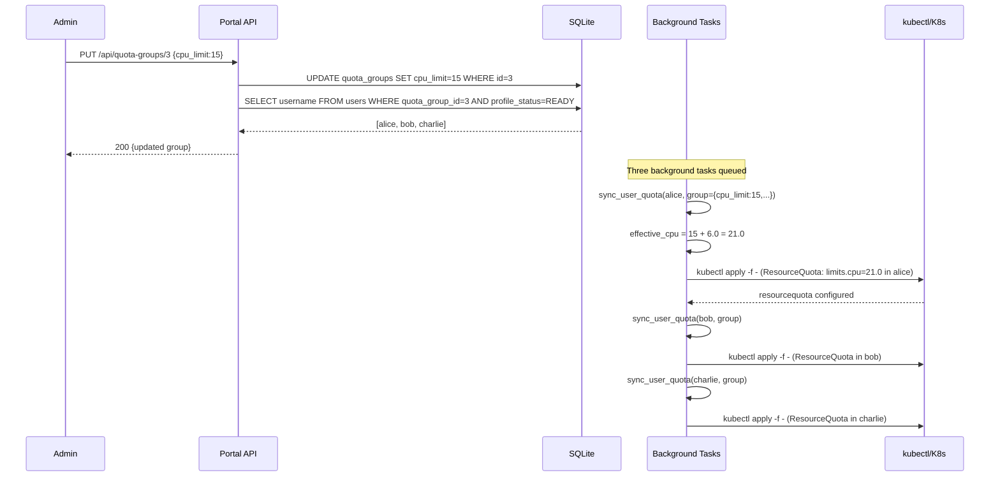
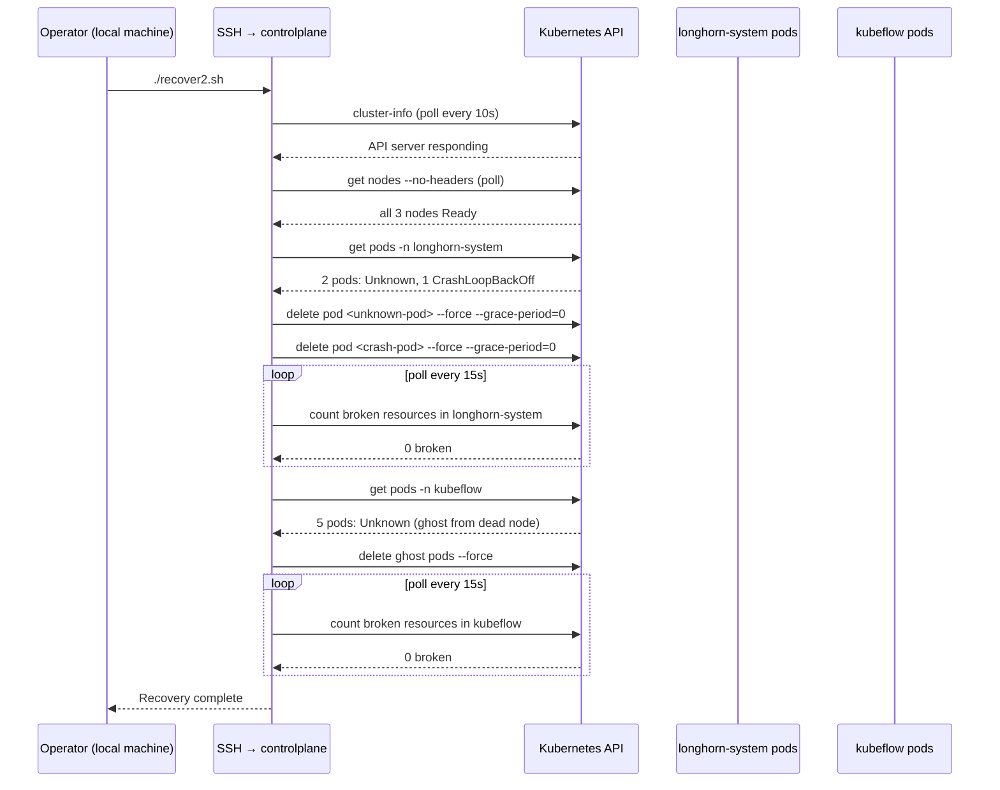

# Charmed Kubeflow MLOps Platform — Complete Technical Engineering Handbook

> **Audience:** Engineers and technical stakeholders who have never seen this codebase before.
> This document reverse-engineers every component, every interaction, every configuration, and every
> communication path in the system. It is designed to serve as the single source of truth for
> understanding, operating, and presenting this platform.

---

## Table of Contents

1. [Executive Overview](#1-executive-overview)
2. [Complete System Architecture](#2-complete-system-architecture)
3. [Repository Walkthrough](#3-repository-walkthrough)
4. [Startup Sequence](#4-startup-sequence)
5. [Backend Walkthrough](#5-backend-walkthrough)
6. [Frontend Walkthrough](#6-frontend-walkthrough)
7. [Database](#7-database)
8. [Authentication Flow](#8-authentication-flow)
9. [Kubernetes Walkthrough](#9-kubernetes-walkthrough)
10. [Kubeflow Integration](#10-kubeflow-integration)
11. [GitLab Integration](#11-gitlab-integration)
12. [Storage Architecture](#12-storage-architecture)
13. [Networking](#13-networking)
14. [Complete API Documentation](#14-complete-api-documentation)
15. [Communication Flows](#15-communication-flows)
16. [Sequence Diagrams](#16-sequence-diagrams)
17. [Component Communication Matrix](#17-component-communication-matrix)
18. [ResourceQuota System](#18-resourcequota-system)
19. [Complete Request Lifecycle](#19-complete-request-lifecycle)
20. [Error Handling](#20-error-handling)
21. [Security](#21-security)
22. [Deployment](#22-deployment)
23. [Monitoring and Recovery](#23-monitoring-and-recovery)
24. [End-to-End Walkthrough](#24-end-to-end-walkthrough)
25. [Presentation Slide Plan](#25-presentation-slide-plan)

---

---

# 1. Executive Overview

## 1.1 Project Objective

This project builds a **self-hosted, multi-tenant MLOps platform** for a private organisation
(Olivesoft). The platform allows AI/ML engineers to create Jupyter notebooks, compose visual
ML pipelines, store model artifacts, and collaborate — all inside a governed Kubernetes
environment where each engineer is isolated in their own namespace with enforced resource limits.

The platform is built **entirely on-premises**, hosted on a Proxmox bare-metal hypervisor,
using open-source tools only. There is no cloud provider dependency.

## 1.2 Problems Solved

| Problem | Solution |
|---|---|
| No shared ML infrastructure | Kubernetes cluster provisioned automatically via Terraform + Ansible |
| No user isolation | Kubeflow Profiles give every engineer a private namespace |
| Manual user account creation | Admin Portal provisions GitLab + Kubeflow in one click |
| No authentication on the ML platform | GitLab acts as OIDC identity provider via Dex |
| Engineers need pipeline tooling without YAML knowledge | Elyra visual pipeline editor auto-configured in every notebook |
| MinIO credentials not available in notebooks | PodDefault injects credentials automatically before notebook starts |
| No resource governance | ResourceQuota Groups limit CPU/Memory/GPU/Storage per user namespace |
| Cluster down after power loss | Automated recovery scripts detect and heal broken pods |

## 1.3 Architecture Philosophy

The design follows these principles:

- **Infrastructure-as-Code everything**: No VM, no cluster component, no service is configured
  by hand. Terraform, Ansible, and Juju own all state.
- **Automation over documentation**: Users get a working Elyra runtime the moment a notebook
  starts — not after reading a setup guide.
- **Simplicity over scale**: MicroK8s instead of full Kubernetes; SQLite instead of PostgreSQL;
  single-binary kubectl over Python SDKs. The platform is right-sized for a lab/research team.
- **GitLab as the single identity source**: Every platform user maps to a GitLab account.
  Login, project storage, and OIDC tokens all flow through GitLab.

## 1.4 Major Technologies

| Layer | Technology | Version |
|---|---|---|
| Hypervisor | Proxmox VE | Latest |
| IaC — VM Provisioning | Terraform (`bpg/proxmox` provider) | ≥ 0.73.0 |
| IaC — Cluster Setup | Ansible | Latest |
| Kubernetes Distribution | MicroK8s | 1.31/stable |
| CNI (Networking) | Calico (IP-in-IP mode) | 3.26.0 |
| Load Balancer | MetalLB (L2 mode) | Built into MicroK8s |
| Storage | Longhorn | Latest via Helm |
| Identity Provider | GitLab CE | Latest |
| OIDC Broker | Dex (via Charmed Kubeflow charm) | Bundled |
| ML Platform | Charmed Kubeflow | 1.10/stable |
| Kubeflow Operator | Juju | 3.6/stable |
| Service Mesh | Istio (via Charmed Kubeflow) | Bundled |
| Notebook Extension | Elyra | Custom image `ahmed8603/elyra:v2` |
| Admin Portal Backend | Python / FastAPI / Uvicorn | Latest |
| Admin Portal Database | SQLite | Built into Python |
| Admin Portal Frontend | Vanilla HTML/CSS/JS | — |
| Artifact Storage | MinIO (via Charmed Kubeflow) | Bundled |

## 1.5 Overall Workflow

```
Terraform provisions VMs on Proxmox
        ↓
Ansible configures MicroK8s cluster, Longhorn, GitLab, Juju
        ↓
Juju deploys Charmed Kubeflow (50+ charms including Istio, Dex, KFP, MinIO)
        ↓
Admin Portal deployed on GitLab VM (FastAPI + systemd)
        ↓
Administrator opens Admin Portal → provisions users (GitLab + Kubeflow namespace)
        ↓
User logs in via GitLab OIDC → Dex issues session cookie
        ↓
User creates Jupyter notebook (Elyra image, auto-configured)
        ↓
User designs ML pipeline in Elyra → submits to KFP API
        ↓
KFP orchestrates pipeline pods → stores artifacts in MinIO
        ↓
ResourceQuota enforces CPU/Memory/Storage limits per namespace
```

---

---

# 2. Complete System Architecture

## 2.1 Physical Infrastructure

```
┌─────────────────────────────────────────────────────────────────┐
│  Proxmox VE Host  (10.110.188.118)                              │
│  LAN: 10.110.188.0/22   Gateway: 10.110.188.1                   │
│                                                                  │
│  ┌──────────────────┐  ┌───────────────────┐  ┌──────────────┐ │
│  │ microk8s-control │  │ microk8s-worker-1 │  │microk8s-     │ │
│  │ 10.110.188.144   │  │ 10.110.188.145    │  │worker-2      │ │
│  │ 8 vCPU / 10 GB   │  │ 10 vCPU / 12 GB   │  │10.110.188.146│ │
│  │ 100 GB SSD       │  │ 150 GB SSD        │  │10vCPU/12GB   │ │
│  └──────────────────┘  └───────────────────┘  └──────────────┘ │
│                                                                  │
│  ┌──────────────────┐  ┌───────────────────┐                    │
│  │ juju-controller  │  │ gitlab-server     │                    │
│  │ 10.110.188.147   │  │ 10.110.188.148    │                    │
│  │ 4 vCPU / 4 GB    │  │ 4 vCPU / 8 GB    │                    │
│  │ 50 GB SSD        │  │ 60 GB SSD        │                    │
│  └──────────────────┘  └───────────────────┘                    │
└─────────────────────────────────────────────────────────────────┘
```

## 2.2 Logical Architecture Diagram



## 2.3 Component Descriptions

### Proxmox VE Hypervisor
- **Purpose**: Bare-metal virtualisation host running all VMs
- **IP**: 10.110.188.118
- **API**: REST at `:8006/api2/json`
- **Authentication**: `root@pam!terraform=<token>` for Terraform
- **Dependencies**: Physical server, LAN switch
- **Protocol**: HTTPS (self-signed cert, `insecure=true` in Terraform)

### MicroK8s Cluster (3 nodes)
- **Purpose**: Kubernetes control plane + worker nodes running all workloads
- **Control plane**: 10.110.188.144 — Kubernetes API server at `:16443`
- **Workers**: 10.110.188.145, 10.110.188.146 — run pods, store Longhorn volumes
- **Calico CNI**: IP-in-IP mode, pod CIDR `172.16.1.0/16`, service CIDR `172.17.1.0/18`
- **MetalLB**: L2 mode, IP pool `10.110.188.200–10.110.188.207`
- **Failure case**: Power loss → pods stuck in Unknown/CrashLoopBackOff → `recover.sh`

### Juju Controller VM
- **Purpose**: Hosts the Juju controller daemon inside an LXD container
- **IP**: 10.110.188.147
- **LXD bridge**: `lxdbr0` — private subnet (e.g. `10.177.205.0/24`)
- **Juju agent port**: 17070
- **Critical routing**: K8s nodes need a static route to the LXD subnet via this VM
- **Responsibility**: Manages lifecycle of all 50+ Charmed Kubeflow operators

### GitLab CE Server
- **Purpose**: User identity store + OIDC provider + Git repository server
- **IP**: 10.110.188.148, port 80
- **Key service**: Doorkeeper OAuth2 app "Kubeflow Dex"
- **Config**: Single Puma worker (`worker_processes=0`) to avoid CSRF race conditions
- **Dependencies**: PostgreSQL (bundled), Redis (bundled), Nginx (bundled)

### Admin Portal (FastAPI)
- **Purpose**: Web UI for administrators to manage users and quotas
- **Host**: GitLab VM (10.110.188.148), port 7070
- **Process manager**: systemd service `kubeflow-admin-portal`
- **Calls**: GitLab REST API, Kubernetes API (via subprocess kubectl), SQLite
- **Authentication**: HTTP Basic Auth (admin password)
- **Database**: SQLite at `/var/lib/portal-data/portal.db`

### Charmed Kubeflow (namespace: `kubeflow`)
- **Purpose**: ML platform with pipelines, notebooks, model serving
- **Ingress**: Istio Ingress Gateway, MetalLB assigns `10.110.188.200`
- **Deployed by**: Juju with `kubeflow 1.10/stable` bundle
- **Key components**: Dex, KFP API, MinIO, Jupyter UI, Katib, KServe, Istio

### Longhorn
- **Purpose**: Distributed block storage for Kubernetes PersistentVolumes
- **Namespace**: `longhorn-system`
- **Dashboard**: NodePort 30080 (any worker node IP)
- **Data path**: `/var/lib/longhorn` on each worker node
- **Default replica count**: 1 (lab environment)

---

---

# 3. Repository Walkthrough

## 3.1 Top-Level Structure

```
Stage-Olivesoft/
├── terraform/              # Older Terraform config (root-level, legacy)
├── micro_k8s/              # PRIMARY: all active infrastructure code
│   ├── terraform/          # VM provisioning — ACTIVE
│   ├── ansible/            # Cluster automation — ACTIVE
│   ├── elyra/              # Custom notebook image — ACTIVE
│   └── recovery/           # Post-reboot recovery scripts — ACTIVE
├── ansible/                # Older ansible structure (legacy placeholder)
├── mlops-for-devops/       # Educational MLOps reference implementation
├── yaml-pipelines/         # KFP pipeline YAML examples
├── docs/                   # All written documentation
└── .kiro/specs/            # Feature spec for Resource Quota Management
```

## 3.2 `micro_k8s/terraform/` — VM Provisioning

| File | Purpose |
|---|---|
| `providers.tf` | Declares `bpg/proxmox` and `hashicorp/local` providers |
| `variables.tf` | Input variable declarations (types, defaults, descriptions) |
| `terraform.tfvars` | Concrete values: Proxmox API URL, token, SSH keys, node name |
| `main.tf` | VM resource blocks: control plane, 2 workers, Juju VM, GitLab VM |
| `inventory.tf` | `local_file` resource that generates `ansible/inventory.ini` |
| `inventory.tpl` | Go template for the Ansible inventory |
| `.terraform.lock.hcl` | Provider version lock file |
| `terraform.tfstate` | Current infrastructure state (DO NOT edit manually) |

**How they connect**: `terraform apply` reads `main.tf`, creates VMs via the Proxmox API, extracts
VM IPs from state, passes them to `inventory.tpl` via `inventory.tf`, and writes
`ansible/inventory.ini`. Ansible then uses that file to connect to the right hosts.

## 3.3 `micro_k8s/ansible/` — Cluster Automation

```
ansible/
├── playbook.yml            # Orchestrates all 6 plays in order
├── ansible.cfg             # SSH config, privilege escalation, forks
├── inventory.ini           # Auto-generated by Terraform (defines hosts)
├── hosts.ini               # Alternative inventory (same content)
├── group_vars/all.yml      # Shared variables (IPs, CIDRs, versions)
├── metallb-pool.yaml       # MetalLB IP pool manifest
├── configs/                # Runtime-generated config files
│   ├── config              # MicroK8s kubeconfig (copied from control plane)
│   └── gitlab_oauth_creds.json  # GitLab OAuth client_id + client_secret
└── roles/
    ├── common/             # Every K8s node: packages, swap, kernel modules
    ├── master/             # Control plane: addons, Calico, kubeconfig, Helm
    ├── worker/             # Workers: join cluster, label, copy kubeconfig
    ├── longhorn/           # All nodes: iSCSI; master: Helm install
    ├── gitlab/             # GitLab VM: install CE, OAuth app, Admin Portal
    └── juju/               # Juju VM: LXD, Juju, routing fix, Kubeflow
```

**Key design**: `configs/` is populated at runtime:
- `config` (kubeconfig) is written during the `master` role by `microk8s config`
- `gitlab_oauth_creds.json` is fetched during the `gitlab` role after Rails creates the OAuth app
- Both files are then read by subsequent roles without re-running earlier steps

## 3.4 `micro_k8s/ansible/roles/gitlab/files/` — Admin Portal Application

```
files/
├── WALKTHROUGH.md          # Detailed portal walkthrough (the source of truth)
├── index.html              # Single-page frontend (5000+ lines, inline CSS+JS)
├── requirements.txt        # fastapi, uvicorn, requests, pydantic
├── logo.png                # Portal logo
├── favicon.ico             # Browser favicon
└── app/                    # FastAPI Python package
    ├── __init__.py         # Empty (marks directory as package)
    ├── main.py             # App factory: mounts static, registers routers, startup
    ├── config.py           # All constants + env vars + logging setup
    ├── database.py         # SQLite init, migrations (idempotent), get_db()
    ├── gitlab_client.py    # gl_api() — single function wrapping all GitLab calls
    ├── kubernetes.py       # All kubectl subprocess calls for K8s resources
    ├── routes/
    │   ├── __init__.py     # Empty
    │   ├── users.py        # GET/POST/PATCH/DELETE /api/users
    │   ├── quota_groups.py # Full CRUD + sync for /api/quota-groups
    │   └── health.py       # GET /api/health
    └── services/
        ├── __init__.py     # Empty
        └── quota_sync.py   # ResourceQuota CRUD + reconcile_all()
```

## 3.5 `micro_k8s/elyra/` — Custom Notebook Image

| File | Purpose |
|---|---|
| `Dockerfile` | Builds `ahmed8603/elyra:v2` on top of Charmed Kubeflow base |
| `setup-elyra-runtime.sh` | Init script: writes Elyra runtime JSON before JupyterLab starts |
| `WALKTHROUGH.md` | Step-by-step guide for the Elyra auto-config feature |

**Connection to the rest**: The Dockerfile copies `setup-elyra-runtime.sh` into the image.
The image is referenced in `juju config jupyter-ui jupyter-images`. When a notebook pod starts,
the Kubeflow webhook injects the `elyra-minio-access` PodDefault (created by the Admin Portal)
which provides the environment variables that the script reads.

## 3.6 `micro_k8s/recovery/` — Recovery Scripts

| File | Purpose |
|---|---|
| `recover.sh` | First version: cleans CrashLoopBackOff, Unknown pods via `--field-selector` |
| `recover2.sh` | Improved version: parses pod STATUS column directly (handles sticky Unknown phase) |

**Connection**: Run from the operator's local machine. Connects to control plane via SSH,
executes `kubectl` commands remotely. Recovers `longhorn-system` first, then `kubeflow`.

## 3.7 `yaml-pipelines/minio22.yaml` — House Price KFP Pipeline

A complete Kubeflow Pipelines v2 YAML definition for a 4-step pipeline:
1. `data-prep` — loads California Housing dataset, splits train/test
2. `train-model` — trains a linear regression model with scikit-learn
3. `upload-to-minio` — uploads the model `.joblib` to MinIO bucket `models`
4. `evaluate-model` — evaluates with RMSE on test set

Each step runs in a `python:3.11` container. The `upload-to-minio` step reads
`AWS_ACCESS_KEY_ID` and `AWS_SECRET_ACCESS_KEY` from the `mlpipeline-minio-artifact`
secret via `secretKeyRef`.

## 3.8 `mlops-for-devops/` — Educational Reference

A separate educational project (not part of the Olivesoft platform itself) that demonstrates
MLOps concepts for DevOps engineers:
- `phase-1-local-dev/`: Employee attrition prediction model, local training/serving
- `phase-2-enterprise-setup/`: Kubeflow pipelines, Airflow DAGs, Feast feature store

## 3.9 `docs/` — Written Documentation

| File | Content |
|---|---|
| `00-index.md` | Platform overview table, VM inventory |
| `01-infrastructure-terraform.md` | Terraform deep-dive |
| `02-cluster-ansible.md` | Ansible playbook walkthrough |
| `03-storage-longhorn.md` | Longhorn setup and configuration |
| `04-gitlab-oidc.md` | GitLab CE install and OAuth setup |
| `05-kubeflow-juju.md` | Juju bootstrap and Kubeflow deployment |
| `06-elyra-notebook.md` | Elyra auto-config design and verification |
| `07-admin-portal.md` | Admin Portal API and architecture |
| `08-resource-quotas.md` | ResourceQuota design and Istio overhead |
| `09-recovery.md` | Recovery script usage and troubleshooting |

## 3.10 `.kiro/specs/resource-quota-management/`

Formal requirements and design documents written in the Kiro spec format:
- `requirements.md` — 12 formal requirements with acceptance criteria
- `design.md` — Architecture diagrams, Pydantic models, algorithm pseudocode,
  correctness properties, ER diagram
- `tasks.md` — Implementation task list

This spec describes a **future refactor** of the quota system to use the official
Kubernetes Python client (`kubernetes` SDK) instead of `subprocess` calls to `kubectl`,
and to add a dedicated `quota_sync_status` field and a dashboard endpoint.

---

---

# 4. Startup Sequence

This section describes exactly what happens from zero (bare Proxmox host) to a fully
operational platform with a user logged in.

## 4.1 Phase 0 — Terraform: VM Provisioning

```
Operator runs: terraform init && terraform apply

1. Terraform reads terraform.tfvars
   → proxmox_api_url = "https://10.110.188.118:8006/api2/json"
   → proxmox_api_token = "root@pam!terraform=<uuid>"

2. bpg/proxmox provider authenticates to Proxmox REST API via API token.
   SSH also established to Proxmox root user for cloud-init disk operations.

3. Five VMs cloned from template VM ID 9000 (Ubuntu 24.04 cloud-init image):
   - VM 220: microk8s-control (10.110.188.144), 8 vCPU, 10 GB RAM, 100 GB
   - VM 221: microk8s-worker-1 (10.110.188.145), 10 vCPU, 12 GB RAM, 150 GB
   - VM 222: microk8s-worker-2 (10.110.188.146), 10 vCPU, 12 GB RAM, 150 GB
   - VM 223: juju-controller  (10.110.188.147),  4 vCPU,  4 GB RAM,  50 GB
   - VM 224: gitlab-server    (10.110.188.148),  4 vCPU,  8 GB RAM,  60 GB

4. cloud-init applies to each VM on first boot:
   - Sets static IP address from ip_config block
   - Creates 'ubuntu' user with injected SSH public keys
   - Sets hostname

5. inventory.tf resource executes: writes micro_k8s/ansible/inventory.ini
   with the actual IP addresses from Terraform state.

6. terraform apply completes. All 5 VMs are running.
```

## 4.2 Phase 1 — Ansible Play 1: Common Setup (all K8s nodes)

```
ansible-playbook playbook.yml --tags common

On controlplane (10.110.188.144), node01 (10.110.188.145), node02 (10.110.188.146):

1. Install packages: curl, ca-certificates, snapd, iptables, jq, gnupg
2. Configure DNS: writes /etc/systemd/resolved.conf.d/dns_servers.conf (8.8.8.8, 1.1.1.1)
3. Populate /etc/hosts with all 3 node IPs + hostnames
4. Disable swap: swapoff -a, comment out fstab swap lines
5. Load kernel modules: overlay, br_netfilter, ipip
6. Write /etc/sysctl.d/k8s.conf: enable IP forwarding, bridge iptables, inotify limits
7. Install MicroK8s 1.31/stable via snap
8. Add ubuntu user to microk8s group
9. microk8s status --wait-ready (blocks until API server is up)
10. Add kubectl/helm shell aliases
```

## 4.3 Phase 2 — Ansible Play 2: Control Plane Setup

```
ansible-playbook playbook.yml --tags master  [controlplane only]

1. Create kubectl wrapper: /usr/local/bin/kubectl → microk8s.kubectl
2. microk8s enable dns → starts CoreDNS pods in kube-system
3. microk8s enable metallb:10.110.188.200-10.110.188.207
   → deploys MetalLB controller and speaker DaemonSet
   → creates IPAddressPool for IPs .200-.207
4. Patch Calico: switch from VXLAN to IP-in-IP mode
   kubectl patch configmap calico-config -n kube-system ...
   kubectl patch ippool default-ipv4-ippool ...
   kubectl rollout restart daemonset calico-node -n kube-system
5. Generate kubeconfig: microk8s config
   → writes to configs/config, /root/.kube/config, /home/ubuntu/.kube/config
6. Install Helm 3 via get-helm-3 script
7. Label node: node-role.kubernetes.io/control-plane="" master=""
```

## 4.4 Phase 3 — Ansible Play 3: Workers Join (serial: 1)

```
For each worker (node01, node02) — ONE AT A TIME:

1. Set hostname to match inventory_hostname (node01, node02)
2. Create kubectl wrapper
3. Check if already joined: kubectl get nodes on master
4. If not joined:
   a. On MASTER: microk8s add-node --token-ttl 600
      → outputs: microk8s join 10.110.188.144:25000/<token>
   b. On WORKER: microk8s join 10.110.188.144:25000/<token> --worker
   c. On MASTER: kubectl label node <name> node-role.kubernetes.io/worker=""
5. Copy kubeconfig to ubuntu and root users on worker
```

## 4.5 Phase 4 — Ansible Play 4: Longhorn Storage

```
On ALL nodes:
1. Install open-iscsi, tgt, nfs-common, util-linux
2. systemctl enable --now iscsid
3. systemctl enable --now tgt

On MASTER only:
4. helm repo add longhorn https://charts.longhorn.io
5. kubectl create namespace longhorn-system
6. helm upgrade --install longhorn longhorn/longhorn \
   --set defaultReplicaCount=1 \
   --set csi.kubeletRootDir="/var/snap/microk8s/common/var/lib/kubelet" \
   --set service.ui.nodePort=30080 \
   --timeout 10m --wait
7. Remove default annotation from all StorageClasses
8. kubectl patch storageclass longhorn -p '{"metadata":{"annotations":{...}}}'
   → Longhorn becomes default StorageClass
9. kubectl rollout status daemonset/longhorn-manager -n longhorn-system --timeout=5m
```

## 4.6 Phase 5 — Ansible Play 5: GitLab CE + Admin Portal

```
On GITLAB VM (10.110.188.148):

1. apt install curl, openssh-server, postfix, ca-certificates, perl
2. Add GitLab apt repository
3. EXTERNAL_URL="http://10.110.188.148" apt install gitlab-ce
4. Write /etc/gitlab/gitlab.rb:
   - external_url 'http://10.110.188.148'
   - puma['worker_processes'] = 0  (single worker)
   - trusted_proxies = ['10.110.188.0/24', '172.16.0.0/16', '172.17.0.0/18']
5. gitlab-ctl reconfigure  (takes 5-10 minutes)
6. Wait for port 80 to be open + 30s extra
7. gitlab-rails runner: create Doorkeeper app "Kubeflow Dex"
   → redirect_uri = 'http://10.110.188.200/dex/callback'
   → scopes = 'openid profile email read_user'
   → writes /tmp/gitlab_oauth_creds.json
8. ansible fetch: copy gitlab_oauth_creds.json to local configs/
9. gitlab-rails runner: create Personal Access Token for portal
   → name = 'kubeflow-admin-portal-token', scopes=['api'], expires 365d
   → writes /tmp/gitlab_portal_token.txt
10. Install kubectl v1.31.0 to /usr/local/bin/kubectl on GitLab VM
11. Create /home/ubuntu/admin-portal/ and /var/lib/portal-data/
12. Copy kubeconfig (from configs/config), replace 127.0.0.1 with 10.110.188.144
    (for both ubuntu and root users)
13. Copy app/, index.html, requirements.txt to /home/ubuntu/admin-portal/
14. pip install in virtualenv: fastapi, uvicorn, requests, pydantic
15. Write /lib/systemd/system/kubeflow-admin-portal.service
16. systemctl enable --now kubeflow-admin-portal
    → uvicorn starts on 0.0.0.0:7070
    → startup() called: init_db() creates/migrates SQLite
```

## 4.7 Phase 6 — Ansible Play 6: Juju Controller + Charmed Kubeflow

```
On JUJU VM (10.110.188.147):

1. apt install jq
2. snap install lxd --channel=latest/stable
3. snap install juju --channel=3.6/stable --classic
4. lxd init --auto
   → creates lxdbr0 bridge with private subnet (e.g. 10.177.205.0/24)
   → creates default LXD storage pool
5. usermod -aG lxd ubuntu

ROUTING FIX (critical):
6. ip route show dev lxdbr0 → get LXD subnet CIDR (e.g. 10.177.205.0/24)
7. sysctl net.ipv4.ip_forward=1  on Juju VM
8. iptables -I FORWARD -i lxdbr0 -j ACCEPT
   iptables -I FORWARD -o lxdbr0 -j ACCEPT
9. On ALL K8s nodes (delegated):
   → write /etc/systemd/system/juju-route.service:
     ip route replace 10.177.205.0/24 via 10.110.188.147
   → systemctl enable --now juju-route

JUJU BOOTSTRAP:
10. juju bootstrap localhost lxd-controller
    → creates LXD container, installs Juju agent daemon (port 17070)
    → e.g. container IP 10.177.205.126

11. Copy kubeconfig to /home/ubuntu/.kube/config
12. juju add-k8s kubeflow-cloud --controller lxd-controller --storage=longhorn
    → reads kubeconfig, registers MicroK8s as Juju cloud

13. juju add-model kubeflow kubeflow-cloud
    → creates 'kubeflow' namespace in MicroK8s

14. juju deploy kubeflow --trust --channel=1.10/stable -m kubeflow
    → deploys 50+ charms: Istio, Dex, KFP, MinIO, Jupyter, Katib, KServe...
    → TAKES 20-40 MINUTES
    → Longhorn provisions PVCs for MySQL, MinIO, metadata store

CONFIGURE DEX OIDC:
15. Wait for dex-auth charm: active
16. juju config dex-auth static-username=admin static-password=kubeflow-admin-2024
17. juju config dex-auth issuer-url="http://10.110.188.200/dex"
18. Write /home/ubuntu/dex_connectors.yaml with GitLab OAuth credentials
    (read from configs/gitlab_oauth_creds.json via Ansible lookup)
19. juju config dex-auth connectors=@/home/ubuntu/dex_connectors.yaml

CONFIGURE JUPYTER UI:
20. Wait for jupyter-ui charm: active
21. juju config jupyter-ui jupyter-images='["ahmed8603/elyra:v2", ...]'
22. juju config jupyter-ui default-poddefaults='["access-ml-pipeline","elyra-minio-access"]'
```

## 4.8 Platform Ready State

At this point:
- `http://10.110.188.200` → Kubeflow dashboard (login via GitLab or admin/kubeflow-admin-2024)
- `http://10.110.188.148` → GitLab CE
- `http://10.110.188.148:7070` → Admin Portal
- `http://10.110.188.145:30080` → Longhorn Dashboard

---

---

# 5. Backend Walkthrough

## 5.1 Application Entry Point — `app/main.py`

```python
from fastapi import FastAPI
from fastapi.staticfiles import StaticFiles
from app.config import GITLAB_TOKEN, INDEX_HTML, STATIC_DIR, logger
from app.database import init_db
from app.routes import health, quota_groups, users

app = FastAPI(title="Charmed Kubeflow Multi-User Admin Portal")
app.mount("/static", StaticFiles(directory=STATIC_DIR), name="static")
app.include_router(users.router)
app.include_router(health.router)
app.include_router(quota_groups.router)

@app.on_event("startup")
def startup() -> None:
    if not GITLAB_TOKEN:
        logger.error("GITLAB_TOKEN environment variable is not set!")
    init_db()

@app.get("/", response_class=HTMLResponse)
def get_index():
    with open(INDEX_HTML, "r") as fh:
        return fh.read()
```

**What happens at startup**:
1. FastAPI app object is created
2. `/static` directory is mounted — serves `favicon.ico` and `logo.png`
3. Three routers are registered (`/api/users`, `/api/health`, `/api/quota-groups`)
4. The `startup` event runs: checks `GITLAB_TOKEN` env var, calls `init_db()`
5. `init_db()` creates/migrates SQLite tables (idempotent)
6. The `GET /` route serves the single-page frontend HTML from disk

**Dependencies**: Reads `STATIC_DIR=/home/ubuntu/admin-portal/static` and
`INDEX_HTML=/home/ubuntu/admin-portal/index.html` from `config.py`.

## 5.2 Configuration — `app/config.py`

```python
import os, logging

logging.basicConfig(level=logging.INFO, format="%(asctime)s [%(levelname)s] %(message)s")
logger = logging.getLogger("kubeflow-admin-portal")

DB_PATH    = "/var/lib/portal-data/portal.db"
STATIC_DIR = "/home/ubuntu/admin-portal/static"
INDEX_HTML = "/home/ubuntu/admin-portal/index.html"
GITLAB_URL   = "http://localhost"   # GitLab is on the same VM
GITLAB_TOKEN = os.getenv("GITLAB_TOKEN", "")  # injected by systemd
```

**Key design decisions**:
- `GITLAB_URL = "http://localhost"` — GitLab is on the same VM as the portal,
  so all GitLab API calls go to localhost (no network hop, no TLS required)
- `GITLAB_TOKEN` comes from the systemd `Environment=` directive — never hardcoded
- All paths are absolute — the service runs as root with no CWD assumption

## 5.3 Database — `app/database.py`

### Connection Factory: `get_db()`

```python
@contextmanager
def get_db():
    conn = sqlite3.connect(DB_PATH)
    conn.row_factory = sqlite3.Row   # rows accessible as dicts
    conn.execute("PRAGMA foreign_keys = ON")
    try:
        c = conn.cursor()
        yield conn, c
        conn.commit()         # auto-commit on clean exit
    except Exception:
        conn.rollback()       # auto-rollback on any exception
        raise
    finally:
        conn.close()
```

Using `sqlite3.Row` factory means every row can be accessed by column name
(`row["username"]`) in addition to index. Foreign keys are enforced via PRAGMA
because SQLite does not enforce them by default.

### Schema Initialization: `init_db()`

Called every time the application starts. Designed to be completely idempotent:

1. Creates `quota_groups` table if not exists
2. Creates `users` table if not exists
3. Checks `PRAGMA table_info(users)` for existing columns
4. If `quota_group_id` column is missing → `ALTER TABLE users ADD COLUMN...`

This migration approach means:
- Brand new deployments: both tables and the FK column are created in one pass
- Existing deployments: only the missing column is added; existing data preserved
- Re-runs: no-op because `CREATE TABLE IF NOT EXISTS` and the column check

## 5.4 GitLab Client — `app/gitlab_client.py`

Single function `gl_api(method, path, data)` handles all GitLab API communication:

```python
def gl_api(method: str, path: str, data: Any = None) -> GitLabResponse:
    headers = {"Private-Token": GITLAB_TOKEN}
    url = f"{GITLAB_URL}/api/v4{path}"    # e.g. http://localhost/api/v4/users

    resp = requests.request(method, url, headers=headers, json=data, timeout=15)

    if resp.status_code == 204:
        return {}, 204      # DELETE success, no body

    if resp.status_code >= 400:
        return resp.json(), resp.status_code  # error dict + code

    return resp.json(), resp.status_code   # success dict + code
```

**Authentication**: Every request includes `Private-Token: <GITLAB_TOKEN>` header.
This is GitLab's Personal Access Token mechanism — simpler than OAuth2 for
server-to-server calls.

**Error handling**: Never raises exceptions for HTTP errors. Always returns
`(body_dict, status_code)`. The caller decides how to handle non-2xx responses.
Network exceptions are caught and returned as `{"error": str(exc)}, 500`.

**Timeout**: 15 seconds — long enough for GitLab's Rails app to respond but
short enough to prevent the portal from hanging indefinitely if GitLab is down.

## 5.5 Kubernetes Module — `app/kubernetes.py`

All Kubernetes interactions use `subprocess` calls to the `kubectl` binary.
No Python Kubernetes SDK is used. This was a deliberate design choice for
simplicity — the `kubectl` binary is already on the GitLab VM (installed during
the Ansible portal role).

### Pattern 1 — Apply a manifest via stdin

```python
proc = subprocess.Popen(
    ["kubectl", "apply", "-f", "-"],  # "-" means read from stdin
    stdin=subprocess.PIPE,
    stdout=subprocess.PIPE,
    stderr=subprocess.PIPE,
    text=True,
)
stdout, stderr = proc.communicate(input=yaml_manifest_string)
if proc.returncode != 0:
    raise RuntimeError(stderr)
```

`Popen` with `communicate()` is used instead of `subprocess.run()` when writing
to stdin. `communicate()` writes the YAML string to kubectl's stdin, waits for
the process to finish, and returns `(stdout, stderr)`.

### Pattern 2 — Read or delete

```python
result = subprocess.run(
    ["kubectl", "get", "namespace", username],
    capture_output=True,  # equivalent to stdout=PIPE, stderr=PIPE
    text=True,
)
if result.returncode == 0:
    # success
```

`subprocess.run()` is used when there's no stdin input needed.

### `create_kubeflow_profile(username, owner_email)`

Applies a Kubeflow `Profile` custom resource:

```yaml
apiVersion: kubeflow.org/v1
kind: Profile
metadata:
  name: alice
spec:
  owner:
    kind: User
    name: alice@example.com   # email — must match Dex/GitLab identity
```

The `Profile` controller (part of Charmed Kubeflow) watches for these objects
and upon creation:
1. Creates a Kubernetes namespace with the same name as the Profile
2. Creates a ServiceAccount `default-editor` in that namespace
3. Creates a RoleBinding granting the owner email admin access
4. Injects Istio namespace-level configuration

### `delete_kubeflow_profile(username)`

```bash
kubectl delete profile alice
```

The Profile controller cascades the deletion — it removes the namespace,
RoleBindings, and all resources inside the namespace (including PVCs unless
`reclaimPolicy: Retain`).

### `delete_namespace(username)`

```bash
kubectl delete namespace alice --wait=false
```

Belt-and-suspenders deletion. `--wait=false` returns immediately without
waiting for all resources in the namespace to be cleaned up. This is intentional
because namespace deletion with PVCs can take minutes.

### `replicate_minio_secret_and_verify(username)` — async background task

This is the most complex function. It runs as a FastAPI `BackgroundTask`,
meaning it starts after the HTTP response is already sent to the browser.

```
Step 1: Poll for namespace existence (up to 30 times, 1s apart)
  kubectl get namespace alice
  → if returncode != 0 after 30 tries: set status=NAMESPACE_TIMEOUT, return

Step 2: Fetch MinIO credentials from 'kubeflow' namespace
  kubectl get secret mlpipeline-minio-artifact -n kubeflow -o json
  → parses JSON response
  → removes: creationTimestamp, resourceVersion, uid, ownerReferences
  → sets: metadata.namespace = "alice"

Step 3: Apply modified secret to user namespace
  kubectl apply -f - (secret JSON piped to stdin)
  → if success: UPDATE users SET profile_status='READY'
  → then: apply_elyra_poddefault(username)
```

**Why this must be async**: The namespace creation is handled by the Kubeflow
Profile controller, which runs asynchronously. The portal cannot know when the
namespace is ready — it has to poll. Doing this in the HTTP request handler
would time out the browser. Running as a background task allows the HTTP
response ("user created, setting up in background") to return immediately.

### `apply_elyra_poddefault(namespace)`

Applies a `PodDefault` CRD to the user namespace:

```yaml
apiVersion: kubeflow.org/v1alpha1
kind: PodDefault
metadata:
  name: elyra-minio-access
  namespace: alice
spec:
  selector:
    matchLabels:
      elyra-minio-access: "true"
  desc: "Auto-inject MinIO credentials for Elyra KFP runtime"
  env:
    - name: ELYRA_COS_ENDPOINT
      value: "http://minio.kubeflow.svc.cluster.local:9000"
    - name: ELYRA_COS_BUCKET
      value: "mlpipeline"
    - name: ELYRA_COS_USERNAME
      valueFrom:
        secretKeyRef:
          name: mlpipeline-minio-artifact
          key: accesskey
    - name: ELYRA_COS_PASSWORD
      valueFrom:
        secretKeyRef:
          name: mlpipeline-minio-artifact
          key: secretkey
```

This PodDefault will be automatically applied by the Kubeflow admission webhook
to any pod in the `alice` namespace that carries the label `elyra-minio-access: "true"`.
The label is pre-selected in `jupyter-ui` via `default-poddefaults` juju config.

**Critical ordering**: `apply_elyra_poddefault()` is called AFTER the MinIO secret
is replicated. The PodDefault references the secret via `secretKeyRef`, so the secret
must exist first. The Portal ensures this ordering by calling `apply_elyra_poddefault`
only inside the success branch of secret replication.

## 5.6 Users Route — `app/routes/users.py`

### GET `/api/users`

```
1. gl_api("GET", "/users?per_page=100")
   → fetches all GitLab users
   → extracts set of usernames (excluding 'root' and 'ghost')

2. SELECT u.*, qg.name FROM users u LEFT JOIN quota_groups qg ON qg.id=u.quota_group_id
   → all portal users with their quota group name

3. Filter: only return users whose username exists in GitLab
   (users deleted directly from GitLab are not shown in portal)

4. Return: array of user objects with all fields
```

**Why cross-reference with GitLab?** If a GitLab admin manually deletes a user,
the portal's local DB still has them. By filtering against GitLab's user list, the
portal stays consistent with reality.

### POST `/api/users`

Input schema:
```python
class UserCreate(BaseModel):
    name: str
    username: str    # sanitized to [a-z0-9-] before use
    email: str
    password: str
    quota_group_id: Optional[int] = None
```

7-step flow with progressive rollback on failure:
1. **Sanitize username**: `"".join(c for c in username.lower() if c.isalnum() or c=="-")`
   — ensures the username is a valid Kubernetes namespace name
2. **Validate quota_group_id**: `SELECT FROM quota_groups WHERE id=?`
3. **Duplicate check**: `SELECT FROM users WHERE username=? OR email=?`
4. **Create GitLab user**: `gl_api("POST", "/users", {..., skip_confirmation: true})`
   — `skip_confirmation` bypasses email verification
5. **Insert into SQLite**: `INSERT INTO users (..., profile_status='PROVISIONING', ...)`
   — on failure: `gl_api("DELETE", "/users/{gitlab_id}")` to rollback GitLab creation
6. **Create Kubeflow Profile**: `create_kubeflow_profile(username, email)`
   — on failure: set `profile_status='PROFILE_CREATION_FAILED'` (user stays in DB)
7. **Queue background tasks**: return HTTP 200 immediately, tasks run asynchronously:
   - `replicate_minio_secret_and_verify(username)`
   - `sync_user_quota(username, quota_group)` — only if quota_group was provided

**Idempotency caveat**: If step 6 fails, the user exists in GitLab and SQLite but
has no Kubeflow Profile. The admin must delete and recreate. This is surfaced via
the `PROFILE_CREATION_FAILED` status in the UI.

### PATCH `/api/users/{username}/quota-group`

```python
class UserQuotaUpdate(BaseModel):
    quota_group_id: Optional[int] = None  # None = Unlimited
```

1. Check user exists in DB
2. If `quota_group_id` provided: validate group exists
3. `UPDATE users SET quota_group_id=? WHERE username=?`
4. Queue background task: `sync_user_quota(username, quota_group_or_none)`
   - If group: `kubectl apply -f -` (ResourceQuota manifest)
   - If None: `kubectl delete resourcequota portal-quota -n <username>`

### DELETE `/api/users/{gitlab_id}/{username}`

4-step irreversible deletion:
1. `gl_api("DELETE", "/users/{gitlab_id}?hard_delete=true")` — permanently removes GitLab account
2. `delete_kubeflow_profile(username)` — cascades namespace deletion
3. `delete_namespace(username)` — belt-and-suspenders
4. `DELETE FROM users WHERE gitlab_id=?`

`hard_delete=true` is crucial — without it, GitLab "blocks" the user but keeps
the account (for audit trail). With it, the account, repositories, and merge
requests are permanently deleted.

## 5.7 Quota Groups Route — `app/routes/quota_groups.py`

### GET `/api/quota-groups`

```sql
SELECT qg.*, COUNT(u.id) AS user_count
FROM quota_groups qg
LEFT JOIN users u ON u.quota_group_id = qg.id
GROUP BY qg.id ORDER BY qg.name
```

Returns all groups with a `user_count` showing how many users are in each.

### POST `/api/quota-groups`

Pydantic validates all fields before DB insertion:
- `cpu_limit > 0`
- `memory_limit` matches `^\d+(\.\d+)?[Gg][Ii]$` (normalised to `Gi`)
- `storage_limit` same format
- `gpu_limit >= 0`

### PUT `/api/quota-groups/{id}` — triggers K8s sync

```
1. UPDATE quota_groups SET name=?, cpu_limit=?, ..., updated_at=CURRENT_TIMESTAMP
2. SELECT username FROM users WHERE quota_group_id=? AND profile_status='READY'
3. For each affected user: background_tasks.add_task(sync_user_quota, username, group)
   → each task calls apply_resource_quota(username, group)
   → ResourceQuota in user's namespace is updated
```

The sync only targets `READY` users — users in `PROVISIONING` don't have a namespace yet.

### DELETE `/api/quota-groups/{id}`

```
1. Collect affected usernames BEFORE deletion
2. DELETE FROM quota_groups WHERE id=?
   → FK ON DELETE SET NULL: users.quota_group_id → NULL automatically
3. For each affected user: background_tasks.add_task(sync_user_quota, username, None)
   → each task calls delete_resource_quota(username)
   → ResourceQuota removed from user's namespace
```

### POST `/api/quota-groups/{id}/duplicate`

```python
base_name = f"{src['name']} (copy)"
new_name = base_name
counter = 2
while True:
    c.execute("SELECT id FROM quota_groups WHERE name = ?", (new_name,))
    if not c.fetchone():
        break
    new_name = f"{base_name} {counter}"
    counter += 1
# INSERT with new_name and all other fields copied
```

Automatically generates a unique name by appending " (copy)", " (copy) 2", etc.

### POST `/api/quota-groups/sync` — manual reconciliation

Calls `reconcile_all()` synchronously and returns a report:
```json
{
  "status": "success",
  "report": {
    "created": ["alice"],   // quota applied, didn't exist before
    "updated": ["bob"],     // quota applied, was different
    "deleted": ["charlie"], // quota removed (no longer assigned to group)
    "errors":  []           // failed operations
  }
}
```

### GET `/api/quota-groups/stats/overview`

Aggregated statistics for the dashboard page:
```sql
SELECT
    SUM(qg.cpu_limit * sub.cnt) AS total_cpu,
    GROUP_CONCAT(qg.memory_limit) AS memory_vals,
    SUM(qg.gpu_limit * sub.cnt) AS total_gpu
FROM quota_groups qg
JOIN (
    SELECT quota_group_id, COUNT(*) AS cnt
    FROM users WHERE quota_group_id IS NOT NULL
    GROUP BY quota_group_id
) sub ON sub.quota_group_id = qg.id
```

## 5.8 Health Route — `app/routes/health.py`

```python
@router.get("/health")
def health():
    # Kubernetes
    res = subprocess.run(["kubectl", "version", "--client"], capture_output=True)
    k8s_ok = res.returncode == 0

    # GitLab
    _, code = gl_api("GET", "/users?per_page=1")
    gitlab_ok = code == 200

    # Longhorn
    sock = socket.socket(socket.AF_INET, socket.SOCK_STREAM)
    sock.settimeout(2)
    longhorn_ok = sock.connect_ex(("10.110.188.144", 30080)) == 0
    sock.close()

    return {
        "status": "ok",
        "kubernetes_reachable": k8s_ok,
        "gitlab_reachable": gitlab_ok,
        "longhorn_reachable": longhorn_ok,
    }
```

Polled every 15 seconds by the frontend JavaScript. The three status dots in the
health widget update based on this response.

- **K8s check**: `kubectl version --client` only checks that the binary works and
  can reach the API server (returncode 0 = connectivity)
- **GitLab check**: makes a real API call (`GET /users`) — returncode 200 = API is up
- **Longhorn check**: raw TCP connection to the NodePort (30080) — does not need HTTP

## 5.9 Quota Sync Service — `app/services/quota_sync.py`

The `QUOTA_NAME = "portal-quota"` constant means all ResourceQuotas created by this
portal are named consistently. This makes it easy to find (`kubectl get resourcequota
portal-quota -n <ns>`) and avoids collisions with manually created quotas.

### `_build_manifest(namespace, group)` — the Istio overhead compensation

```python
ISTIO_CPU_OVERHEAD = 6.0

def _build_manifest(namespace, group):
    effective_cpu = group["cpu_limit"] + ISTIO_CPU_OVERHEAD
    hard = {
        "limits.cpu":    str(effective_cpu),   # e.g. "16.0" for a 10-core group
        "limits.memory": group["memory_limit"],
        "requests.storage": group["storage_limit"],
    }
    if group["gpu_limit"] > 0:
        hard["requests.nvidia.com/gpu"] = str(group["gpu_limit"])
        hard["limits.nvidia.com/gpu"]   = str(group["gpu_limit"])
    # Render as YAML with labels
```

Generates complete YAML like:
```yaml
apiVersion: v1
kind: ResourceQuota
metadata:
  name: portal-quota
  namespace: alice
  labels:
    managed-by: kubeflow-admin-portal
spec:
  hard:
    limits.cpu: "16.0"
    limits.memory: "16Gi"
    requests.storage: "50Gi"
    requests.nvidia.com/gpu: "2"
    limits.nvidia.com/gpu: "2"
```

### `quota_matches_group(namespace, group)` — drift detection

```python
def quota_matches_group(namespace, group):
    live = get_resource_quota(namespace)   # kubectl get ... -o json
    if not live:
        return False
    hard = live.get("spec", {}).get("hard", {})
    effective_cpu = group["cpu_limit"] + ISTIO_CPU_OVERHEAD
    expected = {
        "limits.cpu":       str(effective_cpu),
        "limits.memory":    group["memory_limit"],
        "requests.storage": group["storage_limit"],
    }
    return all(hard.get(k) == v for k, v in expected.items())
```

This comparison prevents unnecessary `kubectl apply` calls during `reconcile_all()`.
If the live quota already matches the group, no apply is issued.

---

---

# 6. Frontend Walkthrough

## 6.1 Architecture

The frontend is a single HTML file (`index.html`) served by FastAPI's `GET /` endpoint.
It uses no JavaScript frameworks, no build tools, no bundler. All CSS is inline in `<style>`
tags. All JavaScript is inline in `<script>` tags. The UI uses:

- **Lucide Icons** (CDN: `unpkg.com/lucide@latest`) for SVG icons
- **Google Fonts** (CDN): `Outfit` font family
- CSS variables for theming: dark background (`#0b0f19`), accent cyan (`#38bdf8`)

## 6.2 Pages and Navigation

The UI has two visible pages and a login screen:

```
Login Screen    → checks credentials against PORTAL_AUTH_TOKEN
                  shown on load, hides on success
                  
User Provisioner page (page-users)
  ├── Header + system time clock
  ├── Health Grid: GitLab / K8s API / Longhorn status dots
  ├── Provision Form: name, username, email, password (+ generate button), quota group
  └── User Directory: table of all users with status badges + actions

Resource Quotas page (page-quota)
  ├── Dashboard stats: total groups, users with quota, unlimited, CPU, GPU totals
  ├── Bar charts: CPU/GPU per group
  └── Quota Group cards: each shows limits + user count + edit/duplicate/delete buttons
```

Navigation between pages is handled entirely in JavaScript:

```javascript
function showPage(page, el) {
    document.querySelectorAll('.section-page').forEach(p => p.classList.remove('active'));
    document.getElementById(`page-${page}`).classList.add('active');
    document.querySelectorAll('.nav-item').forEach(n => n.classList.remove('active'));
    el.classList.add('active');
    if (page === 'quota') fetchQuotaGroups();
    lucide.createIcons();   // re-render Lucide icons for newly visible elements
}
```

## 6.3 Initialization Flow

```javascript
window.onload = function() {
    lucide.createIcons();           // render all Lucide icon placeholders
    startClock();                   // update system time every second
    fetchHealth();                  // check connectivity
    fetchUsers();                   // populate user directory
    fetchQuotaGroupsForSelect();    // populate quota group <select> in provision form
    setInterval(fetchHealth, 15000); // poll health every 15s
    setInterval(fetchUsers, 10000);  // refresh user list every 10s
}
```

## 6.4 Health Widget

The three health cards display status dots that update based on `GET /api/health`:

```javascript
async function fetchHealth() {
    const data = await apiCall('GET', '/api/health');
    updateStatus('status-gitlab',  data.gitlab_reachable,  'GitLab');
    updateStatus('status-k8s',     data.kubernetes_reachable, 'K8s API');
    updateStatus('status-longhorn', data.longhorn_reachable, 'Longhorn');
}

function updateStatus(id, ok, label) {
    const el = document.getElementById(id);
    el.innerHTML = ok
        ? `<span class="status-dot ok"></span> Connected`
        : `<span class="status-dot error"></span> Unreachable`;
}
```

CSS: `.status-dot.ok` = green glow, `.status-dot.error` = red glow, `.status-dot.pending` = amber pulse animation.

## 6.5 User Provisioning Form

```javascript
async function provisionUser() {
    const payload = {
        name:     document.getElementById('user-name').value.trim(),
        username: document.getElementById('user-username').value.trim(),
        email:    document.getElementById('user-email').value.trim(),
        password: document.getElementById('user-password').value,
        quota_group_id: parseInt(document.getElementById('user-quota-group').value) || null,
    };

    // Normalize Gi format before sending
    // (not needed for users endpoint but defensive)
    
    const btn = document.getElementById('provision-btn');
    btn.disabled = true;
    // show spinning icon

    try {
        const result = await apiCall('POST', '/api/users', payload);
        showToast(`User ${result.username} provisioned!`);
        fetchUsers();   // refresh table
    } catch(e) {
        showToast(e.message, true);   // error toast
    } finally {
        btn.disabled = false;
    }
}
```

**Password generator button**: On click, generates a 12-character random password
from letters + digits + `!@#$%^` symbols and fills the password field.

## 6.6 User Directory Table

Columns: Name/Username, Email, Password (hidden with eye toggle), Status badge, Quota Group, Delete button, Reassign button.

Status badges:
- `READY` → green `ready` badge
- `PROVISIONING` → amber `pending` badge with CSS pulse animation
- `PROFILE_CREATION_FAILED` → red `error` badge
- Any other → amber `pending`

Password cells use a toggle:
```javascript
function togglePw(btn) {
    const pw = btn.previousElementSibling;
    const hidden = pw.classList.toggle('pw-hidden');
    // if hidden: show '••••••••••', if shown: display actual password
    btn.querySelector('i').setAttribute('data-lucide', hidden ? 'eye' : 'eye-off');
    lucide.createIcons();
}
```

## 6.7 Delete Confirmation Modal

The delete flow requires typing the username to confirm — preventing accidental deletions:

```javascript
function openDeleteModal(gitlabId, username, name) {
    currentDeleteGitlabId = gitlabId;
    currentDeleteUsername = username;
    document.getElementById('delete-user-name').textContent = name;
    document.getElementById('delete-username-confirm').textContent = username;
    document.getElementById('delete-modal').classList.add('show');
    
    document.getElementById('delete-confirmation-input').addEventListener('input', e => {
        document.getElementById('delete-confirm-btn').disabled = (e.target.value !== username);
    });
}

async function confirmDelete() {
    await apiCall('DELETE', `/api/users/${currentDeleteGitlabId}/${currentDeleteUsername}`);
    closeDeleteModal();
    showToast(`User ${currentDeleteUsername} deleted`);
    fetchUsers();
}
```

## 6.8 Quota Groups Page

### Cards

Each quota group is rendered as a "glass card" with:
- Group name and description
- Limits grid: CPU / Memory / Storage / GPU
- User count badge
- Action buttons: Edit (pencil), Duplicate, Delete

### Quota Modal (Create/Edit)

```javascript
async function saveQuotaGroup() {
    const payload = {
        name:          document.getElementById('qg-name').value.trim(),
        description:   document.getElementById('qg-desc').value.trim(),
        cpu_limit:     parseFloat(document.getElementById('qg-cpu').value),
        memory_limit:  document.getElementById('qg-memory').value.trim()
                           .replace(/gi$/i, 'Gi'),  // normalize case
        storage_limit: document.getElementById('qg-storage').value.trim()
                           .replace(/gi$/i, 'Gi'),
        gpu_limit:     parseInt(document.getElementById('qg-gpu').value) || 0,
    };

    const method = editingGroupId ? 'PUT' : 'POST';
    const path   = editingGroupId ? `/api/quota-groups/${editingGroupId}` : '/api/quota-groups';
    
    await apiCall(method, path, payload);
    closeQuotaModal();
    fetchQuotaGroups();
}
```

Frontend normalizes `Gi` suffix case (e.g. `16GI` → `16Gi`) before sending to match backend validation.

### Dashboard Charts

Simple bar charts rendered in pure HTML/CSS (no canvas or SVG):

```javascript
function renderBarChart(containerId, items) {
    const max = Math.max(...items.map(i => i.value));
    items.forEach(item => {
        const pct = max > 0 ? (item.value / max * 100).toFixed(1) : 0;
        // render: bar-label | bar-track > bar-fill (width: pct%) | bar-val
    });
}
```

## 6.9 Toast Notifications

```javascript
function showToast(message, isError = false) {
    const toast = document.createElement('div');
    toast.className = `toast${isError ? ' error' : ''}`;
    toast.innerHTML = `<i data-lucide="${isError ? 'x-circle' : 'check-circle'}"></i> ${message}`;
    document.getElementById('toast-container').appendChild(toast);
    
    requestAnimationFrame(() => {
        toast.classList.add('show');   // trigger CSS transition
        setTimeout(() => {
            toast.classList.remove('show');
            setTimeout(() => toast.remove(), 300);  // remove after fade-out
        }, 3000);
    });
    lucide.createIcons();
}
```

## 6.10 External Links in Sidebar

The sidebar has three hardcoded external links:
- `http://10.110.188.200` → Kubeflow Dashboard
- `http://10.110.188.148` → GitLab Server
- `http://10.110.188.144:30080` → Longhorn Dashboard (note: uses control plane IP, not worker)

These open in a new tab (`target="_blank"`).

---

---

# 7. Database

## 7.1 Tables

### `quota_groups` — Resource limit templates

```sql
CREATE TABLE IF NOT EXISTS quota_groups (
    id              INTEGER PRIMARY KEY AUTOINCREMENT,
    name            TEXT    NOT NULL UNIQUE,     -- display name, must be unique
    description     TEXT,                        -- optional notes
    cpu_limit       REAL    NOT NULL,            -- cores, e.g. 10.0
    memory_limit    TEXT    NOT NULL,            -- e.g. "16Gi"
    storage_limit   TEXT    NOT NULL,            -- e.g. "50Gi"
    gpu_limit       INTEGER NOT NULL DEFAULT 0,  -- 0 = no GPU
    created_at      TIMESTAMP DEFAULT CURRENT_TIMESTAMP,
    updated_at      TIMESTAMP DEFAULT CURRENT_TIMESTAMP
);
```

**Notes**:
- `cpu_limit` is stored as `REAL` (float) because CPU can be fractional (e.g. 2.5 cores)
- `memory_limit` and `storage_limit` are stored as TEXT strings (e.g. "16Gi") because
  they need to be passed verbatim to Kubernetes
- `gpu_limit` is `INTEGER` because GPUs are always whole numbers
- `updated_at` is updated manually via SQL (`updated_at = CURRENT_TIMESTAMP`) in the
  PUT endpoint — SQLite has no `ON UPDATE` trigger like MySQL

### `users` — Provisioned platform users

```sql
CREATE TABLE IF NOT EXISTS users (
    id              INTEGER PRIMARY KEY AUTOINCREMENT,
    gitlab_id       INTEGER UNIQUE,              -- GitLab internal user ID
    name            TEXT,                        -- display name
    username        TEXT UNIQUE,                 -- also the K8s namespace name
    email           TEXT UNIQUE,                 -- OIDC claim in Kubeflow
    password        TEXT,                        -- stored plaintext (admin portal only)
    profile_status  TEXT,                        -- see status values table
    quota_group_id  INTEGER                      -- NULL = Unlimited
        REFERENCES quota_groups(id) ON DELETE SET NULL,
    created_at      TIMESTAMP DEFAULT CURRENT_TIMESTAMP
);
```

**Notes**:
- `gitlab_id` is the Proxmox-assigned integer ID from GitLab's user table. Used for
  deletion calls which require the numeric ID.
- `username` must match a valid Kubernetes namespace name — the sanitization step
  in `create_user()` ensures this.
- `email` is the OIDC claim — Kubeflow matches this against the email in the JWT
  token issued by Dex to identify which Profile the user owns.
- `password` stored in plaintext. This is an admin portal — only admins see it, and
  it exists so admins can hand credentials to users. Not for security-sensitive contexts.
- `quota_group_id` FK with `ON DELETE SET NULL` means deleting a quota group
  automatically sets affected users to `NULL` (Unlimited), preventing orphaned references.

## 7.2 Entity-Relationship Diagram



## 7.3 Profile Status Values

| Status | Set by | Meaning |
|---|---|---|
| `PROVISIONING` | `create_user()` on insert | GitLab + DB created, K8s work pending |
| `READY` | `replicate_minio_secret_and_verify()` | Fully operational |
| `PROFILE_CREATION_FAILED` | `create_user()` exception handler | Profile kubectl failed |
| `NAMESPACE_TIMEOUT` | `replicate_minio_secret_and_verify()` | Namespace not ready in 30s |
| `MINIO_SECRET_FETCH_FAILED` | same | Cannot read secret from kubeflow ns |
| `MINIO_SECRET_APPLY_FAILED` | same | Cannot write secret to user ns |
| `REPLICATION_ERROR` | same | Unexpected exception |

## 7.4 Migration Strategy

The migration approach uses an **additive, idempotent** pattern:

```python
# In init_db():
existing_cols = {row[1] for row in c.execute("PRAGMA table_info(users)")}
if "quota_group_id" not in existing_cols:
    logger.info("Migration: adding quota_group_id column to users table")
    c.execute("""
        ALTER TABLE users
        ADD COLUMN quota_group_id INTEGER
            REFERENCES quota_groups(id) ON DELETE SET NULL
    """)
```

This pattern is safe for production because:
1. `CREATE TABLE IF NOT EXISTS` never fails on re-run
2. The `PRAGMA table_info` check prevents `ALTER TABLE` from running twice
3. New columns get `NULL` as their default for existing rows (Unlimited quota)
4. No data is ever deleted during migration

## 7.5 How Data Flows

```
Admin creates user via portal:
  POST /api/users
    → 1. gl_api creates GitLab user → returns gitlab_id
    → 2. INSERT INTO users (profile_status='PROVISIONING')
    → 3. kubectl apply Profile
    → 4. Background: poll namespace, replicate secret
    → 5. UPDATE users SET profile_status='READY'
    → 6. Background: apply_resource_quota (if quota_group set)

Admin updates quota group:
  PUT /api/quota-groups/3
    → UPDATE quota_groups SET ...
    → SELECT affected users
    → For each: kubectl apply ResourceQuota
    [no DB write for quota sync — K8s is the source of truth for quota state]

User logs in (Kubeflow reads email from JWT):
  → Kubeflow Profile controller looks up Profile by owner.name = email
  → finds namespace alice (from username)
  → grants access to that namespace

Admin deletes user:
  DELETE /api/users/42/alice
    → gl_api DELETE → 204
    → kubectl delete profile alice
    → kubectl delete namespace alice (takes namespace + ResourceQuota with it)
    → DELETE FROM users WHERE gitlab_id=42
```

---

---

# 8. Authentication Flow

## 8.1 Overview

The platform uses **OpenID Connect (OIDC)** with GitLab as the identity provider
and **Dex** as the OIDC broker. Dex is deployed as part of Charmed Kubeflow.

There are two login paths:
1. **GitLab OAuth2 flow** — normal user login via "Login with GitLab" button
2. **Static credentials** — emergency admin access (`admin` / `kubeflow-admin-2024`)
   configured directly in Dex via `juju config`

## 8.2 Component Roles

| Component | Role |
|---|---|
| Browser | Initiates login, handles redirects, stores cookies |
| Istio Ingress Gateway | Routes all traffic to `10.110.188.200` |
| Dex (`dex-auth` charm) | OIDC server, talks to GitLab, issues JWT session tokens |
| GitLab CE | OAuth2 authorization server (Doorkeeper app "Kubeflow Dex") |
| Kubeflow Profiles | Namespace → user email mapping |
| Kubeflow Central Dashboard | Session cookie validation |

## 8.3 GitLab OAuth2 Flow — Step by Step

```mermaid
sequenceDiagram
    participant B as Browser
    participant IG as Istio Ingress (10.110.188.200)
    participant D as Dex (/dex)
    participant GL as GitLab (10.110.188.148)
    participant KF as Kubeflow Dashboard

    B->>IG: GET http://10.110.188.200/
    IG->>KF: forward to dashboard
    KF-->>B: 302 redirect → /dex/auth?...
    B->>IG: GET /dex/auth?response_type=code&client_id=...
    IG->>D: forward to Dex
    D-->>B: 302 redirect → GitLab authorize URL
    B->>GL: GET /oauth/authorize?client_id=b2180497e5dc...&scope=openid+profile+email
    GL-->>B: Display GitLab login page
    B->>GL: POST credentials
    GL-->>B: Display consent/authorization screen
    B->>GL: User clicks Authorize
    GL-->>B: 302 redirect → http://10.110.188.200/dex/callback?code=<auth_code>
    B->>IG: GET /dex/callback?code=<auth_code>
    IG->>D: forward
    D->>GL: POST /oauth/token (exchange code for access_token)
    GL-->>D: access_token + id_token
    D->>GL: GET /api/v4/user (fetch email, name using access_token)
    GL-->>D: {"email": "alice@example.com", "name": "Alice", ...}
    D-->>B: Set session cookie; 302 redirect → Kubeflow dashboard
    B->>IG: GET / with session cookie
    IG->>KF: forward with cookie
    KF-->>B: Dashboard (shows alice's namespace only)
```

## 8.4 The OAuth Application: "Kubeflow Dex"

Created in GitLab via Rails runner:

```ruby
app = Doorkeeper::Application.create!(
    name:         'Kubeflow Dex',
    redirect_uri: 'http://10.110.188.200/dex/callback',
    scopes:       'openid profile email read_user',
    confidential: true,   # requires client_secret (server-side flow)
)
# client_id:     "b2180497e5dc11e1144cbdc7bf3508a3240729e39c858e6f918b1b6b61327129"
# client_secret: "96b6830d948a546ea..."
```

Stored in `configs/gitlab_oauth_creds.json` after Ansible fetch.

## 8.5 Dex Configuration

Applied via Juju:

```yaml
# dex_connectors.yaml
- type: gitlab
  id: gitlab
  name: GitLab
  config:
    baseURL: "http://10.110.188.148"
    clientID: "b2180497e5dc11e1144cbdc7bf3508a3240729e39c858e6f918b1b6b61327129"
    clientSecret: "96b6830d..."
    redirectURI: "http://10.110.188.200/dex/callback"
    scopes: [openid, profile, email]
```

**Why `issuer-url` matters**: Dex embeds the issuer URL in every JWT token it issues
(`"iss"` claim). If this is wrong (defaults to internal K8s service URL), the browser
rejects the token because the URL doesn't match what the browser thinks it's talking to.

```bash
juju config dex-auth issuer-url="http://10.110.188.200/dex"
```

## 8.6 CSRF Fix: Single Puma Worker

**The bug without this fix**: With 2+ Puma workers, Nginx round-robins requests between them:
1. Worker A receives `GET /oauth/authorize` → creates CSRF token in session (stored in Worker A's memory)
2. Nginx routes `POST /oauth/callback` to Worker B
3. Worker B has no session → CSRF check fails → "CSRF token invalid" error

**The fix**:
```ruby
puma['worker_processes'] = 0   # "0" means single-worker mode
puma['min_threads'] = 1
puma['max_threads'] = 8
```

With a single worker, all requests share the same session store. No cross-worker CSRF failures.

## 8.7 Trusted Proxies: Why Oauth Callbacks Were Rejected

Kubeflow's Istio proxy and MetalLB inject `X-Forwarded-For` headers into requests.
Without `trusted_proxies`, GitLab Rails sees these as untrusted headers from unknown IPs
and treats the `Origin` header as suspicious, failing its CSRF check on the OAuth callback.

```ruby
gitlab_rails['trusted_proxies'] = [
    '10.110.188.0/24',  # LAN (MetalLB assigns from here)
    '172.16.0.0/16',    # Kubernetes pod CIDR
    '172.17.0.0/18'     # Kubernetes service CIDR
]
```

## 8.8 Why Plain IP Instead of nip.io

`nip.io` is a free DNS service that maps `<ip>.nip.io` to `<ip>`. For example
`10.110.188.200.nip.io` → `10.110.188.200`.

The reason **not** to use it: `nip.io` is listed in the [Public Suffix List](https://publicsuffix.org/).
Chrome and Safari refuse to set cookies on Public Suffix domains. The Dex CSRF state
cookie cannot be set on `http://10.110.188.200.nip.io`, causing the OAuth callback
to fail with "state did not match" or "CSRF check failed".

Using plain IP `http://10.110.188.200` avoids this entirely.

## 8.9 Session and RBAC

After login:
- Dex issues a JWT session token as a cookie
- Kubeflow reads the email claim from the token
- Kubeflow Profiles controller has a namespace named after the username
- The Profile's `owner.name` field is set to the user's **email address**
- Kubeflow grants the user admin access to their own namespace
- The user can only see resources in their own namespace in the dashboard
- Istio enforces namespace-level isolation: pods in namespace `alice` cannot
  call the API of pods in namespace `bob` without explicit AuthorizationPolicy

---

---

# 9. Kubernetes Walkthrough

## 9.1 Cluster Overview

```
kubectl get nodes
NAME           STATUS   ROLES            AGE   VERSION
controlplane   Ready    control-plane    ...   v1.31.x
node01         Ready    worker           ...   v1.31.x
node02         Ready    worker           ...   v1.31.x
```

MicroK8s 1.31 uses `k8s-dqlite` (instead of `etcd`) as the distributed key-value
store on the control plane.

## 9.2 Namespaces

```
kube-system         CoreDNS, Calico CNI pods, MetalLB speaker/controller
metallb-system      MetalLB IPAddressPool, L2Advertisement
longhorn-system     Longhorn manager (DaemonSet), CSI driver, UI
kubeflow            All Charmed Kubeflow components
juju-<uuid>         Juju agent pods (one per model)
<username>          One namespace per provisioned user (e.g. alice, bob)
```

## 9.3 Network Configuration

### Calico CNI (IP-in-IP mode)

```yaml
# Calico ConfigMap (calico-backend: bird)
# IPPool:
spec:
  cidr: 172.16.1.0/16
  vxlanMode: Never
  ipipMode: Always
```

**IP-in-IP**: Pod traffic between nodes is encapsulated in IP-in-IP tunnels.
This provides lower overhead than VXLAN because it doesn't add Ethernet headers —
only a second IP header (20 bytes vs 50+ bytes for VXLAN).

**BIRD**: BGP routing daemon. In Calico, BIRD distributes pod CIDR routes between
nodes so each node knows the pod subnet of every other node.

### MetalLB (L2 mode)

```yaml
apiVersion: metallb.io/v1beta1
kind: IPAddressPool
metadata:
  name: kubeflow-pool
  namespace: metallb-system
spec:
  addresses:
  - 10.110.188.200-10.110.188.207
---
kind: L2Advertisement
spec:
  ipAddressPools:
  - kubeflow-pool
```

When a Service of type `LoadBalancer` is created, MetalLB assigns the next available
IP from the pool and the MetalLB speaker DaemonSet sends ARP announcements on the LAN.
Any machine on the 10.110.188.0/22 network can reach the assigned IP directly.

The Istio Ingress Gateway service gets `10.110.188.200` — all Kubeflow traffic enters here.

## 9.4 Kubernetes Objects per User Namespace

When a user `alice@example.com` is provisioned with username `alice`:

### Profile (Kubeflow CRD)

```yaml
apiVersion: kubeflow.org/v1
kind: Profile
metadata:
  name: alice
spec:
  owner:
    kind: User
    name: alice@example.com   # must match OIDC email claim
```

The Profile controller watches for this object and creates:
- Namespace `alice`
- ServiceAccount `default-editor` in namespace `alice`
- RoleBinding granting `alice@example.com` admin role in namespace `alice`
- Istio namespace-level AuthorizationPolicy

### Secret — MinIO credentials

```yaml
apiVersion: v1
kind: Secret
metadata:
  name: mlpipeline-minio-artifact
  namespace: alice
type: Opaque
data:
  accesskey: <base64 encoded>
  secretkey: <base64 encoded>
```

Copied from the `kubeflow` namespace by the Admin Portal background task.
This is the same secret that KFP itself uses — so pipeline pods and notebook pods
both authenticate to MinIO with identical credentials.

### PodDefault — Elyra configuration injection

```yaml
apiVersion: kubeflow.org/v1alpha1
kind: PodDefault
metadata:
  name: elyra-minio-access
  namespace: alice
spec:
  selector:
    matchLabels:
      elyra-minio-access: "true"
  desc: "Auto-inject MinIO credentials for Elyra KFP runtime"
  env:
    - name: ELYRA_COS_ENDPOINT
      value: "http://minio.kubeflow.svc.cluster.local:9000"
    - name: ELYRA_COS_BUCKET
      value: "mlpipeline"
    - name: ELYRA_COS_USERNAME
      valueFrom:
        secretKeyRef:
          name: mlpipeline-minio-artifact
          key: accesskey
    - name: ELYRA_COS_PASSWORD
      valueFrom:
        secretKeyRef:
          name: mlpipeline-minio-artifact
          key: secretkey
```

The Kubeflow admission webhook (`kubeflow-admission-webhook`) intercepts pod CREATE
requests. If the pod's labels match a PodDefault selector in the same namespace, the
webhook patches the pod spec with the PodDefault's `env`, `volumes`, `volumeMounts`
before the pod is scheduled.

### ResourceQuota — resource limits

```yaml
apiVersion: v1
kind: ResourceQuota
metadata:
  name: portal-quota
  namespace: alice
  labels:
    managed-by: kubeflow-admin-portal
spec:
  hard:
    limits.cpu: "16.0"         # 10 admin-set + 6 Istio overhead
    limits.memory: "16Gi"
    requests.storage: "50Gi"
    requests.nvidia.com/gpu: "2"
    limits.nvidia.com/gpu: "2"
```

The `limits.cpu` constraint means the sum of all pods' `resources.limits.cpu` in
namespace `alice` cannot exceed 16.0 cores. If a new pod would push usage over this,
Kubernetes rejects the pod with an error message referencing `portal-quota`.

## 9.5 MetalLB IP Assignment

When Kubeflow's `istio-ingressgateway` Service requests `type: LoadBalancer`, MetalLB:
1. Reads the `IPAddressPool` for available IPs
2. Assigns `10.110.188.200` (first in pool)
3. MetalLB speaker DaemonSet sends gratuitous ARP on the LAN: "10.110.188.200 is at MAC XX:XX"
4. All LAN machines now route traffic to that IP through MetalLB's leader node
5. MetalLB forwards packets to the actual Service's ClusterIP

## 9.6 Longhorn Storage Objects

### StorageClass

```yaml
apiVersion: storage.k8s.io/v1
kind: StorageClass
metadata:
  name: longhorn
  annotations:
    storageclass.kubernetes.io/is-default-class: "true"
provisioner: driver.longhorn.io
allowVolumeExpansion: true
parameters:
  numberOfReplicas: "1"
  staleReplicaTimeout: "2880"
  fromBackup: ""
```

`numberOfReplicas: "1"` — for the lab environment. Production should use 2-3.

### PVC Lifecycle

```
User creates notebook with 10GB storage request
→ StatefulSet creates PVC: accessMode=ReadWriteOnce, storage=10Gi
→ Longhorn StorageClass provisioner receives the PVC
→ Longhorn creates a Volume with 10GB on one node's /var/lib/longhorn
→ PVC transitions from Pending → Bound
→ Pod mounts the volume as /home/jovyan (JupyterLab workspace)
→ All notebook files persist across pod restarts
→ User deletes notebook → StatefulSet deleted → PVC remains (Retain policy)
→ Admin must manually delete PVC to free storage
```

### CSI Driver Path Fix

The `csi.kubeletRootDir="/var/snap/microk8s/common/var/lib/kubelet"` Helm value is critical.
MicroK8s stores kubelet state in the snap directory, not `/var/lib/kubelet`.
Without this override, the CSI node driver can't find the kubelet socket, and volume
attachment fails with "kubelet socket not found".

## 9.7 Istio Service Mesh

### Components (deployed by `istio-pilot` and `istio-ingressgateway` charms)

- **istiod**: Control plane — manages Envoy proxy configurations across the mesh
- **istio-ingressgateway**: Entry point — the service that gets the MetalLB IP
- **Envoy sidecars**: Automatically injected into every pod in the `kubeflow` namespace
  and user namespaces

### Traffic Flow

```
External Request → 10.110.188.200:80
    ↓
MetalLB L2 → routes to an Istio Ingress Gateway pod
    ↓
Envoy proxy (istio-ingressgateway)
    ↓
Istio VirtualService routing:
  /dex/*        → dex-auth service
  /pipeline/*   → kfp-ui service
  /notebooks/*  → jupyter-ui service
  /             → kubeflow-dashboard service
    ↓
Target service → Pod (also running Envoy sidecar)
```

### Why Istio Sidecars Affect ResourceQuota

Every pod in the `kubeflow` namespace and user namespaces has an Envoy sidecar injected
automatically (namespace label `istio-injection=enabled`). Each sidecar has:

```yaml
resources:
  limits:
    cpu: "2"
    memory: "1Gi"
```

System pods that Kubeflow creates in each user namespace:
- `ml-pipeline-ui-artifact` (sidecar: 2 CPU limit)
- `ml-pipeline-visualizationserver` (sidecar: 2 CPU limit)

Total: ~4 CPU cores consumed before any user notebook starts.
The `ISTIO_CPU_OVERHEAD = 6.0` constant in `quota_sync.py` accounts for this.

---

---

# 10. Kubeflow Integration

## 10.1 Charmed Kubeflow Architecture

Charmed Kubeflow is deployed as a Juju bundle containing 50+ charms (Kubernetes operators).
Each charm is responsible for deploying, configuring, and maintaining one component of the
Kubeflow stack.

### Key Components

| Charm | Kubernetes Object | Purpose |
|---|---|---|
| `istio-pilot` | Deployment/DaemonSet | Istiod control plane |
| `istio-ingressgateway` | Service (LoadBalancer) | External entry point |
| `dex-auth` | StatefulSet | OIDC identity broker |
| `kubeflow-profiles` | Deployment | Creates namespaces from Profile CRDs |
| `kubeflow-admission-webhook` | Deployment + ValidatingWebhookConfig | Injects PodDefaults |
| `jupyter-ui` | StatefulSet | Notebook server spawner web UI |
| `jupyter-controller` | Deployment | Manages Notebook CRDs |
| `kfp-api` | Deployment | Kubeflow Pipelines REST API |
| `kfp-ui` | Deployment | KFP web UI |
| `kfp-persistence-agent` | Deployment | Stores pipeline run state in MySQL |
| `minio` | StatefulSet | Object storage for pipeline artifacts |
| `mysql` | StatefulSet | Metadata store for KFP |
| `katib-controller` | Deployment | Hyperparameter optimization |
| `kserve-controller` | Deployment | Model serving |

## 10.2 Profile Lifecycle

### Creation

```
Admin Portal → kubectl apply Profile YAML
    ↓
Kubeflow Profiles controller (kubeflow-profiles charm) watches Profile CRDs
    ↓
Controller creates:
  1. Namespace (name = profile.metadata.name = username)
  2. ServiceAccount: default-editor (in namespace)
  3. ClusterRoleBinding: profile-owner-role-binding
     (grants owner email = profile.spec.owner.name ADMIN access to namespace)
  4. Namespace label: istio-injection=enabled (triggers sidecar injection)
  5. AuthorizationPolicy: allow access from owner, deny others
    ↓
Admin Portal background task: waits for namespace, replicates MinIO secret, applies PodDefault
```

### Deletion

```
kubectl delete profile alice
    ↓
Controller receives deletion event
    ↓
Controller deletes namespace alice
    ↓
Kubernetes garbage-collects everything in namespace:
  - Pods (notebook pods, pipeline pods)
  - Services
  - PVCs (Note: depends on reclaimPolicy — if Delete, volumes are destroyed)
  - ConfigMaps, Secrets
  - ResourceQuota (portal-quota)
  - PodDefault (elyra-minio-access)
  - RoleBindings
```

## 10.3 Notebook Lifecycle

### Notebook CRD

```yaml
apiVersion: kubeflow.org/v1
kind: Notebook
metadata:
  name: my-notebook
  namespace: alice
spec:
  template:
    spec:
      containers:
      - name: my-notebook
        image: ahmed8603/elyra:v2
        resources:
          requests:
            cpu: "1"
            memory: "2Gi"
          limits:
            cpu: "4"
            memory: "8Gi"
        volumeMounts:
        - name: workspace
          mountPath: /home/jovyan
      volumes:
      - name: workspace
        persistentVolumeClaim:
          claimName: my-notebook-workspace-my-notebook-0
```

### What Happens When User Clicks "Launch"

```
1. Browser sends POST to jupyter-ui (via Kubeflow dashboard)
   - Image: ahmed8603/elyra:v2
   - CPU/Memory requests and limits
   - Configurations selected: access-ml-pipeline, elyra-minio-access

2. jupyter-ui creates Notebook CRD in user's namespace

3. jupyter-controller watches Notebook CRDs
   - Creates StatefulSet with the notebook pod spec
   - StatefulSet creates Pod

4. Kubeflow admission webhook intercepts Pod CREATE request
   - Checks pod's labels: {access-ml-pipeline: "true", elyra-minio-access: "true"}
   - Finds matching PodDefaults in namespace alice
   - Patches pod spec: adds 4 ELYRA_COS_* environment variables from MinIO secret
   - Adds KFP service account token volume mount (from access-ml-pipeline PodDefault)

5. Istio sidecar injected (because namespace has istio-injection=enabled)
   - Envoy proxy added as init container
   - Envoy proxy added as sidecar container
   - CPU/memory limits from sidecar COUNT AGAINST ResourceQuota

6. Kubernetes schedules pod on a worker node
   - Longhorn CSI creates PVC and attaches volume
   - Pod starts: Envoy init runs, then notebook container starts

7. In notebook container (ahmed8603/elyra:v2):
   a. s6-overlay init system runs /etc/cont-init.d/02-setup-elyra:
      → bash runs setup-elyra-runtime.sh
      → script reads NAMESPACE from /var/run/secrets/kubernetes.io/serviceaccount/namespace
      → script reads ELYRA_COS_* from environment (injected by PodDefault)
      → script writes ~/.local/share/jupyter/metadata/runtimes/default.json
   b. JupyterLab starts

8. User connects to notebook via "Connect" button in Kubeflow UI
   - Istio routes the connection through the ingress gateway
   - JupyterLab is ready with Elyra runtime already configured
```

## 10.4 Pipeline Execution (Elyra Submission)

```
1. User designs pipeline in Elyra visual editor
   - Drags component nodes onto canvas
   - Connects nodes (defines data flow)
   - Selects "default" runtime configuration

2. Elyra's KFP runtime sends:
   a. POST to http://ml-pipeline.kubeflow.svc.cluster.local:8888/apis/v2beta1/runs
      - Pipeline YAML compiled from the canvas
      - Uses Kubernetes Service Account Token for auth

3. KFP API server receives request
   - Stores pipeline metadata in MySQL
   - Creates Argo Workflow CR in the user's namespace

4. Argo Workflow controller creates pods for each pipeline step
   - Each step is a separate Kubernetes pod
   - Pods are scheduled on worker nodes

5. For the house-price pipeline (minio22.yaml):
   Step 1 (data-prep):
     - Pod: python:3.11
     - Installs pandas, scikit-learn, kfp
     - Runs data_prep function
     - Outputs train_data and test_data as system.Dataset artifacts
     - Artifacts stored in MinIO: mlpipeline bucket

   Step 2 (train-model):
     - Depends on: data-prep (needs train_data artifact)
     - Downloads train_data from MinIO
     - Trains LinearRegression model
     - Saves model.joblib to MinIO

   Step 3 (upload-to-minio):
     - Depends on: train-model
     - Uses minio Python SDK
     - Reads AWS_ACCESS_KEY_ID from mlpipeline-minio-artifact secret
     - Creates bucket "models" if not exists
     - Uploads linear_model.joblib

   Step 4 (evaluate-model):
     - Depends on: data-prep + train-model
     - Downloads test_data and model from MinIO
     - Computes RMSE
     - Logs metric to KFP metadata store

6. KFP UI shows run status, logs, and metrics
7. MinIO bucket contains artifacts (datasets, models)
```

## 10.5 MinIO Object Storage

MinIO is deployed as a StatefulSet in the `kubeflow` namespace:

```
Service: minio.kubeflow.svc.cluster.local:9000
Bucket:  mlpipeline (default for KFP artifacts)
Auth:    accesskey/secretkey from mlpipeline-minio-artifact secret
```

**How credentials flow**:
1. MinIO StatefulSet has its credentials stored in the `kubeflow` namespace secret
2. Admin Portal copies the secret to each user namespace as `mlpipeline-minio-artifact`
3. PodDefault references this secret via `secretKeyRef`
4. Pods get the credentials as environment variables

**Why not share the kubeflow namespace secret directly?**
Kubernetes RBAC prevents pods in namespace `alice` from reading secrets in namespace
`kubeflow`. The secret must exist in the same namespace as the pod that reads it.

---

---

# 11. GitLab Integration

## 11.1 User Lifecycle

### Creation

The Admin Portal calls GitLab's REST API with `Private-Token` authentication:

```python
gl_api("POST", "/users", {
    "name":              "Alice Wonderland",
    "username":          "alice",
    "email":             "alice@example.com",
    "password":          "s3cur3p4ss!",
    "skip_confirmation": True,    # bypasses email verification
})
# Response: {"id": 42, "username": "alice", "email": "alice@example.com", ...}
```

`skip_confirmation: true` is needed because the platform doesn't have an email server
configured for user-facing mail delivery. Without it, the account is created in a
"pending confirmation" state and the user cannot log in.

### Retrieval (for user list)

```python
gl_api("GET", "/users?per_page=100")
# Returns first 100 users, excluding 'root' and 'ghost'
```

Used by `GET /api/users` to cross-reference portal users with GitLab reality.

### Deletion

```python
gl_api("DELETE", f"/users/{gitlab_id}?hard_delete=true")
```

`hard_delete=true` is a GitLab-specific query parameter. Without it, GitLab "blocks"
the user (keeps the account but prevents login). With `hard_delete=true`:
- User account permanently removed
- All user's projects (unless archived/forked) deleted
- Contributions removed
- SSH keys removed
- Personal access tokens revoked

## 11.2 OAuth Application

**Doorkeeper** is GitLab's OAuth2 provider library. The "Kubeflow Dex" application
registered via `gitlab-rails runner` is a standard OAuth2 confidential client:

```
Authorization URL: http://10.110.188.148/oauth/authorize
Token URL:         http://10.110.188.148/oauth/token
Userinfo URL:      http://10.110.188.148/oauth/userinfo
Discovery URL:     http://10.110.188.148/.well-known/openid-configuration
```

**Scopes granted**:
- `openid`: Allows issuing an ID token (OIDC requirement)
- `profile`: Returns `name`, `username`, `picture`
- `email`: Returns `email`, `email_verified`
- `read_user`: Access to `/api/v4/user` (full user profile including GitLab username)

## 11.3 Personal Access Token for Admin Portal

The portal uses a PAT (Personal Access Token) instead of OAuth2 for server-to-server calls:

```ruby
# Created by gitlab-rails runner
token = user.personal_access_tokens.create!(
    name:       'kubeflow-admin-portal-token',
    scopes:     ['api'],     # full API access
    expires_at: 365.days.from_now
)
```

The `api` scope gives read + write access to all GitLab API endpoints, which the
portal needs for creating and hard-deleting users.

**Rotation**: The Ansible portal task checks if the token exists and is valid. If it's
expired or revoked, it destroys the old one and creates a fresh one. The new token
value is written to `/tmp/gitlab_portal_token.txt` and injected into the systemd
service via `Environment=GITLAB_TOKEN=<value>`.

## 11.4 Why GitLab Runs on Port 80 (Not 443)

This is an internal platform with no external exposure. Using HTTP eliminates:
- Certificate management complexity
- SSL termination overhead
- TLS handshake latency

The `EXTERNAL_URL = "http://10.110.188.148"` configuration in `gitlab.rb` tells GitLab
to use HTTP for all generated URLs, OAuth redirect URIs, and Nginx configuration.

---

# 12. Storage Architecture

## 12.1 Persistent Storage Hierarchy

```
Proxmox local-lvm (host storage)
    │
    ├── VM disk images (100GB, 150GB, etc.)
    │
    └── Inside each VM's disk:
        /var/lib/longhorn/       ← Longhorn data directory
        /var/lib/portal-data/    ← Admin Portal SQLite DB
```

## 12.2 Longhorn Volume Provisioning

```
User creates Notebook with 10GB storage:
  1. Notebook StatefulSet creates PVC:
     apiVersion: v1
     kind: PersistentVolumeClaim
     metadata:
       name: my-notebook-workspace-my-notebook-0
       namespace: alice
     spec:
       storageClassName: longhorn   (default)
       accessModes: [ReadWriteOnce]
       resources:
         requests:
           storage: 10Gi

  2. Longhorn StorageClass provisioner receives Create event
  3. Longhorn manager creates a Volume object in longhorn-system namespace
  4. Longhorn manager picks a node with enough free space
  5. Longhorn engine creates a sparse file in /var/lib/longhorn/<volume-id>/
  6. Longhorn CSI driver creates PV and binds PVC to it
  7. PVC status: Bound
  8. Pod can mount the volume

  Storage path on node: /var/lib/longhorn/<volume-uuid>/
```

## 12.3 ResourceQuota Storage Constraint

```yaml
spec:
  hard:
    requests.storage: "50Gi"
```

This limits the **sum of all PVC storage requests** in the namespace. If Alice
has three 10GB notebooks (30GB used) and tries to create a 25GB notebook, the
PVC creation is rejected: "exceeded quota: requests.storage".

## 12.4 MinIO Object Storage

MinIO is not Longhorn — it's an S3-compatible object store deployed by Kubeflow
as a StatefulSet backed by a Longhorn PVC:

```
KFP API creates pipeline run
    → Uploads compiled pipeline YAML to MinIO: mlpipeline/<run-id>/pipeline.yaml
    
Pipeline step creates Dataset artifact
    → Argo Worker pod uploads to MinIO: mlpipeline/<run-id>/data/train.csv

Pipeline step creates Model artifact
    → Uploaded to MinIO: mlpipeline/<run-id>/models/model.joblib

Upload-to-minio step (explicit in house-price pipeline)
    → Uploads to MinIO: models/linear_model.joblib
    → Uses Minio Python SDK + credentials from secret
```

**Access pattern**:
- KFP API: uses internal S3 credentials (`mlpipeline-minio-artifact` secret)
- Pipeline pods: use credentials injected via `secretKeyRef` in pod env
- Elyra: uses credentials injected via PodDefault → `ELYRA_COS_*` env vars

## 12.5 Admin Portal SQLite

```
Location: /var/lib/portal-data/portal.db
Owner: root (service runs as root)
Mode: 600 (only root can read/write)
```

The directory `/var/lib/portal-data/` is created by `init_db()` at application startup:
```python
os.makedirs(os.path.dirname(DB_PATH), exist_ok=True)
```

SQLite is appropriate because:
- Single-writer design (only the portal writes)
- Small dataset (tens to hundreds of users)
- No concurrent write contention
- Zero setup — no separate database server process

---

---

# 13. Networking

## 13.1 Network Topology

```
Physical LAN: 10.110.188.0/22  Gateway: 10.110.188.1

Kubernetes Pod CIDR:      172.16.1.0/16  (Calico, IP-in-IP tunnels)
Kubernetes Service CIDR:  172.17.1.0/18  (kube-proxy iptables rules)
LXD Bridge (Juju):        10.177.205.0/24 (private, lxdbr0 on Juju VM)
MetalLB Pool:             10.110.188.200–10.110.188.207
```

## 13.2 Kubernetes Service Types Used

| Service | Type | IP/Port | Notes |
|---|---|---|---|
| `istio-ingressgateway` | LoadBalancer | 10.110.188.200:80 | MetalLB assigned |
| `longhorn-frontend` | NodePort | <worker-ip>:30080 | Longhorn UI |
| `minio.kubeflow` | ClusterIP | 172.17.x.x:9000 | Internal only |
| `ml-pipeline.kubeflow` | ClusterIP | 172.17.x.x:8888 | KFP API |
| `kfp-ui.kubeflow` | ClusterIP | 172.17.x.x:3000 | KFP UI (via Istio) |
| `kubeflow-gateway` | ClusterIP | 172.17.x.x | Istio Gateway |

## 13.3 DNS Resolution

**CoreDNS** runs in `kube-system` and resolves:
- `minio.kubeflow.svc.cluster.local` → MinIO ClusterIP
- `ml-pipeline.kubeflow.svc.cluster.local` → KFP API ClusterIP
- `<service>.<namespace>.svc.cluster.local` → general pattern

**External DNS** (8.8.8.8 / 1.1.1.1): for pulling Docker images, apt packages, snap packages.

## 13.4 Cross-Network Routing (LXD → K8s)

The most critical networking concern in this deployment:

```
PROBLEM:
  Juju Controller runs in LXD container at 10.177.205.126
  Kubernetes nodes are at 10.110.188.144/145/146
  No route exists from K8s nodes to 10.177.205.0/24

SOLUTION:
  On Juju VM (10.110.188.147):
    sysctl net.ipv4.ip_forward=1
    iptables -I FORWARD -i lxdbr0 -j ACCEPT
    iptables -I FORWARD -o lxdbr0 -j ACCEPT

  On each K8s node:
    ip route add 10.177.205.0/24 via 10.110.188.147
    (persisted via systemd service: juju-route.service)

TRAFFIC FLOW AFTER FIX:
  K8s Pod (172.16.x.x) → Juju agent at 10.177.205.126:17070
    → routed via 10.110.188.144 (node's LAN IP)
    → LAN delivers to 10.110.188.147 (Juju VM)
    → Juju VM forwards to lxdbr0 → LXD container
```

## 13.5 Istio Traffic Routing

```
Request: GET http://10.110.188.200/pipeline/
    ↓
MetalLB routes to istio-ingressgateway pod
    ↓
Istio Gateway resource matches port 80
    ↓
Istio VirtualService matches path prefix /pipeline/
    ↓
Routes to kfp-ui service in kubeflow namespace
    ↓
kfp-ui pod (with Envoy sidecar) receives request
    ↓
Response flows back through same path
```

VirtualServices and DestinationRules are Kubernetes CRDs managed by istiod.
Every service in the mesh has an Envoy sidecar that implements:
- mTLS between services (internal traffic is encrypted)
- Request routing based on headers/paths
- Load balancing
- Circuit breaking
- Observability (metrics, tracing)

## 13.6 Admin Portal Network Access

The Admin Portal on the GitLab VM (10.110.188.148) needs to reach:

1. **GitLab API** (`http://localhost/api/v4/...`): same VM, port 80, no network hop
2. **Kubernetes API** (`https://10.110.188.144:16443`): across LAN, secured by kubeconfig cert
3. **Longhorn UI** (`10.110.188.144:30080`): TCP check only, across LAN

The kubeconfig at `/root/.kube/config` was patched during Ansible to replace
`127.0.0.1:16443` (control plane's localhost) with `10.110.188.144:16443` (actual IP).
Without this patch, kubectl would try to connect to itself and fail.

---

# 14. Complete API Documentation

## 14.1 Base URL

```
http://10.110.188.148:7070
```

All routes are under `/api/` except the root (`/`) which serves the frontend.

## 14.2 GET `/`

**Purpose**: Serve the single-page admin portal frontend  
**Input**: None  
**Output**: HTML (index.html contents)  
**Auth**: None (portal itself has a login screen handled in JS)  
**Errors**: 200 with inline error HTML if file missing

## 14.3 GET `/api/health`

**Purpose**: Check connectivity to GitLab, Kubernetes, and Longhorn  
**Input**: None  
**Output**:
```json
{
  "status": "ok",
  "kubernetes_reachable": true,
  "gitlab_reachable": true,
  "longhorn_reachable": false
}
```
**Internal logic**:
1. `kubectl version --client` → `kubernetes_reachable`
2. `GET /api/v4/users?per_page=1` → `gitlab_reachable`
3. TCP connect to `10.110.188.144:30080` timeout 2s → `longhorn_reachable`

**Errors**: Never returns 4xx/5xx; always returns 200 with boolean fields

## 14.4 GET `/api/users`

**Purpose**: List all provisioned users  
**Input**: None  
**Output**:
```json
[
  {
    "gitlab_id": 42,
    "name": "Alice Wonderland",
    "username": "alice",
    "email": "alice@example.com",
    "password": "s3cur3p4ss!",
    "profile_status": "READY",
    "created_at": "2024-01-15 10:30:00",
    "quota_group_id": 3,
    "quota_group_name": "Standard"
  }
]
```
**Internal logic**:
1. `GET /api/v4/users?per_page=100` — get all GitLab users
2. `SELECT u.*, qg.name FROM users JOIN quota_groups` — all DB users with quota info
3. Filter: only return users whose username exists in both GitLab and DB

**Errors**: 502 if GitLab is unreachable

## 14.5 POST `/api/users`

**Purpose**: Provision a new user (GitLab + Kubeflow + quota)  
**Input**:
```json
{
  "name": "Alice Wonderland",
  "username": "alice",
  "email": "alice@example.com",
  "password": "s3cur3p4ss!",
  "quota_group_id": 3
}
```
**Output**:
```json
{
  "status": "success",
  "username": "alice",
  "gitlab_id": 42,
  "quota_group_id": 3
}
```
**Validation**:
- `username` sanitized to `[a-z0-9-]`
- `quota_group_id` must exist in DB if provided
- `username` or `email` must not already exist in DB

**Errors**:
- 400: Username/email already exists, or username becomes empty after sanitization
- 404: quota_group_id not found
- 409: GitLab reports user already exists
- 500: DB insert failed (with GitLab rollback), or Profile kubectl failed

**Background tasks (async)**:
- `replicate_minio_secret_and_verify(username)` — polls namespace, copies secret, sets READY
- `sync_user_quota(username, group)` — if quota_group_id provided

## 14.6 PATCH `/api/users/{username}/quota-group`

**Purpose**: Assign or remove quota group for a user  
**Input**:
```json
{"quota_group_id": 3}   // or null for Unlimited
```
**Output**:
```json
{
  "status": "success",
  "username": "alice",
  "quota_group_id": 3
}
```
**Internal**:
1. Validate user exists in DB
2. Validate group exists if non-null
3. `UPDATE users SET quota_group_id=?`
4. Background: `sync_user_quota(username, group)` → kubectl apply/delete ResourceQuota

**Errors**: 404 if user or group not found

## 14.7 DELETE `/api/users/{gitlab_id}/{username}`

**Purpose**: Permanently delete a user from all systems  
**Input**: Path params `gitlab_id` (int) and `username` (str)  
**Output**:
```json
{"status": "success", "message": "User alice successfully deleted"}
```
**Internal**:
1. `DELETE /api/v4/users/{id}?hard_delete=true` → 204 or 404 treated as success
2. `kubectl delete profile alice`
3. `kubectl delete namespace alice --wait=false`
4. `DELETE FROM users WHERE gitlab_id=?`

**Errors**: 4xx from GitLab propagated; 500 if DB cleanup fails (GitLab already deleted)

## 14.8 GET `/api/quota-groups`

**Output**: Array of quota group objects with `user_count` field

## 14.9 GET `/api/quota-groups/{id}`

**Output**: Single quota group object  
**Errors**: 404 if not found

## 14.10 POST `/api/quota-groups`

**Input**:
```json
{
  "name": "Standard",
  "description": "Default tier",
  "cpu_limit": 10.0,
  "memory_limit": "16Gi",
  "storage_limit": "50Gi",
  "gpu_limit": 0
}
```
**Validation** (Pydantic `field_validator`):
- `cpu_limit > 0`
- `memory_limit` and `storage_limit` match `^\d+(\.\d+)?[Gg][Ii]$` (normalised to `Gi`)
- `gpu_limit >= 0`

**Errors**: 409 if name already exists; 422 if validation fails

## 14.11 PUT `/api/quota-groups/{id}`

**Input**: Same as POST  
**Internal**: Updates DB then queues `sync_user_quota` for all `READY` users in group  
**Errors**: 404 not found, 409 name conflict, 422 validation

## 14.12 DELETE `/api/quota-groups/{id}`

**Internal**:
1. Collect affected READY users
2. `DELETE FROM quota_groups WHERE id=?` (FK ON DELETE SET NULL → users.quota_group_id)
3. Background: `sync_user_quota(username, None)` for each → delete ResourceQuota

## 14.13 POST `/api/quota-groups/{id}/duplicate`

**Internal**: Finds unique name with "(copy)" suffix, inserts new row  
**Output**: New quota group object

## 14.14 POST `/api/quota-groups/sync`

**Purpose**: Reconcile all Kubernetes ResourceQuotas against the database  
**Output**:
```json
{
  "status": "success",
  "report": {
    "created": ["alice"],
    "updated": ["bob"],
    "deleted": ["charlie"],
    "errors": []
  }
}
```

## 14.15 GET `/api/quota-groups/stats/overview`

**Output**:
```json
{
  "total_groups": 3,
  "users_with_quota": 12,
  "unlimited_users": 3,
  "total_cpu_allocated": 120,
  "total_gpu_allocated": 4,
  "groups": [{"id": 1, "name": "Standard", "cpu_limit": 10, "user_count": 8}, ...]
}
```

---

---

# 15. Communication Flows

## 15.1 Create User

```
Admin Browser → POST /api/users
    │
    ▼ routes/users.py → create_user()
    │
    ├─► GitLab REST API (localhost:80)
    │     POST /api/v4/users
    │     Header: Private-Token: <GITLAB_TOKEN>
    │     Body: {name, username, email, password, skip_confirmation:true}
    │     Response: {id:42, username:"alice", ...}
    │
    ├─► SQLite (local file)
    │     INSERT INTO users (gitlab_id=42, ..., profile_status='PROVISIONING')
    │
    ├─► Kubernetes API (via kubectl subprocess)
    │     kubectl apply -f - (Profile YAML piped to stdin)
    │     KUBECONFIG=/root/.kube/config → https://10.110.188.144:16443
    │     Creates: Profile CRD "alice" in no namespace (cluster-scoped)
    │       └─► Kubeflow Profile controller (async, separate process):
    │             Creates namespace "alice"
    │             Creates ServiceAccount default-editor
    │             Creates RoleBinding for alice@example.com
    │
    └─► HTTP Response: 200 {status:"success", username:"alice"}
    
[Background Task 1 - replicate_minio_secret_and_verify]
    Poll: kubectl get namespace alice (up to 30 times, 1s apart)
    →  kubectl get secret mlpipeline-minio-artifact -n kubeflow -o json
    →  Patch secret (change namespace to alice, remove metadata)
    →  kubectl apply -f - (patched secret JSON)
    →  SQLite: UPDATE users SET profile_status='READY' WHERE username='alice'
    →  kubectl apply -f - (PodDefault YAML)

[Background Task 2 - sync_user_quota (if quota_group_id set)]
    →  kubectl apply -f - (ResourceQuota YAML: portal-quota in namespace alice)
```

## 15.2 Delete User

```
Admin Browser → DELETE /api/users/42/alice
    │
    ▼ routes/users.py → delete_user()
    │
    ├─► GitLab REST API
    │     DELETE /api/v4/users/42?hard_delete=true
    │     Response: 204 No Content
    │
    ├─► Kubernetes API (kubectl)
    │     kubectl delete profile alice
    │     (Profile controller: deletes namespace alice + all contents)
    │
    ├─► Kubernetes API (kubectl)
    │     kubectl delete namespace alice --wait=false
    │     (belt-and-suspenders, namespace + ResourceQuota gone)
    │
    └─► SQLite
          DELETE FROM users WHERE gitlab_id=42
    
Response: 200 {status:"success", message:"User alice successfully deleted"}
```

## 15.3 User Login

```
Browser → GET http://10.110.188.200/
    │
    ├─► MetalLB routes to istio-ingressgateway pod
    ├─► Istio routes to kubeflow-dashboard service
    ├─► Dashboard: no session → redirect to /dex/auth
    │
Browser → GET http://10.110.188.200/dex/auth?client_id=kubeflow&...
    ├─► Dex: no session → redirect to GitLab OAuth2 authorize
    │
Browser → GET http://10.110.188.148/oauth/authorize?client_id=b2180497...&scope=openid+profile+email
    ├─► GitLab: render login form
    │
Browser → POST http://10.110.188.148/users/sign_in (credentials)
    ├─► GitLab authenticates user
    ├─► GitLab consent: user approves scopes
    ├─► GitLab issues authorization code
    ├─► 302 redirect → http://10.110.188.200/dex/callback?code=<code>
    │
Browser → GET http://10.110.188.200/dex/callback?code=<code>
    ├─► Dex exchanges code: POST /oauth/token to GitLab
    │     Body: grant_type=authorization_code, code=<code>, client_secret=...
    │     Response: access_token + id_token
    ├─► Dex fetches user info: GET /api/v4/user (Header: Authorization: Bearer <token>)
    │     Response: {email:"alice@example.com", name:"Alice"}
    ├─► Dex creates session cookie (JWT signed by Dex)
    ├─► 302 redirect → Kubeflow dashboard
    │
Browser → GET http://10.110.188.200/ [with session cookie]
    ├─► Dashboard validates cookie against Dex
    ├─► Dashboard looks up Profile by owner.name=alice@example.com
    ├─► Dashboard shows alice's namespace resources only
    └─► Response: Kubeflow dashboard HTML
```

## 15.4 Create Quota Group

```
Admin Browser → POST /api/quota-groups
    {name:"Standard", cpu_limit:10, memory_limit:"16Gi", storage_limit:"50Gi", gpu_limit:0}
    │
    ▼ Pydantic validation:
      cpu_limit > 0 ✓
      memory_limit matches ^\d+(\.\d+)?Gi$ ✓
      storage_limit matches pattern ✓
      gpu_limit >= 0 ✓
    │
    ▼ SQLite:
      INSERT INTO quota_groups (name, cpu_limit, memory_limit, storage_limit, gpu_limit)
    │
    Response: 201 {id:3, name:"Standard", user_count:0, ...}
    
[No Kubernetes API call — quota groups are just DB templates]
[Kubernetes is only touched when a quota group is assigned to a user]
```

## 15.5 Assign Quota Group to User

```
Admin Browser → PATCH /api/users/alice/quota-group
    {quota_group_id: 3}
    │
    ▼ Validate user exists, group exists
    │
    ▼ SQLite: UPDATE users SET quota_group_id=3 WHERE username='alice'
    │
    ▼ Return 200 immediately
    
[Background Task - sync_user_quota]
    group = SELECT * FROM quota_groups WHERE id=3
    →  _build_manifest("alice", group):
         effective_cpu = 10.0 + 6.0 = 16.0  (Istio overhead)
         manifest = ResourceQuota YAML
    →  kubectl apply -f - (ResourceQuota YAML piped to stdin)
         Creates/updates: portal-quota in namespace alice
         spec.hard:
           limits.cpu: "16.0"
           limits.memory: "16Gi"
           requests.storage: "50Gi"
```

## 15.6 Launch Notebook

```
User → GET http://10.110.188.200/notebooks/
    ├─► Istio routes to jupyter-ui service
    ├─► jupyter-ui shows new notebook form
    
User → fills form: image=ahmed8603/elyra:v2, CPU=2, Memory=4Gi, Storage=10Gi
    Configurations: [✓ Allow KFP access, ✓ Auto-inject MinIO for Elyra]
    
User → clicks Launch
    │
    ├─► jupyter-ui POST to kube API server
    │     Creates: Notebook CRD "my-notebook" in namespace alice
    │
    ▼ jupyter-controller (watches Notebook CRDs)
    │     Creates: StatefulSet "my-notebook" in namespace alice
    │
    ▼ StatefulSet creates Pod
    │
    ▼ Kubeflow admission webhook intercepts pod CREATE
    │     Checks labels: {elyra-minio-access:"true"}
    │     Finds PodDefault elyra-minio-access in namespace alice
    │     Patches pod spec: adds ELYRA_COS_* env vars from mlpipeline-minio-artifact secret
    │
    ▼ Istio injects Envoy sidecar (namespace has istio-injection=enabled)
    │     [This USES ~2 CPU cores from ResourceQuota]
    │
    ▼ Kubernetes scheduler places pod on a worker node
    │
    ▼ Longhorn CSI driver creates volume:
    │     10Gi PVC → Longhorn volume on worker node
    │     Mounts to /home/jovyan in container
    │
    ▼ Container starts (ahmed8603/elyra:v2):
    │     s6-overlay runs /etc/cont-init.d/02-setup-elyra:
    │       → setup-elyra-runtime.sh
    │       → reads NAMESPACE from /var/run/secrets/kubernetes.io/serviceaccount/namespace
    │       → reads ELYRA_COS_* from environment
    │       → writes ~/.local/share/jupyter/metadata/runtimes/default.json
    │
    ▼ JupyterLab starts (s6 hands control to main process)
    │
    ▼ User clicks "Connect" in Kubeflow dashboard
    │     → browser opens JupyterLab tab
    │     → Elyra runtime "default" already configured
```

## 15.7 Launch Pipeline (Elyra)

```
User → Elyra pipeline editor: design steps, connect nodes
User → clicks Run Pipeline → selects "default" runtime
    │
    ▼ Elyra KFP runtime:
    │   POST http://ml-pipeline.kubeflow.svc.cluster.local:8888/apis/v2beta1/runs
    │   Header: Authorization: Bearer <K8s service account token>
    │   Body: compiled pipeline YAML
    │
    ▼ KFP API (ml-pipeline pod in kubeflow namespace):
    │   Stores metadata in MySQL
    │   Creates Argo Workflow CR in user namespace alice
    │
    ▼ Argo Workflow Controller:
    │   Reads Workflow CR
    │   Creates step pods (one per pipeline step) in namespace alice
    │
    ▼ Step pod 1 (data-prep): python:3.11
    │   Installs dependencies (pandas, scikit-learn, kfp)
    │   Runs data_prep() function
    │   Saves artifacts to MinIO: mlpipeline/<run-id>/
    │   PUT minio.kubeflow.svc.cluster.local:9000/mlpipeline/...
    │   Credentials: from AWS_ACCESS_KEY_ID/SECRET env vars (from secret)
    │
    ▼ Step pod 2 (train-model): python:3.11
    │   Downloads train_data artifact from MinIO
    │   Trains model
    │   Saves model.joblib to MinIO
    │
    ▼ Step pod 3 (upload-to-minio): python:3.11
    │   Uses Minio Python SDK
    │   client = Minio("minio.kubeflow.svc.cluster.local:9000", ...)
    │   client.fput_object("models", "linear_model.joblib", model.path)
    │
    ▼ Step pod 4 (evaluate-model): python:3.11
    │   Downloads test_data and model from MinIO
    │   Computes RMSE
    │   Logs metric to KFP metadata store
    │
    Response: Run appears in KFP UI at http://10.110.188.200/pipeline/#/runs
```

---

---

# 16. Sequence Diagrams

## 16.1 User Login via GitLab OIDC

```mermaid
sequenceDiagram
    participant B as Browser
    participant IG as Istio Gateway (.200)
    participant KF as Kubeflow Dashboard
    participant D as Dex (/dex)
    participant GL as GitLab (:148)

    B->>IG: GET /
    IG->>KF: route to dashboard
    KF-->>B: 302 → /dex/auth?client_id=kubeflow
    B->>IG: GET /dex/auth
    IG->>D: forward
    D-->>B: 302 → GitLab /oauth/authorize?client_id=b2180...&scope=openid+profile+email
    B->>GL: GET /oauth/authorize
    GL-->>B: Login form HTML
    B->>GL: POST credentials (email+password)
    GL-->>B: Consent page
    B->>GL: User clicks Authorize
    GL-->>B: 302 → http://10.110.188.200/dex/callback?code=<auth_code>
    B->>IG: GET /dex/callback?code=<auth_code>
    IG->>D: forward
    D->>GL: POST /oauth/token (code exchange)
    GL-->>D: access_token + id_token
    D->>GL: GET /api/v4/user (fetch email)
    GL-->>D: {email:"alice@example.com", name:"Alice"}
    D-->>B: Set-Cookie: authservice_session=<jwt>; 302 → /
    B->>IG: GET / with cookie
    IG->>KF: forward
    KF-->>B: Dashboard (alice's view)
```

## 16.2 User Creation



## 16.3 Notebook Startup



## 16.4 Pipeline Execution (House Price)



## 16.5 Quota Group Update (Auto-Sync)



## 16.6 Recovery After Reboot



---

---

# 17. Component Communication Matrix

## 17.1 Who Talks to Who

| Source | Destination | Protocol | Auth | Data Exchanged | Failure Scenario |
|---|---|---|---|---|---|
| Admin Portal | GitLab API | HTTP | Private-Token header | User CRUD payloads | 401 if token expired; portal shows "Unreachable" |
| Admin Portal | Kubernetes API | HTTPS + kubectl | kubeconfig cert | YAML manifests, JSON responses | 403 if kubeconfig wrong; kubectl non-zero return |
| Admin Portal | SQLite | File I/O | POSIX permissions | SQL queries | 500 if disk full or permissions error |
| Admin Portal | Longhorn UI | TCP | None (just a health check) | TCP handshake only | Returns `longhorn_reachable: false` |
| Browser | Admin Portal | HTTP | JS login token | JSON API calls | Portal unreachable = empty page |
| Browser | Kubeflow Dashboard | HTTP | Session cookie | HTML/API | Kubeflow down = no access |
| Browser | GitLab | HTTP | Username/password | Login, OAuth2 flow | GitLab down = OIDC broken |
| Dex | GitLab OAuth2 | HTTP | client_id + client_secret | Authorization codes, tokens | GitLab down = OIDC broken |
| Dex | GitLab Userinfo | HTTP | Bearer token | email, name, username | Token exchange fails = login fails |
| Kubernetes nodes | Juju Controller | TCP | mTLS (Juju agent cert) | Agent heartbeat, commands | Charm operators stop functioning |
| KFP Pipeline pods | MinIO | HTTP | Access key + secret key | Artifact upload/download | Pipeline fails with "connection refused" |
| Elyra (notebook) | KFP API | HTTP | K8s service account token | Pipeline YAML, run status | Pipeline submission fails |
| Notebooks | MinIO | HTTP | ELYRA_COS_* env vars | Dataset/model files | Upload fails, pipeline errors |
| Longhorn CSI | kubelet | Unix socket | Local | Volume attach/detach | PVC stays Pending |
| Calico | Other nodes | IP-in-IP | None | Pod-to-pod routing | Cross-node communication broken |
| MetalLB speaker | LAN | ARP | None | IP→MAC announcements | External access to .200 breaks |

## 17.2 Port Reference

| IP | Port | Service | Protocol |
|---|---|---|---|
| 10.110.188.118 | 8006 | Proxmox API | HTTPS |
| 10.110.188.144 | 16443 | Kubernetes API Server | HTTPS |
| 10.110.188.144-146 | 30080 | Longhorn NodePort | HTTP |
| 10.110.188.147 | — | Juju VM (router only) | — |
| 10.110.188.148 | 80 | GitLab CE | HTTP |
| 10.110.188.148 | 7070 | Admin Portal (FastAPI) | HTTP |
| 10.110.188.200 | 80 | Kubeflow (Istio Gateway) | HTTP |
| 10.177.205.126 | 17070 | Juju Controller agent | TCP (mTLS) |

---

# 18. ResourceQuota System

## 18.1 Design Goals

1. **Transparent**: The admin sets "user-facing" cores. Istio overhead is hidden.
2. **Automatic**: Kubernetes is updated whenever DB changes — no manual steps.
3. **Idempotent**: Applying the same quota twice has no effect.
4. **Reconcilable**: A manual sync button can fix any drift between DB and cluster.

## 18.2 The Istio Overhead Problem in Detail

When Kubeflow creates a user namespace, it marks it with `istio-injection=enabled`.
This causes Istio to inject an Envoy proxy container into every pod, including system pods.

System pods that Kubeflow auto-creates in every user namespace:
- `ml-pipeline-ui-artifact` — serves pipeline output UIs
- `ml-pipeline-visualizationserver` — renders pipeline visualizations

Each of these has an Istio sidecar with:
```yaml
resources:
  limits:
    cpu: "2000m"   # 2 cores
    memory: "1Gi"
```

Total Istio sidecar CPU consumed by system pods: **4 cores at minimum, 6 when notebooks run**.

Without compensation, a user assigned 10 CPU cores would only have 4 cores left for their notebooks.

**The compensation formula**:
```python
ISTIO_CPU_OVERHEAD = 6.0

# In _build_manifest():
effective_cpu = group["cpu_limit"] + ISTIO_CPU_OVERHEAD
# So admin-set 10 → K8s sees 16 → user gets 10 for actual workloads
```

This is transparent to the admin — they see and set only the workload cores.

## 18.3 ResourceQuota Enforcement by Kubernetes

When a pod is created in a namespace with a ResourceQuota, Kubernetes:
1. Sums all existing pod `limits.cpu` in the namespace (including Istio sidecars)
2. Adds the new pod's requested `limits.cpu`
3. Compares to `spec.hard.limits.cpu`
4. If sum > hard limit → rejects pod with:

```
pods "notebook-0" is forbidden: exceeded quota: portal-quota,
  requested: limits.cpu=10, used: limits.cpu=4600m, limited: limits.cpu=10
```

**Interpretation**: used=4600m (Istio sidecars), requested=10 (notebook), but 4600m + 10000m > 10000m.
With our fix (hard=16): 4600m + 10000m = 14600m < 16000m → notebook starts.

## 18.4 Synchronization Logic

```python
def reconcile_all():
    # Read all READY users with their quota groups from SQLite
    rows = SELECT u.username, qg.* FROM users u LEFT JOIN quota_groups qg
           WHERE u.profile_status = 'READY'

    for row in rows:
        has_group = row["quota_group_id"] is not None
        live = get_resource_quota(row["username"])  # kubectl get resourcequota -o json

        if not has_group:
            if live:
                delete_resource_quota(row["username"])   # was removed, clean up K8s
        else:
            group = {cpu_limit, memory_limit, storage_limit, gpu_limit}
            if not live:
                apply_resource_quota(row["username"], group)  # missing, create
            elif not quota_matches_group(row["username"], group):
                apply_resource_quota(row["username"], group)  # stale, update
            # else: already correct, skip (no kubectl call)
```

The `quota_matches_group()` check prevents unnecessary API calls — if the quota
already matches the group, no update is issued. This comparison accounts for the
Istio overhead: it computes `effective_cpu = group["cpu_limit"] + ISTIO_CPU_OVERHEAD`
and compares against the live quota's `limits.cpu`.

## 18.5 GPU Support

When a quota group has `gpu_limit > 0`, the ResourceQuota includes:

```yaml
spec:
  hard:
    requests.nvidia.com/gpu: "2"
    limits.nvidia.com/gpu: "2"
```

Both `requests` and `limits` are set to ensure that:
- Pods that don't set a GPU limit are not accidentally allowed to consume GPUs
- Pods cannot set a GPU limit without a matching request

If `gpu_limit == 0`, these fields are omitted entirely — no GPU constraint is applied.

## 18.6 Storage Quota

```yaml
spec:
  hard:
    requests.storage: "50Gi"
```

This limits the **sum of storage requests across all PVCs** in the namespace.
It applies to both notebook workspace PVCs and any PVCs created by pipeline runs.
When a user creates a notebook with 10GB storage and already has 45GB of PVCs,
the new PVC is rejected.

## 18.7 Edge Cases

| Scenario | Behavior |
|---|---|
| User in PROVISIONING state has quota group | `reconcile_all()` skips (filters `profile_status='READY'`) |
| Quota group deleted while user is running notebook | `quota_group_id → NULL`, background task deletes ResourceQuota; user becomes Unlimited |
| ResourceQuota manually edited in kubectl | Next `reconcile_all()` or group update detects drift and reapplies |
| Namespace doesn't exist during sync | `kubectl get resourcequota` returns non-zero → treated as "no quota", apply attempted; fails with namespace error logged |
| CPU limit set to exactly Istio overhead | Notebooks cannot start (effective=12, system uses 6+, only 6 left; notebook requests ≥ 1) |

---

---

# 19. Complete Request Lifecycle

## 19.1 POST /api/users — Full Internal Lifecycle

```
Time 0ms: Browser sends POST /api/users

Time 1ms: FastAPI receives request
  - Uvicorn event loop picks up request
  - FastAPI parses JSON body with Pydantic UserCreate model
  - Pydantic validates: all required fields present

Time 2ms: routes/users.py → create_user() begins

Time 3ms: Username sanitization
  "Alice Wonderland" → username field "alice_wonderland" → sanitized to "alice-wonderland"
  (keeps only a-z, 0-9, -)

Time 5ms: Quota group validation
  sqlite3.connect("/var/lib/portal-data/portal.db")
  PRAGMA foreign_keys = ON
  SELECT * FROM quota_groups WHERE id = 3
  → returns row: {id:3, name:"Standard", cpu_limit:10.0, ...}
  conn.close()

Time 7ms: Duplicate check
  Connection via get_db() context manager
  SELECT id FROM users WHERE username='alice-wonderland' OR email='alice@example.com'
  → empty result (no duplicate)
  conn.commit()

Time 10ms: GitLab API call
  requests.post("http://localhost/api/v4/users",
    headers={"Private-Token": "glpat-xxxx"},
    json={name, username, email, password, skip_confirmation:True},
    timeout=15
  )
  
  [~50-200ms: GitLab Rails app processes request]
  → PostgreSQL INSERT into users table
  → Returns: {"id": 42, "username": "alice-wonderland", ...}

Time 200ms: SQLite insert
  get_db() context manager:
    conn = sqlite3.connect("/var/lib/portal-data/portal.db")
    conn.execute("PRAGMA foreign_keys = ON")
    INSERT INTO users (gitlab_id=42, name="Alice Wonderland",
                      username="alice-wonderland", email="alice@example.com",
                      password="s3cur3p4ss!", profile_status="PROVISIONING",
                      quota_group_id=3)
    conn.commit()
    conn.close()

Time 210ms: Kubeflow Profile creation
  subprocess.Popen(["kubectl", "apply", "-f", "-"], ...)
  proc.communicate(input="""
    apiVersion: kubeflow.org/v1
    kind: Profile
    metadata:
      name: alice-wonderland
    spec:
      owner:
        kind: User
        name: alice@example.com
  """)
  
  [~100-500ms: kubectl → K8s API server → profile controller creates namespace]
  returncode = 0
  logger.info("Kubeflow Profile created for 'alice-wonderland'")

Time 600ms: Background tasks queued
  background_tasks.add_task(replicate_minio_secret_and_verify, "alice-wonderland")
  background_tasks.add_task(sync_user_quota, "alice-wonderland", quota_group_dict)

Time 601ms: HTTP Response returned to browser
  {"status": "success", "username": "alice-wonderland", "gitlab_id": 42, "quota_group_id": 3}
  HTTP 200

[ASYNC: background tasks now run in the same event loop]

Time 605ms (Background Task 1 starts):
  for i in range(30):
    kubectl get namespace alice-wonderland
    returncode != 0  → await asyncio.sleep(1)

Time ~5000ms (namespace appears - Kubeflow Profile controller created it):
  kubectl get namespace alice-wonderland
  returncode == 0
  logger.info("Namespace 'alice-wonderland' verified after 5 second(s).")

Time 5010ms: Fetch MinIO secret
  kubectl get secret mlpipeline-minio-artifact -n kubeflow -o json
  Returns JSON with base64-encoded accesskey and secretkey

Time 5015ms: Patch and apply secret
  secret["metadata"]["namespace"] = "alice-wonderland"
  del secret["metadata"]["resourceVersion"]
  del secret["metadata"]["uid"]
  del secret["metadata"]["ownerReferences"]
  
  kubectl apply -f - (patched secret JSON piped to stdin)
  returncode == 0

Time 5020ms: Update status and apply PodDefault
  UPDATE users SET profile_status = 'READY' WHERE username = 'alice-wonderland'
  kubectl apply -f - (PodDefault YAML for elyra-minio-access)

Time 5025ms (Background Task 2 starts: sync_user_quota):
  _build_manifest("alice-wonderland", {cpu_limit:10.0, memory_limit:"16Gi", ...})
  effective_cpu = 10.0 + 6.0 = 16.0
  manifest = ResourceQuota YAML
  kubectl apply -f - (ResourceQuota portal-quota in namespace alice-wonderland)
  returncode == 0
  logger.info("ResourceQuota 'portal-quota' applied to namespace 'alice-wonderland'")

Time 5030ms: User is fully provisioned
  - GitLab account created
  - SQLite record with profile_status=READY
  - Kubernetes namespace alice-wonderland
  - MinIO secret mlpipeline-minio-artifact in alice-wonderland
  - PodDefault elyra-minio-access in alice-wonderland
  - ResourceQuota portal-quota in alice-wonderland (limits.cpu=16.0, limits.memory=16Gi)
```

---

# 20. Error Handling

## 20.1 GitLab API Errors

```python
# gl_api() always returns (body, status_code), never raises
gl_res, code = gl_api("POST", "/users", payload)
if code >= 400:
    raise HTTPException(
        status_code=code,
        detail=f"GitLab error: {_format_gitlab_error(gl_res)}"
    )
```

Error formatting extracts the `message` field from GitLab's error JSON:
- `{"message": {"username": ["already taken"]}}` → "username: already taken"
- `{"message": "401 Unauthorized"}` → "401 Unauthorized"
- `{"error": "invalid_token"}` → "invalid_token"

## 20.2 Kubernetes Errors

```python
proc = subprocess.Popen(["kubectl", "apply", "-f", "-"], ...)
_, stderr = proc.communicate(input=yaml)
if proc.returncode != 0:
    raise RuntimeError(stderr)
```

kubectl exit codes:
- `0` = success
- `1` = validation error (bad YAML, object not found)
- `1` = API server returned error (e.g. namespace quota exceeded)

Non-zero exit codes from Profile creation → set `profile_status=PROFILE_CREATION_FAILED`
and return HTTP 500 to the browser.

## 20.3 Background Task Failures

Background tasks cannot return HTTP errors (the response was already sent).
They log errors and update `profile_status` in SQLite:

```python
except Exception as exc:
    logger.error(f"Error during secret parsing/applying: {exc}")
    update_profile_status(username, "REPLICATION_ERROR")
```

The admin can see the `REPLICATION_ERROR` status badge in the user directory
and take corrective action (manual secret copy or user deletion + recreation).

## 20.4 SQLite Errors

```python
try:
    with get_db() as (conn, c):
        c.execute("INSERT INTO users ...", (...))
        # conn.commit() called automatically on context exit
except Exception as exc:
    logger.error(f"Failed to save user in SQLite: {exc}")
    # Rollback GitLab user creation
    gl_api("DELETE", f"/users/{gitlab_id}")
    raise HTTPException(status_code=500, detail="Failed to save user record locally.")
```

The `get_db()` context manager calls `conn.rollback()` on any exception before
re-raising. The caller catches the re-raise and performs compensating actions
(e.g., deleting the GitLab user to avoid orphaned accounts).

## 20.5 Timeout and Connectivity Errors

```python
# 30-second namespace poll
for i in range(30):   # 30 attempts × 1 second = 30 seconds max
    result = subprocess.run(["kubectl", "get", "namespace", username], ...)
    if result.returncode == 0:
        return True
    await asyncio.sleep(1)
return False   # timeout
```

```python
# GitLab connection timeout
resp = requests.request(..., timeout=15)   # 15 second timeout
except requests.exceptions.Timeout:
    return {"error": "Request timed out"}, 500
except requests.exceptions.ConnectionError:
    return {"error": str(exc)}, 500
```

## 20.6 Validation Errors (Pydantic)

Pydantic `field_validator` decorators in `quota_groups.py` run before any business logic.
If validation fails, FastAPI automatically returns HTTP 422 with a structured error:

```json
{
  "detail": [
    {
      "type": "value_error",
      "loc": ["body", "memory_limit"],
      "msg": "'16GB' must be in Gi format, e.g. '16Gi'",
      "input": "16GB"
    }
  ]
}
```

---

# 21. Security

## 21.1 Authentication

| Layer | Mechanism |
|---|---|
| Admin Portal access | Static password check in JS (client-side — for convenience only) |
| Admin Portal → GitLab API | `Private-Token` header with PAT (scoped to `api`) |
| Admin Portal → K8s API | Client certificate + key in kubeconfig (MicroK8s self-signed CA) |
| User → Kubeflow | OIDC JWT issued by Dex, signed with Dex's key pair |
| Kubeflow → GitLab | OAuth2 client_id + client_secret (confidential flow) |
| Pipeline pods → MinIO | Access key + secret key from Kubernetes Secret |
| Elyra → KFP API | Kubernetes service account token (mounted as volume) |

## 21.2 Secrets Management

| Secret | Location | How Injected |
|---|---|---|
| `GITLAB_TOKEN` | systemd service env var | Set by Ansible during portal.yml role |
| `KUBECONFIG` | systemd service env var | Points to `/root/.kube/config` |
| GitLab OAuth client_secret | Dex config via Juju | Juju encrypts in model config store |
| MinIO credentials | K8s Secret in kubeflow ns | Charmed Kubeflow deploys MinIO with credentials |
| MinIO credentials per user | K8s Secret in user ns | Admin Portal background task copies it |

**Security note**: The Admin Portal stores user passwords in plaintext in SQLite.
This is intentional for an admin-only internal portal — admins need to see the
password to hand it to the user. In production, this should be replaced with
password-less OIDC-only authentication.

## 21.3 Namespace Isolation

Each user namespace enforces isolation through:
1. **RBAC**: Only the user's email has admin access to their namespace
2. **Istio AuthorizationPolicy**: Denies cross-namespace requests by default
3. **ResourceQuota**: Limits CPU/memory/storage/GPU consumption
4. **NetworkPolicy**: (Not explicitly configured — Istio handles this)

The `Profile` controller automatically creates these isolation controls when it
creates the namespace.

## 21.4 RBAC (Role-Based Access Control)

The portal runs kubectl as `root` on the GitLab VM, with a kubeconfig that has
cluster-admin access (MicroK8s default admin kubeconfig).

This means the portal can:
- Create CRDs (Profile)
- Create resources in any namespace
- Read secrets across namespaces (needed to copy MinIO secret from kubeflow ns)
- Delete any namespace

This is appropriate for an admin-only internal tool but would need to be scoped
down with a dedicated ServiceAccount and restrictive ClusterRole for a production deployment.

## 21.5 API Security

The Admin Portal API has no authentication middleware. Anyone who can reach
port 7070 on the GitLab VM can call the API.

The frontend has a "login screen" but it's implemented entirely in JavaScript —
the actual API has no token validation. The design assumes network-level access
control (firewall, VPN) to restrict who can reach the portal.

---

---

# 22. Deployment

## 22.1 Infrastructure Deployment (Terraform)

```bash
cd micro_k8s/terraform
terraform init    # download providers
terraform plan    # preview changes
terraform apply   # create 5 VMs + inventory.ini
```

Prerequisites:
- Proxmox API token (`root@pam!terraform=<uuid>`)
- Cloud-init template VM (ID 9000) on Proxmox
- SSH key `~/.ssh/pfa_bouri_terraform` on operator machine

**Terraform creates**:
- VM 220: Control plane
- VMs 221-222: Workers
- VM 223: Juju controller
- VM 224: GitLab server
- `ansible/inventory.ini` with actual IPs

## 22.2 Platform Deployment (Ansible)

```bash
cd micro_k8s/ansible

# Full deployment (takes ~60 minutes)
ansible-playbook playbook.yml -i inventory.ini

# Individual layers
ansible-playbook playbook.yml -i inventory.ini --tags common,master,worker
ansible-playbook playbook.yml -i inventory.ini --tags longhorn
ansible-playbook playbook.yml -i inventory.ini --tags gitlab
ansible-playbook playbook.yml -i inventory.ini --tags juju
```

Ansible uses `pipelining=True` (SSH connection reuse) and `forks=5`
(5 concurrent tasks) for performance.

## 22.3 Admin Portal Deployment

The portal is deployed as part of the `gitlab` Ansible role (tag: `portal`).
To re-deploy only the portal (e.g. after code changes):

```bash
ansible-playbook playbook.yml -i inventory.ini --tags portal
```

Or manually:
```bash
# From operator machine
scp -i ~/.ssh/pfa_bouri_terraform -r micro_k8s/ansible/roles/gitlab/files/app/ \
    ubuntu@10.110.188.148:/home/ubuntu/admin-portal/

ssh -i ~/.ssh/pfa_bouri_terraform ubuntu@10.110.188.148 \
    "sudo systemctl restart kubeflow-admin-portal"
```

## 22.4 Custom Notebook Image (Elyra)

```bash
cd micro_k8s/elyra
docker build -t ahmed8603/elyra:v2 .
docker login
docker push ahmed8603/elyra:v2
```

The image is publicly available on Docker Hub at `ahmed8603/elyra:v2`.

## 22.5 Environment Variables

| Variable | Where Set | Value |
|---|---|---|
| `GITLAB_TOKEN` | systemd service, set by Ansible | GitLab PAT with `api` scope |
| `KUBECONFIG` | systemd service | `/root/.kube/config` |
| `DB_PATH` | `config.py` hardcoded | `/var/lib/portal-data/portal.db` |
| `GITLAB_URL` | `config.py` hardcoded | `http://localhost` |

## 22.6 Startup Order

The platform components have dependencies that require a specific startup order:
1. **Proxmox VMs** must be running (Terraform ensures this with `on_boot=true`)
2. **Kubernetes cluster** must be healthy (MicroK8s auto-starts with snap)
3. **Longhorn** must be ready (DaemonSet pods run on every node)
4. **Juju controller** must be reachable from K8s nodes (requires routing)
5. **Kubeflow** components must be active (Juju manages this)
6. **GitLab** must be running (systemd service, auto-start)
7. **Admin Portal** starts after GitLab (systemd `After=gitlab-runsvdir.service`)

After a power loss, use `recover.sh` to heal Longhorn first, then Kubeflow.
The Admin Portal restarts automatically via systemd `Restart=always`.

---

# 23. Monitoring and Recovery

## 23.1 Application Logs

```bash
# Admin Portal service logs (all levels)
sudo journalctl -u kubeflow-admin-portal -f

# Last 100 lines
sudo journalctl -u kubeflow-admin-portal -n 100

# Filter quota operations only
sudo journalctl -u kubeflow-admin-portal -n 200 | grep -i quota

# Filter by username
sudo journalctl -u kubeflow-admin-portal -n 200 | grep alice

# Check service status
sudo systemctl status kubeflow-admin-portal
```

## 23.2 Health Check Widget

The frontend polls `GET /api/health` every 15 seconds and displays:
- **GitLab Link**: Green dot = GitLab API reachable
- **K8s API Server**: Green dot = kubectl works
- **Longhorn Storage**: Green dot = TCP port 30080 reachable

## 23.3 Kubernetes Cluster State

```bash
# Node status
kubectl get nodes

# All pods in all namespaces
kubectl get pods --all-namespaces

# Kubeflow pods
kubectl get pods -n kubeflow

# User namespaces
kubectl get namespaces | grep -v kube

# ResourceQuotas per user
kubectl get resourcequota --all-namespaces

# Specific user's quota
kubectl describe resourcequota portal-quota -n alice

# Check MinIO secret was replicated
kubectl get secret mlpipeline-minio-artifact -n alice

# Check PodDefault exists
kubectl get poddefault elyra-minio-access -n alice

# Check Kubeflow Profile
kubectl get profile alice -o yaml
```

## 23.4 Troubleshooting Guide

### User stuck in PROVISIONING

```bash
# Check portal logs for username
sudo journalctl -u kubeflow-admin-portal -n 200 | grep alice

# Does namespace exist?
kubectl get namespace alice

# Does MinIO secret exist in namespace?
kubectl get secret mlpipeline-minio-artifact -n alice

# Manual fix if secret missing
kubectl get secret mlpipeline-minio-artifact -n kubeflow -o json \
  | jq 'del(.metadata.resourceVersion,.metadata.uid,.metadata.ownerReferences)
         | .metadata.namespace = "alice"' \
  | kubectl apply -f -

# Update DB status manually
sqlite3 /var/lib/portal-data/portal.db \
  "UPDATE users SET profile_status='READY' WHERE username='alice';"
```

### ResourceQuota not applied

```bash
# Check DB vs K8s state
sqlite3 /var/lib/portal-data/portal.db \
  "SELECT u.username, qg.name, qg.cpu_limit
   FROM users u LEFT JOIN quota_groups qg ON qg.id=u.quota_group_id;"

kubectl get resourcequota portal-quota -n alice

# Use the portal's Sync button or:
curl -X POST http://10.110.188.148:7070/api/quota-groups/sync
```

### GitLab shows "Unreachable"

```bash
# Test from GitLab VM itself
curl -H "Private-Token: $GITLAB_TOKEN" http://localhost/api/v4/users?per_page=1

# Regenerate expired token
gitlab-rails runner "
  user = User.find_by_username('root')
  user.personal_access_tokens.where(name: 'kubeflow-admin-portal-token').destroy_all
  token = user.personal_access_tokens.create!(
    name: 'kubeflow-admin-portal-token', scopes: ['api'], expires_at: 365.days.from_now
  )
  puts token.token
"
# Update systemd service with new token, restart
```

### Post-reboot cluster recovery

```bash
# From local machine
chmod +x micro_k8s/recovery/recover2.sh
./micro_k8s/recovery/recover2.sh
# Connects via SSH, waits for API, heals longhorn-system, then kubeflow
```

## 23.5 SQLite Direct Access

```bash
# On GitLab VM (10.110.188.148)
sqlite3 /var/lib/portal-data/portal.db

# Useful queries
.mode column
.headers on

SELECT id, username, profile_status, quota_group_id FROM users;
SELECT id, name, cpu_limit, memory_limit FROM quota_groups;
SELECT u.username, qg.name FROM users u JOIN quota_groups qg ON u.quota_group_id=qg.id;
```

---

---

# 24. End-to-End Walkthrough

## Scenario: Complete User Journey

**Actors**: Administrator (uses the Admin Portal), Alice (new MLOps engineer)

---

### Step 1: Administrator Creates a User

**Admin opens**: `http://10.110.188.148:7070`

Admin sees the login screen, enters credentials, and the portal loads.
In the User Provisioner page:

1. Admin fills in the form:
   - Name: "Alice Wonderland"
   - Username: "alice"
   - Email: `alice@example.com`
   - Password: (generates random password)
   - Quota Group: "Standard" (10 CPU, 16Gi RAM, 50Gi storage)

2. Admin clicks "Provision Identity & Namespace"

**Internal processing**:

```
Portal sanitizes username: "alice" → valid
Portal validates quota group 3 exists: ✓
Portal checks no duplicate: SELECT users WHERE username='alice' → empty ✓

Portal calls GitLab:
  POST http://localhost/api/v4/users
  {name:"Alice Wonderland", username:"alice", email:"alice@example.com",
   password:"Xk9#mP2...", skip_confirmation:true}
  → Response: {id:42, username:"alice", ...}

Portal inserts into SQLite:
  INSERT INTO users (gitlab_id=42, name="Alice Wonderland", username="alice",
                     email="alice@example.com", password="Xk9#mP2...",
                     profile_status="PROVISIONING", quota_group_id=3)

Portal creates Kubeflow Profile:
  kubectl apply -f - <<EOF
  apiVersion: kubeflow.org/v1
  kind: Profile
  metadata:
    name: alice
  spec:
    owner:
      kind: User
      name: alice@example.com
  EOF
  → profile.kubeflow.org/alice created

Portal returns HTTP 200 to browser immediately.
Browser shows: "User alice provisioned!"
User directory updates: alice appears with PROVISIONING badge (amber, pulsing)
```

**Background (async, ~5-10 seconds later)**:

```
Profile controller creates namespace alice
Profile controller creates ServiceAccount default-editor in alice
Profile controller creates RoleBinding for alice@example.com

Portal background task:
  Polls kubectl get namespace alice (tries ~5 times over 5 seconds)
  → Namespace found!
  
  kubectl get secret mlpipeline-minio-artifact -n kubeflow -o json
  → Gets base64 credentials
  
  Patches secret metadata (namespace=alice, removes uid/resourceVersion)
  kubectl apply -f - (secret in namespace alice)
  → secret/mlpipeline-minio-artifact applied
  
  SQLite: UPDATE users SET profile_status='READY' WHERE username='alice'
  
  kubectl apply -f - (PodDefault elyra-minio-access in alice)
  → poddefault.kubeflow.org/elyra-minio-access created
  
  kubectl apply -f - (ResourceQuota portal-quota in alice)
  → resourcequota/portal-quota created
     limits.cpu: 16.0 (10 + 6 Istio overhead)
     limits.memory: 16Gi
     requests.storage: 50Gi
```

**Result after ~10 seconds**: Alice's user row shows green "READY" badge.

---

### Step 2: Alice Logs In

**Alice opens**: `http://10.110.188.200`

Alice sees the Kubeflow login page with two options:
- "Log in with GitLab"
- Static login form (admin only)

Alice clicks "Log in with GitLab":

```
Browser → Istio → Dex: GET /dex/auth?...
Dex → redirects to GitLab: GET /oauth/authorize?client_id=b2180...
Alice enters: username=alice, password=Xk9#mP2...
GitLab authenticates Alice, shows consent
Alice clicks Authorize
GitLab → 302 redirect → http://10.110.188.200/dex/callback?code=<auth_code>
Dex exchanges code → gets access_token from GitLab
Dex calls GitLab /api/v4/user → gets email: alice@example.com
Dex creates session JWT, sets cookie
Browser → Kubeflow dashboard with cookie
```

**Kubeflow dashboard loads**:
- Shows only Alice's namespace resources
- Navigation: Notebooks, Pipelines, Models
- Alice's Profile matches by `owner.name = alice@example.com`

---

### Step 3: Alice Creates a Notebook

Alice navigates to Notebooks → "New Notebook"

Form fields:
- Name: "my-notebook"
- Image: `ahmed8603/elyra:v2` (appears in dropdown, pre-populated by juju config)
- CPU: 2 (request: 1, limit: 2)
- Memory: 4Gi (request: 2Gi, limit: 4Gi)
- Storage: 5Gi
- Configurations: ✓ Allow access to KFP, ✓ Auto-inject MinIO for Elyra

Alice clicks "Launch":

```
jupyter-ui creates Notebook CR in namespace alice

jupyter-controller detects new Notebook CR:
  Creates StatefulSet "my-notebook" in alice
  StatefulSet creates Pod "my-notebook-0"

Kubernetes admission webhook intercepts Pod CREATE:
  Checks labels: {elyra-minio-access:"true", access-ml-pipeline:"true"}
  Finds PodDefault elyra-minio-access in namespace alice
  Patches pod:
    env:
    - name: ELYRA_COS_ENDPOINT
      value: "http://minio.kubeflow.svc.cluster.local:9000"
    - name: ELYRA_COS_BUCKET
      value: "mlpipeline"
    - name: ELYRA_COS_USERNAME
      valueFrom: {secretKeyRef: {name: mlpipeline-minio-artifact, key: accesskey}}
    - name: ELYRA_COS_PASSWORD
      valueFrom: {secretKeyRef: {name: mlpipeline-minio-artifact, key: secretkey}}

Istio injects Envoy sidecar:
  New containers added: istio-proxy (limits.cpu=2)
  ResourceQuota check: 2 (Istio) + 2 (notebook) = 4 < 16 ✓

Kubernetes schedules pod on node01 (or node02)

Longhorn CSI provisions 5Gi PVC:
  Creates sparse file at /var/lib/longhorn/<volume-id>/
  PVC binds: my-notebook-workspace-my-notebook-0 → PV

Pod starts:
  Init containers run (Envoy init)
  Container starts: ahmed8603/elyra:v2

  s6-overlay runs /etc/cont-init.d/02-setup-elyra:
    → bash /usr/local/bin/setup-elyra-runtime.sh
    → NAMESPACE=$(cat /var/run/secrets/kubernetes.io/serviceaccount/namespace) = "alice"
    → mkdir -p /home/jovyan/.local/share/jupyter/metadata/runtimes/
    → writes default.json with:
       api_endpoint: "http://ml-pipeline.kubeflow.svc.cluster.local:8888"
       user_namespace: "alice"
       cos_endpoint: "http://minio.kubeflow.svc.cluster.local:9000"
       cos_bucket: "mlpipeline"
       cos_username: "minio"          ← from secret (actual value)
       cos_password: "minio123"       ← from secret (actual value)

  JupyterLab starts on port 8888
```

Alice sees the notebook status change from "⏳ Starting..." to "✅ Running".

---

### Step 4: Alice Uses Elyra to Run a Pipeline

Alice clicks "Connect" → JupyterLab opens in new tab.

In JupyterLab:
1. Alice clicks Runtimes icon in left sidebar
2. Sees "default" runtime already listed (all fields populated — zero config needed)
3. Opens Pipeline Editor: File → New → Pipeline
4. Drags nodes: Data Prep → Train Model → Evaluate
5. Selects "default" runtime
6. Clicks "Run Pipeline"

```
Elyra compiles pipeline to KFP v2 YAML format

Elyra submits to KFP API:
  POST http://ml-pipeline.kubeflow.svc.cluster.local:8888/apis/v2beta1/runs
  Header: Authorization: Bearer <K8s service account token>
  Body: pipeline YAML

KFP API stores metadata in MySQL
KFP API creates Argo Workflow CR in namespace alice

Argo creates pods:
  Pod data-prep: python:3.11
    → runs data preparation code
    → uploads artifacts to MinIO

  Pod train-model: python:3.11
    → downloads training data from MinIO
    → trains model
    → uploads model to MinIO

  Pod evaluate: python:3.11
    → downloads model and test data
    → computes metrics
    → logs to KFP metadata store

KFP UI shows run progress
Pipeline completes: "Succeeded"
```

Alice can see the pipeline run in the Kubeflow Dashboard under "Runs".

---

### Step 5: Alice Deletes Her Notebook

Alice navigates back to Notebooks, clicks the Stop button, then Delete.

```
jupyter-ui deletes Notebook CR "my-notebook" in alice

jupyter-controller detects deletion:
  Deletes StatefulSet my-notebook
  StatefulSet deletes Pod my-notebook-0

PVC is NOT automatically deleted (Retain policy by default)
/home/jovyan contents are preserved on the PVC

Admin can delete the PVC manually if storage needs to be freed:
  kubectl delete pvc my-notebook-workspace-my-notebook-0 -n alice
  → Longhorn deletes the sparse file from /var/lib/longhorn/
```

---

### Step 6: Administrator Deletes Alice

Admin returns to portal, finds Alice's row, clicks trash icon, types "alice" to confirm, clicks "Delete User":

```
Browser → DELETE /api/users/42/alice

Portal → GitLab:
  DELETE http://localhost/api/v4/users/42?hard_delete=true
  → 204 No Content
  Alice's GitLab account, repositories, tokens permanently removed

Portal → Kubernetes:
  kubectl delete profile alice
  Profile controller cascades:
    → deletes namespace alice
    → Kubernetes garbage-collects everything inside namespace:
       Pods (none running)
       PVCs (if any left from notebooks)
       Secrets (mlpipeline-minio-artifact)
       PodDefault (elyra-minio-access)
       ResourceQuota (portal-quota)
       RoleBindings
       ServiceAccounts

Portal → Kubernetes (belt-and-suspenders):
  kubectl delete namespace alice --wait=false
  → (namespace may already be deleting from Profile cascade)

Portal → SQLite:
  DELETE FROM users WHERE gitlab_id=42

Browser: toast "User alice successfully deleted"
User directory refreshes: Alice no longer appears
```

Alice can no longer:
- Log into Kubeflow (no OIDC identity in GitLab)
- Access any namespace (namespace deleted)
- Access any data (PVCs deleted with namespace)

---

---

# 25. Presentation Slide Plan

## Slide 1: Title Slide
**Title**: Self-Hosted Kubeflow MLOps Platform — Architecture & Implementation
**Objectives**: Set context, introduce the project  
**Talking Points**:
- Built for Olivesoft as an internship project
- Full-stack infrastructure: from bare metal to ML pipeline execution
- 100% open-source, on-premises, no cloud dependency

**Speaker Notes**: "This presentation will take you through every layer of a complete MLOps platform — from the physical Proxmox hypervisor at the bottom to an Elyra pipeline running in a Jupyter notebook at the top. Every diagram and every configuration shown here exists and runs in production."

---

## Slide 2: Platform at a Glance
**Title**: What We Built  
**Objectives**: Give audience the 30-second overview  
**Content**: Architecture overview diagram from Section 2.2  
**Talking Points**:
- 5 virtual machines on one Proxmox host
- Kubernetes cluster (3 nodes) running Kubeflow
- GitLab as identity provider
- Admin portal for user management

**Expected Questions**: Why on-premises? → cost, data sovereignty, full control

---

## Slide 3: Infrastructure Layer — Proxmox + Terraform
**Title**: Infrastructure as Code with Terraform  
**Content**: VM topology table + `main.tf` snippet  
**Talking Points**:
- Proxmox `bpg` provider creates VMs from cloud-init template
- Static IPs, SSH keys, hostname — all via cloud-init
- Terraform generates Ansible inventory automatically  

**Code Snippet**:
```hcl
resource "proxmox_virtual_environment_vm" "k8s_control" {
  cpu { cores = 8 }
  memory { dedicated = 10240 }
  initialization {
    ip_config { ipv4 { address = "10.110.188.144/22" } }
  }
}
```

---

## Slide 4: Automation Layer — Ansible Playbook
**Title**: 6-Play Ansible Orchestration  
**Content**: Playbook structure diagram  
**Talking Points**:
- Play 1: Common (swap off, kernel modules, MicroK8s install)
- Play 2: Master (DNS, MetalLB, Calico IP-in-IP, kubeconfig)
- Play 3: Workers (join cluster, serial:1 to avoid token collisions)
- Play 4: Longhorn storage
- Play 5: GitLab + Admin Portal
- Play 6: Juju + Charmed Kubeflow

**Animation**: Reveal each play as you explain it

---

## Slide 5: MicroK8s Cluster
**Title**: Kubernetes Cluster — MicroK8s 1.31  
**Content**: 3-node cluster diagram, Calico IP-in-IP explanation  
**Talking Points**:
- MicroK8s: single snap, no kubeadm complexity
- Calico CNI in IP-in-IP mode (lower overhead than VXLAN)
- MetalLB in L2 mode: gratuitous ARP on LAN
- Kubeflow dashboard reachable at 10.110.188.200

---

## Slide 6: Storage — Longhorn
**Title**: Distributed Block Storage with Longhorn  
**Content**: PVC lifecycle diagram  
**Talking Points**:
- Longhorn is a Cloud Native CNCF project
- DaemonSet on every node, data at `/var/lib/longhorn`
- Critical MicroK8s fix: `csi.kubeletRootDir` must point to snap path
- `tgt` (iSCSI target daemon) required for RWX volumes

**Speaker Notes**: "Without the kubeletRootDir override, the CSI driver cannot find the kubelet socket and every PVC stays Pending forever."

---

## Slide 7: GitLab as Identity Provider
**Title**: GitLab CE + OIDC via Dex  
**Content**: OAuth2 flow diagram from Section 8.3  
**Talking Points**:
- GitLab Doorkeeper OAuth2 app: "Kubeflow Dex"
- Scopes: openid, profile, email, read_user
- Dex bridges GitLab → Kubeflow session JWT
- Single Puma worker: avoids CSRF race condition

---

## Slide 8: The CSRF Problem and Fix
**Title**: Solving the Multi-Worker CSRF Bug  
**Content**: Before/after Puma worker diagram  
**Talking Points**:
- With 2+ Puma workers: NGINX round-robins, session state lost
- With single worker: all requests share same session store
- Why NOT nip.io: it's on the Public Suffix List, browsers block cookies

**Expected Questions**: "Is single-worker a performance risk?" → For internal lab use, 8 threads handle all concurrent admin operations fine.

---

## Slide 9: Juju + Charmed Kubeflow
**Title**: Deploying 50+ Operators with Juju  
**Content**: Juju deployment architecture  
**Talking Points**:
- Juju controller in LXD container on dedicated VM
- `juju deploy kubeflow --trust` — `--trust` is critical for CRD creation
- 20-40 minute deployment time
- Charms manage entire lifecycle: deploy, configure, upgrade

---

## Slide 10: The Routing Problem
**Title**: Cross-Network Routing: LXD → Kubernetes  
**Content**: Network diagram showing the routing fix  
**Talking Points**:
- Juju controller at 10.177.205.126 (LXD subnet)
- K8s nodes have no route to 10.177.205.0/24
- Fix: IP forwarding + iptables + static routes on each K8s node
- Persisted as systemd service `juju-route.service`

**This is the most subtle infrastructure problem in the project.**

---

## Slide 11: Admin Portal Architecture
**Title**: FastAPI Admin Portal — User Management Hub  
**Content**: Component diagram (Portal → GitLab, K8s, SQLite)  
**Talking Points**:
- Single FastAPI app, systemd service on GitLab VM port 7070
- 3-way orchestration: GitLab API + kubectl subprocess + SQLite
- Returns 200 immediately, background tasks run async
- sqlite3 row_factory = sqlite3.Row (dict-like access)

---

## Slide 12: User Provisioning Flow
**Title**: 7-Step User Provisioning  
**Content**: Sequence diagram from Section 16.2  
**Talking Points**:
- Steps 1-6 in the HTTP request (synchronous)
- Step 7: background tasks return instantly
- Profile controller creates namespace asynchronously
- Portal polls for namespace, copies MinIO secret, sets READY

---

## Slide 13: ResourceQuota Groups
**Title**: Resource Governance via Quota Groups  
**Content**: Admin UI quota card + YAML manifest  
**Talking Points**:
- Groups are DB templates — Kubernetes is not touched until assigned to user
- Istio overhead compensation: ISTIO_CPU_OVERHEAD = 6.0
- Admin sets user-facing cores; portal adds 6 cores transparently
- Full idempotent reconciliation via Sync button

---

## Slide 14: The Istio CPU Overhead Problem
**Title**: Why We Add 6 CPU Cores  
**Content**: Table (admin sets / K8s enforces / user gets) + explanation  
**Talking Points**:
- Istio injects Envoy sidecar into every pod
- Each sidecar: limits.cpu = 2 cores
- 3 system pods × 2 = 6 cores consumed before any notebook
- Without fix: "10-core" user only has 4 cores for notebooks
- With ISTIO_CPU_OVERHEAD = 6.0: math is transparent

---

## Slide 15: Elyra Notebook Image
**Title**: `ahmed8603/elyra:v2` — Zero-Config ML Pipelines  
**Content**: Dockerfile layers diagram  
**Talking Points**:
- Based on Charmed Kubeflow official notebook base (s6-overlay)
- Adds: Elyra extension, setup script as s6 cont-init hook
- Script runs BEFORE JupyterLab starts
- Reads NAMESPACE from K8s service account file (no hardcoding)
- Writes `default.json` only once (idempotent guard)

---

## Slide 16: PodDefault — The Credential Injection Mechanism
**Title**: PodDefault: Automatic Environment Variable Injection  
**Content**: PodDefault YAML + pod lifecycle diagram  
**Talking Points**:
- Kubeflow CRD in each user namespace
- Admission webhook patches pod spec before scheduling
- Reads credentials from Secret via secretKeyRef (never plaintext)
- Timing critical: PodDefault applied AFTER MinIO secret exists

---

## Slide 17: Complete User Journey (1/2)
**Title**: From Admin Click to Running Notebook  
**Content**: Timeline with steps and timestamps  
**Talking Points**:
- T=0: Admin clicks provision
- T=0.6s: HTTP 200 returned
- T=5s: Namespace created by Profile controller
- T=5s: MinIO secret replicated
- T=5s: PodDefault applied
- T=5s: ResourceQuota applied

---

## Slide 18: Complete User Journey (2/2)
**Title**: From Notebook to Pipeline Artifact  
**Content**: Pipeline execution flow diagram  
**Talking Points**:
- User launches notebook, Elyra runtime pre-configured
- User designs pipeline in visual editor
- Elyra submits to KFP API (service account token auth)
- Argo creates pods for each step
- Artifacts stored in MinIO bucket

---

## Slide 19: MinIO Integration
**Title**: MinIO Object Storage — Connecting Notebooks to Pipelines  
**Content**: Data flow diagram  
**Talking Points**:
- MinIO runs in kubeflow namespace as StatefulSet
- Credentials stored in `mlpipeline-minio-artifact` Secret
- Portal copies this secret to every user namespace
- Pipeline pods read credentials from secretKeyRef
- Elyra reads credentials from PodDefault env vars

---

## Slide 20: House Price Pipeline Demo
**Title**: Real Pipeline: House Price Prediction  
**Content**: 4-step DAG diagram + YAML snippet  
**Talking Points**:
- Uses California Housing dataset (scikit-learn)
- 4 steps: data-prep, train-model, upload-to-minio, evaluate
- Each step: separate Python pod, installs deps at runtime
- MinIO bucket `models/linear_model.joblib` after completion

---

## Slide 21: Recovery Script
**Title**: Surviving Power Loss: `recover2.sh`  
**Content**: Recovery sequence diagram  
**Talking Points**:
- Runs from local machine via SSH
- Phase 0: wait for API server, wait for all nodes Ready
- Phase 1: heal longhorn-system first (storage dependency)
- Phase 2: heal kubeflow
- Detects Unknown (ghost pods), CrashLoopBackOff, Error state pods
- Force-deletes broken pods, waits for K8s to reschedule

---

## Slide 22: The Ghost Pod Problem
**Title**: Why Pod Status is "Unknown" After Reboot  
**Content**: Before/after pod state diagram  
**Talking Points**:
- After node failure, pod status.phase stays "Running" — but STATUS column shows "Unknown"
- `--field-selector=status.phase=Unknown` returns nothing (recover.sh v1 bug)
- Fix in recover2.sh: parse STATUS column from `get pods --no-headers` output
- Force-delete with `--grace-period=0`: Kubernetes reschedules immediately

---

## Slide 23: Security Architecture
**Title**: Security Model  
**Content**: Authentication/authorization matrix  
**Talking Points**:
- RBAC: user email → namespace admin only
- Istio AuthorizationPolicy: denies cross-namespace requests
- ResourceQuota: limits blast radius per user
- OIDC JWT: all Kubeflow sessions are token-signed
- Secrets never in plaintext in pod specs (secretKeyRef)

---

## Slide 24: Networking Deep Dive
**Title**: Five Networks in One Platform  
**Content**: Network topology diagram  
**Talking Points**:
- LAN: 10.110.188.0/22 (VMs talk to each other)
- Pod CIDR: 172.16.1.0/16 (Calico manages pod IPs)
- Service CIDR: 172.17.1.0/18 (kube-proxy manages ClusterIPs)
- LXD bridge: 10.177.205.0/24 (Juju controller private network)
- MetalLB pool: 10.110.188.200–207 (external Kubeflow access)

---

## Slide 25: Juju Spec — Future Quota Refactor
**Title**: What's Next: Formal Spec for Quota System v2  
**Content**: Kiro spec diagram from design.md  
**Talking Points**:
- Current: kubectl subprocess + no Python K8s SDK
- Planned: Official `kubernetes` Python client
- Planned: `quota_sync_status` field per user (SYNCED/DRIFTED/ERROR)
- Planned: Dashboard with per-group CPU/GPU/memory charts
- 12 requirements formalized with acceptance criteria
- Correctness properties documented (idempotency, validation invariants)

---

## Slide 26: Technology Stack Summary
**Title**: Full Technology Stack  
**Content**: Technology table from Section 1.4  
**Talking Points**: One sentence per technology explaining why it was chosen

---

## Slide 27: Lessons Learned
**Title**: Lessons Learned  
**Talking Points**:
- nip.io breaks OIDC cookies — use plain IP
- CSRF with multi-worker Puma — single worker for internal tools
- Calico `csi.kubeletRootDir` is not optional for MicroK8s
- `PRAGMA foreign_keys = ON` must be set per connection in SQLite
- `--trust` is not optional for Charmed Kubeflow deployment
- LXD routing is the hardest problem: visible only when charms fail to start
- Istio CPU overhead is invisible unless you account for it in quotas

---

## Slide 28: Demo Architecture (Live Demo)
**Title**: Live Demo Overview  
**Content**: Numbered steps on screen  
1. Open Admin Portal → provision new user
2. Watch status → PROVISIONING → READY
3. Log in as new user via GitLab OIDC
4. Launch Elyra notebook
5. Show pre-configured runtime
6. Submit house-price pipeline
7. Watch pipeline runs in KFP UI
8. Show MinIO artifacts

---

## Slide 29: Q&A / Summary
**Title**: Summary  
**Talking Points**:
- Infrastructure → Kubernetes → Storage → Identity → Platform → Portal → Notebooks → Pipelines
- Every step automated (IaC from bare metal to ML pipeline)
- Zero-click notebook configuration (PodDefault + s6 init script)
- Admin governance via ResourceQuota Groups with Istio awareness

**Expected Questions & Answers**:
- Q: Why not use managed Kubernetes (EKS/GKE)?  
  A: Data sovereignty, cost, full control over every component
- Q: Why Juju instead of Helm for Kubeflow?  
  A: Charmed Kubeflow officially supports Juju; charms handle cross-component dependencies
- Q: Why SQLite instead of PostgreSQL?  
  A: Single writer, small data, zero ops overhead — perfectly adequate for this use case
- Q: What's the production readiness concern?  
  A: Longhorn replica count (1 in dev), admin portal auth (JS only), plaintext password storage
- Q: How does the platform scale?  
  A: Add worker nodes in `worker_count` variable; Longhorn and MetalLB scale horizontally

---

*Document generated: 2026-07-22*  
*Based on complete source code analysis of the Stage-Olivesoft repository*

---

## Appendix: File Index

| File | Section |
|---|---|
| `micro_k8s/terraform/main.tf` | 3.2, 4.1 |
| `micro_k8s/ansible/playbook.yml` | 3.3, 4.2–4.7 |
| `micro_k8s/ansible/roles/common/tasks/main.yml` | 4.2 |
| `micro_k8s/ansible/roles/master/tasks/main.yml` | 4.3 |
| `micro_k8s/ansible/roles/worker/tasks/main.yml` | 4.4 |
| `micro_k8s/ansible/roles/longhorn/tasks/main.yml` | 4.5, 12.2 |
| `micro_k8s/ansible/roles/gitlab/tasks/main.yml` | 4.6, 11 |
| `micro_k8s/ansible/roles/gitlab/tasks/portal.yml` | 4.6, 22.3 |
| `micro_k8s/ansible/roles/juju/tasks/main.yml` | 4.7, 9.7, 13.4 |
| `micro_k8s/ansible/metallb-pool.yaml` | 9.3 |
| `micro_k8s/ansible/roles/gitlab/files/app/main.py` | 5.1 |
| `micro_k8s/ansible/roles/gitlab/files/app/config.py` | 5.2 |
| `micro_k8s/ansible/roles/gitlab/files/app/database.py` | 5.3, 7 |
| `micro_k8s/ansible/roles/gitlab/files/app/gitlab_client.py` | 5.4 |
| `micro_k8s/ansible/roles/gitlab/files/app/kubernetes.py` | 5.5 |
| `micro_k8s/ansible/roles/gitlab/files/app/routes/users.py` | 5.6, 14.4–14.7 |
| `micro_k8s/ansible/roles/gitlab/files/app/routes/quota_groups.py` | 5.7, 14.8–14.15 |
| `micro_k8s/ansible/roles/gitlab/files/app/routes/health.py` | 5.8 |
| `micro_k8s/ansible/roles/gitlab/files/app/services/quota_sync.py` | 5.9, 18 |
| `micro_k8s/ansible/roles/gitlab/files/index.html` | 6 |
| `micro_k8s/elyra/Dockerfile` | 10.3, 22.4 |
| `micro_k8s/elyra/setup-elyra-runtime.sh` | 10.3 |
| `micro_k8s/recovery/recover.sh` | 23.4 |
| `micro_k8s/recovery/recover2.sh` | 16.6, 23.4 |
| `yaml-pipelines/minio22.yaml` | 10.4 |
| `.kiro/specs/resource-quota-management/` | 3.10, Slide 25 |
