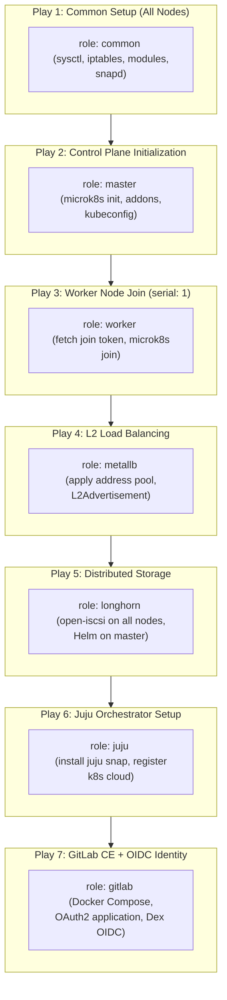

# Cluster Automation — Ansible Playbooks & Roles

Automates node hardening, MicroK8s cluster formation, MetalLB networking, Longhorn storage, Juju orchestration, and GitLab OIDC integration.

---

## 1. Execution Order & Role Topology



---

## 2. Directory Layout

```
ansible/
├── ansible.cfg              # SSH multiplexing, host key checking disabled
├── group_vars/
│   └── all.yml              # Single Source of Truth for IPs, users, networks
├── inventory.ini            # Active inventory rendered from all.yml
├── inventory.188.ini.example# Example alternate inventory (10.110.188.x)
├── inventory.j2             # Jinja2 template for inventory rendering
├── generate-inventory.sh    # Script to regenerate inventory from all.yml
├── generate_inventory.yml   # Localhost playbook that compiles inventory.j2
├── playbook.yml             # Main multi-play orchestration playbook
├── ping.yml                 # Connectivity validation playbook
├── rotate-gitlab.yml        # Playbook to rotate OAuth secrets
├── metallb-pool.yaml        # MetalLB IPAddressPool manifest
└── roles/
    ├── common/              # Base OS packages, kernel modules, sysctl
    ├── master/              # MicroK8s control plane bootstrap
    ├── worker/              # Worker join token request and node join
    ├── metallb/             # MetalLB installation & IP pool application
    ├── longhorn/            # Longhorn CSI driver & Helm deployment
    ├── juju/                # Juju controller registration and k8s cloud
    └── gitlab/              # GitLab CE, Docker Compose, OAuth2 app
```

---

## 3. Inventory Management

The repository uses a **Single Source of Truth** pattern. You do not edit `inventory.ini` directly:

1. Edit [`group_vars/all.yml`](group_vars/all.yml) to configure IP addresses, VM users, and network CIDRs.
2. Regenerate the inventory file:
   ```bash
   ./generate-inventory.sh
   ```

---

## 4. Running the Playbooks

### Connectivity Check
```bash
ansible-playbook -i inventory.ini ping.yml
```

### Full Stack Execution
```bash
ansible-playbook -i inventory.ini playbook.yml
```

### Targeted Execution Using Tags
```bash
# Provision Kubernetes cluster only
ansible-playbook -i inventory.ini playbook.yml --tags kubernetes

# Deploy storage only
ansible-playbook -i inventory.ini playbook.yml --tags longhorn

# Deploy Juju controller and GitLab only
ansible-playbook -i inventory.ini playbook.yml --tags "juju,gitlab"
```
