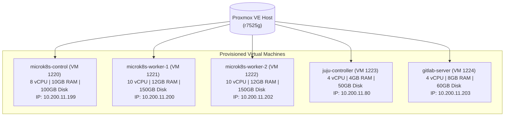

# Infrastructure Layer — Terraform on Proxmox VE

Automated virtual machine provisioning on Proxmox VE using the `bpg/proxmox` provider.

---

## 1. Architecture & VM Sizing



---

## 2. Resource Specifications

| VM Name | VMID | Role | vCPU | RAM | Disk | Primary IP |
|:---|:---:|:---|:---:|:---:|:---:|:---:|
| `microk8s-control` | `1220` | Kubernetes Control Plane | 8 | 10 GB | 100 GB (SCSI) | `10.200.11.199` |
| `microk8s-worker-1` | `1221` | Kubernetes Worker Node 01 | 10 | 12 GB | 150 GB (SCSI) | `10.200.11.200` |
| `microk8s-worker-2` | `1222` | Kubernetes Worker Node 02 | 10 | 12 GB | 150 GB (SCSI) | `10.200.11.202` |
| `juju-controller` | `1223` | Canonical Juju Orchestrator | 4 | 4 GB | 50 GB (SCSI) | `10.200.11.80` |
| `gitlab-server` | `1224` | GitLab CE + Admin Portal | 4 | 8 GB | 60 GB (SCSI) | `10.200.11.203` |

---

## 3. Usage & Execution

### Prerequisites
1. **Cloud-Init Template** on Proxmox (default VMID `9000` with Ubuntu 24.04 and `qemu-guest-agent`).
2. **Proxmox API Token** with VM provisioning permissions (`root@pam!token=secret`).

### Quick Start
```bash
# 1. Initialize the Terraform provider
terraform init

# 2. Configure environment parameters
cp terraform.tfvars.example terraform.tfvars
nano terraform.tfvars

# 3. Preview planned resources
terraform plan

# 4. Provision the infrastructure
terraform apply -auto-approve
```

---

## 4. Key Design Decisions

* **Cloud-Init Automation:** All networking, hostnames, user credentials, and SSH keys are injected during initial boot via cloud-init.
* **VirtIO SCSI Disks:** Fast SSD storage with TRIM/discard enabled (`discard = "on"`).
* **ID Offset:** VMIDs are offset (`1220..1224`) to avoid collisions with existing Proxmox lab machines.
